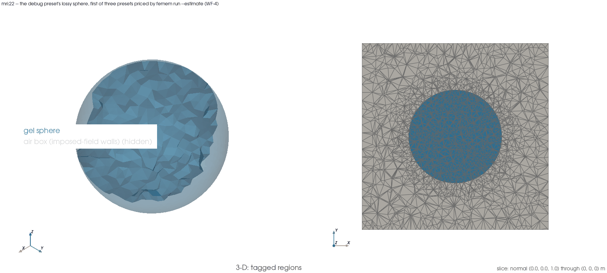

# `-e mri:22` — the three shipped presets through `femem`: price all three, run the two cheap ones, leave the degree-2 one priced

Guide for `examples/mri/22_presets_priced_then_run.py`.
Written to be followed without the source open.

## 1. What this demonstrates

**The shipped ladder and what `femem run --estimate` says about it.** `WF-4` shipped three
presets under `examples/presets/`: `examples/presets/debug.yaml` (the MAT-4 lossy gel sphere
in a box, degree 1, reproduces `MAT4_DEG1_RECORD`), `examples/presets/dev.yaml` (the F-small
exact-rectangle four-port birdcage, degree 1, reproduces the `_record(1)` S), and
`examples/presets/benchmark-lite.yaml` (the same birdcage at degree 2, the gated
`benchmark-lite` column at `-n 8`). The gate `tests/package/test_wf4_presets.py` proves each
reproduces its record and that each price lands inside `BRACKET` (×2) of its own run, one
preset per window. No example read the files. This one reads them in place (no copy, no new
YAML) at `-n 2` and walks the user's workflow:

1. `femem check <preset>` on all three: rc 0, and the `family:` line it prints.
2. `femem run --estimate <preset> --output-dir D` on all three. It prints the
   `ResourceEstimate` fields (cells, exact unknowns, degree, ranks, predicted peak GiB,
   predicted seconds, rows used), builds the mesh and the function space, **never
   factorises**, and writes no directory. The example proves both: the call-through
   wrapper on `fem_em_solver.study_yaml.run_study_file` counts 0 calls across the three
   estimates, and no estimate directory exists on any rank.
3. Read the price table, then `femem run` the two that are cheap at this width (`debug`,
   `dev`), and leave `benchmark-lite` unsolved.

**A price is for the width it ran at.** The estimator fits `time × ranks` per degree over
the measured rows of `PRICE_TABLE` and divides by the width it is called at. So the same
`benchmark-lite` file is priced at 76.65 s on 8 ranks (the gate's window, measured 73.53 s)
and at ≈ 306.6 s on 2. You should not run that preset at `-n 2` on that price. **A price is a
fit over measured rows, not a guarantee, and this example makes no memory claim**: peaks are
printed, never asserted. (The three presets are also the fit's own rows at degree 1, as the
gate's docstring discloses: this is not a predictive estimator at degree 1.)

**What the example adds to the gate.** (Pd) per preset: the printed estimate equals
`load_study(p).estimate(comm)` field by field (`g._diff == set()`), rc (0, 0). (E) the
estimate builds the mesh the run solves: estimated cells equal the run summary's cells for
`debug` and `dev`, and for `benchmark-lite` the estimate gives
`ANS6_EXACT_STRIP_HOLE_CELL_RECORD` cells and 570 332 unknowns. (W) the width law: the same
fit called at 8 ranks, times 8, equals the `-n 2` price times 2 (relative difference
0.000e+00). (L) the ladder is strictly ordered: `debug` < `dev` < `benchmark-lite`.

**Live prices.** `PRICE_TABLE` has moved since `WF-4`'s logs (a third degree-1 row, `T49`,
landed with `U55a`), so a price is read live and never pinned. `WF-4`'s printed prices
(13.70 s, 29.77 s at `-n 2`, 76.65 s at `-n 8`) are printed beside the live ones, not
asserted. The (P) ratios are wall-clock readings and are checked only against the gate's
`BRACKET`.

Negative controls, all asserted: (c1) `debug`'s SAR against `WF15_DEG2_RECORD` misses
`L0_BAND` (3.4937 %, 3.49e7× the band); (c2) `dev`'s S against `_record(2)` misses
`LEG_D0_REPRODUCTION_BAND` (0.0491); (cL) `benchmark-lite`'s price divided by `debug`'s
measured seconds is 20.93, outside `[0.5, 2]` (a constant-returning estimator would sit
inside); (cW) the `-n 8` price applied at `-n 2` unscaled misses the width law by 75 %.

Readings of record (flagged run, harness log `EX-116`, file
`docs/testing/logs/20261016T093905Z_EX-116.log`; the unflagged control `EX-116-control`,
`docs/testing/logs/20261016T094213Z_EX-116-control.log`, reproduces them inside the same
bands):

| Anchor | Reference | Reading (flagged log line) | Bound |
| --- | --- | --- | --- |
| `femem check` rc; `family:` | exact | (0, 0) each; sphere_in_box, four_port_birdcage, four_port_birdcage (`:7315`–`:7317`) | exact |
| (Pd) wrapper calls over 3 estimates | exact | 0 (`:7318`) | exact |
| (Pd) printed = API; no directory | `g._diff == set()` | green for all three (`:7315`–`:7317`) | exact |
| (R-debug) mean SAR vs `MAT4_DEG1_RECORD` | `L0_BAND` | 7.489e-11 (control 6.222e-11; WF-4 6.222e-11) (`:7324`) | 1e-9 |
| (R-dev) S vs `_record(1)` | `LEG_D0_REPRODUCTION_BAND` | 9.557e-11 (WF-4 9.559e-11) (`:7325`) | 1e-9 |
| (R-dev) reciprocity; σ_max; max column power | `RECIPROCITY_BAND`; 1 + `PASSIVITY_SIGMA_TOLERANCE` | 4.377e-16; 0.999760; 0.820520 (`:7325`) | 1e-3; passive |
| (R-dev) circulant spreads | `ADJACENT_SPREAD_BAND` | self 0.0747 %, adjacent 0.0691 %, opposite 0.0897 % (`:7325`) | gate band |
| (P-debug), (P-dev) | `BRACKET` | 1.070, 0.964 (control 1.199, 0.998) (`:7326`) | [0.5, 2] |
| (E) cells | exact | 74 020 = 74 020; 117 206 = 117 206; 80 798 = record; 570 332 unknowns (`:7327`) | exact |
| (W) width law | 8-rank fit × 8 vs 2-rank × 2 | 0.000e+00 (`:7328`) | 1e-9 |
| (L) ladder | strict order | 15.67 < 33.84 < 306.6 s; ratios 2.159, 9.06 (`:7329`) | strict |
| (c1) | `L0_BAND` | 3.4937 %, 3.49e7× (`:7330`) | > 1e-9 |
| (c2) | `LEG_D0_REPRODUCTION_BAND` | 0.0491 (`:7331`) | > 1e-9 |
| (cL) | outside `[1/BRACKET, BRACKET]` | 20.930 (`:7332`) | outside |
| (cW) | 1e-2 | 0.7500 (`:7333`) | > 1e-2 |

**Printed only (no band).** The price table (`:7319`–`:7322`), predicted seconds /
predicted peak GiB, measured seconds and summed peak RSS:

| preset | degree | cells | unknowns | rows used | predicted s | predicted GiB | measured s | ratio | summed peak RSS GiB |
| --- | --- | --- | --- | --- | --- | --- | --- | --- | --- |
| debug | 1 | 74 020 | 90 209 | P1, P3, T49 | 15.67 | 2.148 | 14.65 | 1.07 | 2.374 |
| dev | 1 | 117 206 | 140 460 | P1, P3, T49 | 33.84 | 1.643 | 35.12 | 0.9637 | 3.569 |
| benchmark-lite (priced at `-n 2`, not run) | 2 | 80 798 | 570 332 | nine degree-2 rows | 306.6 | 18.27 | not run | not run | not run |

The `--estimate` calls took 2.3 s (`debug`), 26.5 s (`dev`) and 23.4 s (`benchmark-lite`)
(`:7315`–`:7317`); the runs took 14.7 s and 35.1 s through `cli.main` (`:7324`, `:7325`);
peaks at `:5492` and `:7304`. The `debug` run directory holds the run's JSON summary
(431 B); the `dev` run directory the run's JSON summary (2287 B) and its Touchstone file
(815 B) (`:7334`, `:7335`). The S and Z matrices are never printed.

**Not claimed:** a `--preset` flag or presets in the wheel; the price at any width other than
the one run; a memory claim; a predictive degree-1 estimator; `benchmark-lite`'s S at `-n 2`;
a stable summary schema; any external check. `WF-4` does not move.

## Setup figure



`examples/mri/figures/mri_22_presets_priced_then_run_setup.png`. Rendered right after the
`debug` run returns, from its mesh and cell tags (`FEM_EM_SETUP_FIGURES=1`). Regions: "gel
sphere" (translucent) and "air box (imposed-field walls)" (hidden). The slice is normal to
`z` through the origin and cuts the sphere. The figure is geometry only; it shows the first
of the three fixtures, the one that is cheapest to price and run.

## 2. How to run it

```
./scripts/run_examples.sh -e mri:22 -n 2 -t 590
```

Heavy tier, `-n 2`, complex build (the `mri:` group sources it). Measured wall time
≈ 161 s flagged and ≈ 150 s unflagged (harness elapsed). Output goes to
`examples/mri/paraview_output/`, which is gitignored: `mri_22_debug_run/` and
`mri_22_dev_run/` (the two `femem run` output directories),
`mri_22_presets_priced_then_run_combined.xdmf` with its `.h5`, and the three
`mri_22_*_estimate/` directories, which must not exist. The setup figure is rendered only
with `FEM_EM_SETUP_FIGURES=1`.

## 3. How to analyze it, step by step

**Step 1 — `femem check`.** For each preset the example captures stdout and reads the
`family:` line on rank 0, then broadcasts it (the line prints on rank 0 only). `check`
reads inputs only; nothing is built.

**Step 2 — `femem run --estimate`.** Each call prints `name: repr` lines for the
`ResourceEstimate` fields on rank 0. Rank 0 parses them, compares with
`load_study(p).estimate(comm)` field by field, and broadcasts the verdict. The call builds
the mesh and the function space but does not solve or write anything; `--ranks` is refused
with `--estimate`, because the price is for the process's own width.

**Step 3 — read the ladder.** Predicted seconds at `-n 2` are 15.67, 33.84 and 306.6: the
first rung is cheap, the second about twice that, the third about nine times the second.
The unknowns tell the same story (90 209, 140 460, 570 332) and the degree changes from 1 to
2 at the third rung, which is where the cost sits.

**Step 4 — run the two cheap rungs.** `debug` reproduces its SAR record to 7.489e-11 and
`dev` its S record to 9.557e-11 (both inside 1e-9). Each measured time is inside ×2 of its
own price (1.07, 0.964).

**Step 5 — leave the third priced.** `benchmark-lite` at `-n 2` is ≈ 306.6 s of
factorisation and ≈ 18 GiB predicted; the gate measured it at `-n 8` in 73.53 s
(`docs/testing/logs/20261015T202931Z_WF-4-s1b-W3-benchmark-lite.log:2691`). The example
shows the width law instead: the 8-rank price times 8 equals the 2-rank price times 2
(0.000e+00), so reading the `-n 8` price at `-n 2` is wrong by 75 % (cW).

**Step 6 — the controls.** (c1) and (c2) show each reproduction is blind to the wrong
degree's record; (cL) shows the price of the third preset does not transfer to the first
(20.93×, outside the bracket), so the ladder is a ladder rather than one constant.

**Step 7 — open it in ParaView.**
`File → Open → examples/mri/paraview_output/mri_22_presets_priced_then_run_combined.xdmf`.
The file holds the `debug` run's cell grid with the nodal scalar `E_abs` (|E|), the
cell-wise `SAR` (W/kg, DG0) and `CellTags`.

1. **Slice** at z = 0 and colour by `E_abs`, then by `SAR`.
2. **Threshold** `CellTags` = 1 to see the sphere alone; `SAR` is zero in the air.
3. The imposed-field run is nearly uniform in |E| inside the sphere; `SAR` follows σ|E|²/2ρ.

**Step 8 — what a deviation means.** A (Pd) failure means the printed estimate and the API
disagree, or `--estimate` reached a solve or wrote a directory. (R-debug) / (R-dev) failing
means an example/gate divergence or that `main` drifted. (P) outside ×2 is a wall-clock
reading under host load (check `uptime`), not a result. (E) failing means the estimate and
the run built different meshes. (W) failing means the width law changed. A control inside
its band means a blind comparator.

## Related

- `examples/mri/12_study_estimate.md` — `Study.estimate()` from Python on one lossy sphere at degree 2.
- `examples/mri/09_study_from_yaml.md` — `cli.main(["run", …])` on a YAML file.
- `examples/mri/21_femem_run_tune_section.md` — `femem run` with a `tune:` section.
- `examples/presets/debug.yaml` — the first rung.
- `examples/presets/dev.yaml` — the second rung.
- `examples/presets/benchmark-lite.yaml` — the third rung, priced and not solved here.
- `tests/package/test_wf4_presets.py` — the gate this example imports.
