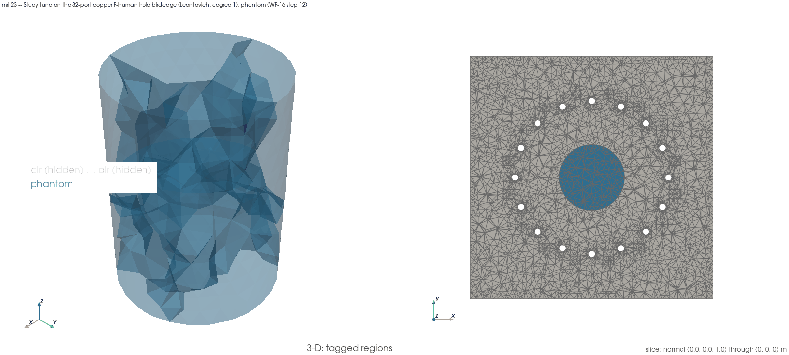

# `-e mri:23` — `Study.tune` on the 32-port copper F-human: the ring read, the k = 2 miss, the k = 1 field

Guide for `examples/mri/23_f_human_study_tune_ring.py`.
Written to be followed without the source open.

## 1. What this demonstrates

**The first 32-port `Study.tune`, at human scale.** `WF-16` step 12 let `Study.tune(k)`
read the 32-port ring-gap matrix of the copper F-human hole birdcage. `mri:19` calls `tune`
on the four-port F-small (a 4-point DFT, a scalar per k); no example touched a 32-port
ring. This one runs the gate module's own Study at 64 MHz, degree 1, `-n 8`, κ off:

```python
study = g._study()                  # FHumanBirdcageGeometry(as_hole=True), gel phantom,
                                    # LumpedPortDrive, LeontovichWall(copper), degree 1
res = study.solve(comm)             # 32x32 S, ports P17 ... P48
t1 = study.tune(k=1, comm=comm)     # z_k (k = 0..8), C_mode, off-block residual
t2 = study.tune(k=2, comm=comm)
```

Every record, band and helper is imported from `tests/package/test_wf16_study_tune_f_human_copper.py`
(the ANS-1 rule); the example states no band.

**The ports and the 2×2 read.** The 32 ring-gap ports `P17` … `P32` are the bottom ring's
slots 0 … 15, `P33` … `P48` the top ring's. The coil is two 16-slot rings, so the per-ring
DFT `W Z Wᴴ` (`W = I₂ ⊗ F`, `F` unitary 16-point) block-diagonalises `Z` into one 2×2
block per k (bottom ring, top ring), not `mri:19`'s scalar. `z_k` is the eigenvalue of the
k-block whose eigenvector is ring-antisymmetric (bottom = −top), and
`C = 1/(ω Im z_k)`. The ring-antisymmetric fraction of each chosen eigenvector is printed.
The off-block residual is what the 16-fold ring symmetry leaves outside the k-blocks.

**Why k = 2 is not the birdcage mode.** The birdcage mode is k = 1 (the uniform transverse
field). The k = 2 block has a different `Im z_k` (31.55 Ω against 21.05 Ω) and a
capacitance 33.27 % lower: it is the negative control (c1), asserted only as a miss.

**The field costs one extra factorisation here, and no re-mesh.** This Study keeps neither
fields nor the factor (`study.result` has `fields=None, solver=None`), and
`Study.b1_plus()` is not defined for it. The example therefore calls
`run_n_port_sparameter_sweep(..., keep_fields=True)` once more on the objects the result
already holds (`res.problem`, `res.port_definitions`, `res.specs`, `res.facet_tags`,
`res.conductor_terms`): about 93 s, against the ≈ 106 s a re-mesh would cost. Every `tune`
read is made before it and `study.result` is never reassigned. The field sweep's S ties the
Study's S (assertion (S=)).

**The field is the incident-wave k-pattern with every port at z₀ = 50 Ω**, not the field of
a coil tuned with `C_mode` on every gap. The drive weights are, in the canonical (bottom
0…15, top 0…15) order, `a_(j, bottom) = e^{+2πi jk/16}/(4√2)` and `a_(j, top) = −a_(j, bottom)`;
`F a` is `+1/√2` at index k, `−1/√2` at 16 + k and 0 elsewhere (assertion (W)).
`superpose_drives` forms the field and the accepted power; the DG0 `B` is L²-projected
to CG1.

**Not a tuning claim.** This is a lossless mode read at 64 MHz, degree 1, on one fixture.
It is **not a tuning, resonance, f₀, Q or compliance claim**. `C_mode` is compared with the
in-model Larmor-root `C_in` only as "a different quantity" (the r = 0.2 Ω root).

Readings of record (flagged run, harness log `EX-118`, `docs/testing/logs/20261016T111327Z_EX-118.log`;
the unflagged control `EX-118-control`, `docs/testing/logs/20261016T111832Z_EX-118-control.log`,
reproduces them at the bands). The gate's run of record is
`docs/testing/logs/20261015T213534Z_WF-16-s12-W1.log`.

| Anchor | Reference | Reading (flagged-log line) | Bound |
| --- | --- | --- | --- |
| (K) refusals before the solve | `ValueError` / `TypeError`, `study.result is None` | k = 0, 3 raise `ValueError`; `k=True` raises `TypeError` (`:35`) | raises |
| (R0) cells; S vs the stored H12c matrix | `HOLE_CELL_RECORD`; `REUSE_REPRODUCTION_RTOL` | 369 387 == record == stored; 1.627e-12 (gate 1.632e-12; `:8310`) | 1e-6 |
| (I) API vs `ring_mode_rows`; closure | `EXACT_IDENTITY_RTOL` | 0 / 0 / 0; 0 (`:8311`) | 1e-10 |
| (a) `C_mode` vs the H12c record | `REDUCTION_BAND` | gap −3.551603e-13 (gate −3.544942e-13; `:8312`) | 1e-3 |
| (W) pattern = k-th ring-antisymmetric | `EXACT_IDENTITY_RTOL` | 4.444e-16 (k = 1), 6.144e-16 (k = 2) (`:8316`) | 1e-10 |
| (S=) field-sweep S vs Study S | `REUSE_REPRODUCTION_RTOL` | 6.923e-14 (predicted ≤ 1e-14: above, reported); repeat `tune(k=1)` hex-equal (`:8317`) | 1e-6 |
| (P) passivity of the superposed drives | `EXACT_IDENTITY_RTOL` | accepted 5.26334e-05 / 3.62810e-05 W of 2.5e-03 W available (`:8318`) | 0 ≤ acc ≤ avail |
| (c1) k = 2 misses the record | `REDUCTION_BAND` | gap −3.327259e-01, 332.7× band (gate −3.327259e-01; `:8314`) | > 1e-3 |
| (cW) k = 2 weights fail the k = 1 target | `> 0.5` | 0.70711 (`:8316`) | > 0.5 |

**Printed only (no band):**

| quantity | value (flagged-log line) |
| --- | --- |
| `C_mode` | 1.181185799070e-10 F (`:8312`); vs the 4-decimal `C_MODE_CU_PF` −1.701e-07 |
| k = 2 C | 7.881746394502e-11 F (`:8314`); vs `WF12_STEP3_C2_CU_F` 4.685e-14 |
| `C_mode` vs `C_in` of the F-human | −1.0582e-03 (a different quantity, not a tuning error; `:8313`) |
| off-block residual | 4.195925e-03 (`:8319`) |
| z_k for k = 0…8 (Ω), anti fraction | `:8320`–`:8328`, e.g. k = 1: 0.31315 + 21.053j, anti 1.00000; k = 0: anti 0.99996 |
| centre \|B₁⁺\|, \|B₁⁻\|, \|B\|, k = 1 | 1.40131e-11, 1.15795e-08, 1.63760e-08 T (`:8330`) |
| centre \|B₁⁺\|, \|B₁⁻\|, \|B\|, k = 2 | 6.70182e-11, 4.04932e-11, 1.22349e-10 T (`:8331`) |
| \|B₂(0)\| / \|B₁(0)\| | 7.4712e-03 (predicted ≪ 1; `:8332`) |
| wall times | mesh 106.1 s, sweep 91.3 s, field sweep 92.6 s, superpose + project 1.5 s (`:8333`) |
| summed peak memory | 14.524 GiB over 8 ranks (`:8334`) |

Mode fields are per unit incident-wave weight: a record, not an absolute field.

**Not claimed:** degree 2; an h-statement; a tuned f₀, Q, `R_in`, match, `C_in` or
resonance; the field of the coil tuned with `C_mode` on its gaps; the circuit ↔ field identity
at `C_mode`; ESR; `femem run` / YAML `tune:` on the F-human; the solid σ = 800 S/m F-human;
any external check. `WF-16`, `WF-12`, `WF-10` do not move.

## 2. How to run it

```
./scripts/run_examples.sh -e mri:23 -n 8 -t 590
```

**Complex build required** — the `mri:` group sources it automatically. Tier: **heavy**
(`-n 8`, container `timeout -k 30 590`). `-n 8` is the gate record's own width and the script
asserts it. Measured wall time ≈ 296 s (299 s with start-up, flagged; 291 s script time,
293 s with start-up, control). It reads the stored H12c 32×32 matrix at `NPZ_PATH` (in the
gitignored `logs/wf12/`); absent means stop, never a re-solve. Add `FEM_EM_SETUP_FIGURES=1`
to re-render the figure.

## Setup figure



`examples/mri/figures/mri_23_f_human_study_tune_ring_setup.png`. Rendered right after the
Study is solved, from its mesh and cell tags (`FEM_EM_SETUP_FIGURES=1`). Regions: the phantom
(translucent) and the air (hidden). The slice is normal to `z` through the origin. **The coil
is drawn as a void:** the hole route has no conductor cells, and the 32 port sheets are facet
tags, which the renderer does not draw. The figure is geometry only.

## 3. How to analyze it, step by step

**Step 1 — the anchor.**

```
[(R0)] cells 369387 vs record 369387 (==) vs npz 369387 (==); ||S_study - S_npz||/||S_npz|| = 1.627e-12 ...
[(I)] rel vs ring_mode_rows: C1 0.000e+00, C2 0.000e+00, off 0.000e+00; ...
[(a)] C_mode = 1.181185799070e-10 F; record 1.181185799070e-10 F; gap -3.551603e-13 ...
```

The example path equals the gate's values to every printed digit; the (R0) and (a) readings
are round-off, at their bands only. A miss is an example/test divergence finding: report
it, never widen a band or re-record from here.

**Step 2 — the z_k table.** `Im z_k` grows from 14.8 Ω (k = 0) through 21.05 Ω (k = 1) and
31.55 Ω (k = 2) to 71.1 Ω (k = 8), so `C_k = 1/(ω Im z_k)` falls from 168 pF to 35 pF. Every
chosen eigenvector is ring-antisymmetric to ≥ 0.9999. The off-block residual is 4.195925e-03.

**Step 3 — the k = 2 control.** k = 2 on the same Study misses the H12c record by 332.7×
the band; the example path reproduces the gate's −3.327259e-01 to its printed digits. A
control inside its band would be a mislabelled variant.

**Step 4 — the field's own checks.** (W) the drive weights transform to the k-th
ring-antisymmetric unit vector to 4.4e-16, and the k = 2 weights fail the k = 1 target by
0.707 (the example reads k, not a constant). (S=) the field-keeping sweep's S ties the
Study's S to 6.9e-14; the repeat `tune(k=1)` is hex-identical (same arithmetic). (P) each
superposed drive accepts less than the 2.5 mW available, the gated `½ aᴴ(I − SᴴS)a`.

**Step 5 — the centre field.** For the k = 1 drive the centre `|B₁⁻|` (1.158e-08 T)
dominates `|B₁⁺|` (1.40e-11 T): which circular polarisation is co-rotating is the e^{jωt}
convention, printed and not claimed. The k = 2 drive has a centre null:
`|B_2(0)|/|B_1(0)| = 7.4712e-03`.

**Step 6 — open it in ParaView.**
`File → Open → examples/mri/paraview_output/mri_23_f_human_study_tune_ring_combined.xdmf`
(its heavy-data sibling is `mri_23_f_human_study_tune_ring_combined.h5`). The file holds the
cell grid with `B_mode1_real` (vector CG1, real part of the superposed phasor), nodal
scalars `B_mode1_abs`, `B1_plus_mode1`, `B1_minus_mode1`, `B_mode2_abs` (nodal \|·\|, not a
point-evaluated \|B\|), and `CellTags`.

1. **Slice** at z = 0 and colour by `B_mode1_abs` and `B_mode2_abs` side by side.
2. **Glyph** `B_mode1_real` on the slice.
3. Compare `B1_plus_mode1` with `B1_minus_mode1`.

**Step 7 — what a deviation means.** The rank-width assertion fails → not `-n 8`. (R0), (I) or (a)
fails → compare with `WF-16` step 12's own gate at the same width: a divergence finding.
(S=) fails → the re-sweep on the kept problem does not reproduce the Study's S. A control
inside its band → a mislabelled variant.

## Related

- `examples/mri/19_study_tune_mode_capacitance.md` — `Study.tune` on the four-port F-small.
- `examples/mri/18_f_human_four_port_quadrature.md` — the copper F-human, four feeds at `C_in`.
- `examples/mri/17_f_human_tuned_quadrature_b1_sar.md` — the tuned two-port quadrature drive.
- `examples/mri/21_femem_run_tune_section.md` — the `tune:` YAML section (four-port).
- `tests/package/test_wf16_study_tune_f_human_copper.py` — the gate this example imports.
