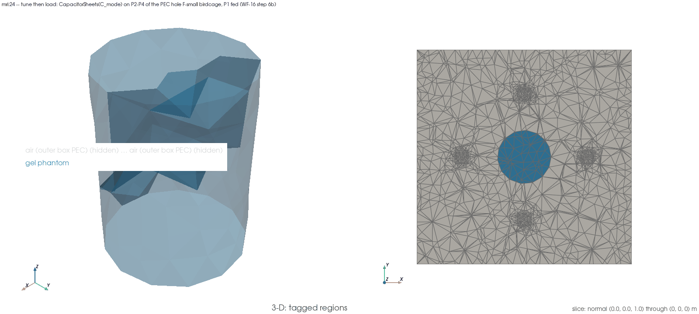

# `-e mri:24` — tune, then load: `CapacitorSheets(C_mode)` on three gaps, the circuit reduction, and the loaded field

Guide for `examples/mri/24_study_tune_then_capacitor_sheets.py`.
Written to be followed without the source open.

## 1. What this demonstrates

**The first example that places capacitors in the solved model through the public
`Study` API.** `WF-16` step 6(a) added `Study.tune(k)`: it reads `C_k = 1/(ω Im z_k)` from
the Study's own 4×4 S. Step 6(b) (item 463) fed that C back in as
`CapacitorSheets(C, 0.0, on=("P2", "P3", "P4"))` and gated the loaded Study against the
circuit reduction of the untuned 4×4. `mri:19` tuned circuit-side only (numpy on the
4×4); this example puts the capacitor in the field solve. The fixture is the gate's: the
exact-rectangle PEC hole F-small birdcage, degree 1, 64 MHz, `-n 2`, κ off. **The run is
lossless** (r = 0): item 463's record is a lossless one, and the capacitor-ESR ruling of
2026-10-06 scopes r to new steps and fixtures and keeps lossless results valid as records,
labelled lossless. Every record, band and helper is imported from
`tests/package/test_wf16_study_tune_capacitors.py` (the ANS-1 rule).

```python
s0 = Study(FourPortBirdcageGeometry(as_hole=True, strip_fraction=GATED_WIDTH_FRACTION),
           phantom, LumpedPortDrive(), frequency_hz=FREQUENCY_64_HZ, degree=1)
res0 = s0.solve(comm)                         # the 50 ohm 4x4
t1 = s0.tune(k=1, comm=comm)                  # C_mode is computed, not typed
exc = CapacitorSheets(t1.c_mode_farad, 0.0, on=("P2", "P3", "P4"))
resA = Study(<same geometry>, phantom, exc, ..., degree=1).solve(comm)   # 1x1
```

**Why the loaded network is 1×1.** `on` must leave a port to drive, so the loaded Study
keeps only P1: no in-model 4×4 at `C_mode` exists (item 463's reading). The example
shows the refusals (K): `tune(k=0)` raises `ValueError` and `tune(k=True)` `TypeError`;
on a loaded Study `tune()` and `b1_plus()` raise `TypeError`; `on=` all four ports raises
`ValueError` (no port left to drive). None meshes.

**(I-A) holds at any C.** The reduced S11 of the loaded Study equals
`reduce_terminated_ports(S0, z0, {1: zc, 2: zc, 3: zc})` (0-based indices; `zc` from the
excitation's own `impedance_ohm`) to 1.4e-5. That is `PORT-22`'s circuit = field identity,
**not a tuning statement**: the same identity would hold at any C. (c2) shows the
comparator reads C: the reduction at the k = 2 capacitance misses by 352.7× the band.

**Why the field costs one more solve.** A loaded Study keeps no fields (and `b1_plus()`
refuses it). The example re-solves once on the result's own kept problem (item 373's
call), with `all_port_definitions` so the three capacitor sheets are in. Two checks make
that solve trustworthy: (S=) its S11, from the power waves, equals the S the identity
read (1.8e-13 flagged, 0 control, against `LEG_D0_REPRODUCTION_BAND`); (P) the exact power
identity `P_src = Σ P_sheet + P_vol` closes to 2.7e-16 flagged (9.8e-16 control) against
`DISCRETE_IDENTITY_RTOL`, with the sheets' dissipation counted (the capacitor sheets
dissipate nothing: their sum is 0 relative to `P_src`).

**(cO), the open-gap trap made visible.** Solving with `port_definitions` (kept ports
only) places no sheet on P2–P4, so they are open gaps. S11 moves to +0.931 − 0.363j,
a miss of 1.79 relative to the loaded S11 (1.79e+03× the band). A caller who used the
wrong port list would silently get this. It is a control, not a physical "detuned coil".

**The Route-A feed is near-resonant but not matched.** `Z_in(P1) + zc` is
4.98802e-02 + 1.07163e-02j Ω (a cancellation of two ≈ 37.5 Ω reactances, printed beside
the gate): the loop is reactance-cancelled seen from the feed, but |S11| = 0.998725, so
the coil is **not matched**.

Readings of record (flagged run, harness log `EX-120`,
`docs/testing/logs/20261016T172544Z_EX-120.log`; the unflagged control `EX-120-control`,
`docs/testing/logs/20261016T172723Z_EX-120-control.log`, reproduces them). The gate's run
of record is `docs/testing/logs/20261015T201110Z_WF-16-s6b-W1.log`:

| Anchor | Reference | Reading (flagged log line) | Bound |
| --- | --- | --- | --- |
| (K) refusals | — | all five raise their stated type, results stay None (`:1768`) | exact |
| (R0) cells; class means vs `"pec"` record | `ANS6_EXACT_STRIP_HOLE_CELL_RECORD`; `LEG_D0_REPRODUCTION_BAND` | 80 798; 5.052e-11 / 3.878e-11 / 5.875e-11 (`:1769`, `:1770`) | 1e-9 |
| C₁, C₂, z₁ vs gate (`:939`, `:940`) | record tolerance 10^-(d−2) | 6.1e-11, 4.2e-11; 1.8e-10, 1.0e-10 (`:1773`) | 1e-8 |
| (a′) C₁ vs `TH17_STEP3_C_MODE_RECORD_F` | `REDUCTION_BAND` | −2.976552e-04 (`:1774`) | 1e-3 |
| S_A S11 vs gate `:954` | record tolerance | 4.0e-11 relative (`:1776`) | 1e-8 |
| (I-A) loaded S11 vs circuit reduction | `REDUCTION_BAND` | 1.391811e-05 (`:1777`) | 1e-3 |
| (c1) k = 2 capacitor leaves Im zt₁ uncancelled | `REDUCTION_BAND` | 3.28828e-01, 328.8× band (`:1779`) | > 1e-3 |
| (c2) reduction at C₂ misses S_A | `REDUCTION_BAND` | 3.52681e-01, 352.7× band (`:1780`) | > 1e-3 |
| (S=) field solve reproduces S_A | `LEG_D0_REPRODUCTION_BAND` | 1.842e-13 (`:1781`); control 0 | 1e-9 |
| (P) power identity | `DISCRETE_IDENTITY_RTOL` | 2.687e-16 (`:1782`); control 9.822e-16 | 1e-6 |
| (cO) open gaps move S11 | `REDUCTION_BAND` | 1.7941, 1.79e+03× band (`:1783`) | > 1e-3 |

**Printed only (no band).** P_src 3.60634e-03 W, P_sheet(P1) 3.60001e-03 W,
P_vol / P_src 1.755e-03, Σ P_sheet(P2–P4) / P_src 0 (`:1782`). Centre (origin) per unit
incident wave, tuned: |B| 1.03902e-06, |B₁⁺| 4.86453e-07, |B₁⁻| 5.50576e-07 T; open:
1.19725e-07, 5.98506e-08, 5.98728e-08 T (`:1784`, `:1785`). |B_T(0)| / |B_O(0)| = 8.678.
Misses of the brief's predictions, reported with no status effect: (S=) read 1.8e-13
where ≤ 1e-14 was predicted (still 5000× inside its band); |B₁⁺| / |B₁⁻| of the tuned
field is 0.8835, not within a few % of 1; |B_T(0)| / |B_O(0)| = 8.68, just under the
predicted order 10. Wall: S0 28.7 s, S_A 35.0 s, tuned field 5.6 s, open field 6.0 s;
summed peak RSS 1.75 GiB; 83 s harness elapsed flagged, 67 s control.

**Not claimed:** an in-model 4×4 at `C_mode`; the per-sheet identity (the gate's (I-4) is
cited, not re-run); field-side mode selection; a tuned f₀, Q, R_in, match or absolute
S₁₁ / Z_in (`ANS-7` stays 🟡); ESR; copper; degree 2; other frequencies; F-human
(`CapacitorSheets` refuses it); an external check. **Not a tuning, resonance, f₀, Q,
R_in, match or compliance claim.** `WF-16`, `PORT-22`, `PORT-24` and `ANS-7` do not move.

## Setup figure



`examples/mri/figures/mri_24_study_tune_then_capacitor_sheets_setup.png`. Rendered right
after the loaded `Study` is solved, from its mesh and cell tags
(`FEM_EM_SETUP_FIGURES=1`). Regions: "gel phantom" (translucent) and "air (outer box
PEC)" (hidden). The slice is normal to `z` through the origin. **The coil is drawn as a
void:** the hole route has no conductor cells, and the port sheets are facet tags, which
the renderer does not draw. The figure is geometry only.

## 2. How to run it

```
./scripts/run_examples.sh -e mri:24 -n 2 -t 420
```

**Complex build required** — the `mri:` group sources it automatically. Tier: **heavy by
ceiling** (`-n 2`, container `timeout -k 30 420`); `-n 2` is the record's own width and
the script asserts it. Two real mesh builds (S0 and S_A, no cache), two single-drive
field solves and two B projections: ≈ 80 s of script wall (83 s harness elapsed flagged,
67 s control). Add `FEM_EM_SETUP_FIGURES=1` to re-render the figure.

## 3. How to analyze it, step by step

**Step 1 — the refusals and the anchor.**

```
[(R0)] class-mean rel vs 'pec' record: self 5.052e-11  adjacent 3.878e-11  opposite 5.875e-11 (band 1e-09; ...)
[(a')] C_1 vs TH17_STEP3_C_MODE_RECORD_F gap -2.976552e-04 (gate :950 -2.976552e-04; ...); band 1.0e-03
```

The example path equals the gate's values to every printed digit. A miss is an
example/test divergence finding: report it, never widen a band or re-record from here.

**Step 2 — load and read (I-A).** `C_mode = 6.626796e-11 F` (66.27 pF) gives
`zc = −37.5264j Ω` exactly reactive. The loaded S11 is −0.278732 + 0.959041j, and the
circuit reduction of the untuned 4×4 matches it to 1.391811e-05. The two meshes are
separate builds, so the digit could in principle drift by round-off; it did not.

**Step 3 — the negative controls.** (c1): the k = 2 capacitance leaves 32.9 % of Im z₁
uncancelled (328.8× the band). (c2): the reduction at that capacitance misses the loaded
S11 by 35.3 % (352.7× the band). A control inside its band would be a mislabelled variant.

**Step 4 — the field and its two checks.** (S=) and (P), above. Read the printed
`sum P_sheet(P2-P4)/P_src`: the capacitor sheets store reactive energy but dissipate
none, so the source power splits into the feed sheet and the gel (0.175 %).

**Step 5 — (cO).** Open gaps give S11 = +0.931167 − 0.362656j against the loaded
−0.278732 + 0.959041j, and a centre |B| about 8.7× lower than the loaded coil's. The
prediction range [0.3, 2.0] for the S11 miss is not asserted; 1.79 sits inside it, below
the passive ceiling ≈ 2.003.

**Step 6 — open it in ParaView.**
`File → Open → examples/mri/paraview_output/mri_24_study_tune_then_capacitor_sheets_combined.xdmf`
(with its sibling `examples/mri/paraview_output/mri_24_study_tune_then_capacitor_sheets_combined.h5`).
The file holds the cell grid with `B_tuned_real` (vector CG1, real part of the phasor per
unit incident wave), nodal scalars `B_tuned_abs`, `B1_plus_tuned`, `B1_minus_tuned` and
`B_open_abs` (nodal |·|, not a point-evaluated |B₁⁺|), and `CellTags`.

1. **Slice** at z = 0 and colour `B_tuned_abs` against `B_open_abs` (log colour scale).
2. **Glyph** `B_tuned_real` on the slice.
3. Compare `B1_plus_tuned` with `B1_minus_tuned`.

**Step 7 — what a deviation means.** (R0), (a′) or (I-A) fails → compare with the item 463
gate at the same width: a divergence finding. (S=) fails → the re-solve on the kept
problem does not reproduce its own S. (P) fails with (S=) green → the sheets'
dissipation is mis-accounted. A control inside its band → the capacitance was not passed
through, or (cO) used `all_port_definitions`.

## Related

- `examples/mri/19_study_tune_mode_capacitance.md` — `Study.tune` read circuit-side.
- `examples/mri/05_birdcage_q_loaded_unloaded.md` — a capacitor-loaded F-small coil
  outside the `Study`.
- `examples/mri/16_study_copper_birdcage.md` — the copper Study and its power identity.
- `examples/mri/08_study_four_port_birdcage.md` — the four-port Study and its S.
- `tests/package/test_wf16_study_tune_capacitors.py` — the gate this example imports.
- `tests/package/test_wf16_study_capacitor_sheets.py` — the `CapacitorSheets` API gate and
  the field-side power identity.
