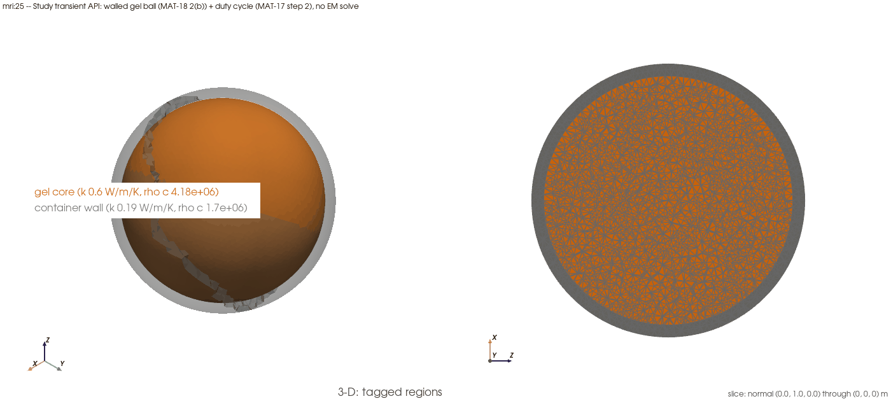

# `-e mri:25` — the `Study` transient API: duty cycle and container wall on thermal-only gel balls

## 1. What this demonstrates

No EM solve. A `Study` built with `material=None` and a `UniformHeatSource` is a
thermal-only study: `solve()` is refused (`TypeError`), and
`Study.temperature(RobinCooling, transient=TransientSpec, duty=DutyCycle)` is the only
call. The five public dataclasses, each beside the direct-API object it replaces:

| Dataclass | Replaces |
|---|---|
| `ThermalBallGeometry(radius, resolution, wall=…)` | `MeshGenerator.ball_domain` / `two_layer_ball_domain` |
| `UniformHeatSource(q)` | the `q` argument of `solve_transient_conduction` (`mat:12`'s DG0 `q`) |
| `TransientSpec(dt, n, rho_c)` | `dt`, `n_steps`, `rho_c`, CN θ = 0.5 and two Rannacher half-steps |
| `DutyCycle(period, duty)` | `mat:11`'s hand-written `_chi(P, D)` schedule |
| `ContainerWall(thickness, k, rho_c)` | `mat:12`'s DG0 k / ρc / q on the two-layer mesh |

It reproduces `MAT-17` step 2 (cases A and B) and `MAT-18` step 2(b) through those
names, with every band and record imported from `tests/package/test_wf15_study_transient.py`
(the `WF-15` step-3 gate). The gate ran in the real build; this example runs in the
complex build, so it is the Study path's first complex-build run. The one substitution
is `m13._interior_error` for `MAT-9`'s, which calls `float()` on a complex value.

What the anchors prove. (UT): the API builds the direct call's problem (same cells,
same mesh geometry, same DG0 coefficients, same source multipliers, bitwise upstream of
the solve). (IT): the solve output agrees with the direct `solve_transient_conduction`
to round-off (measured ≈ 1e-14 against a 1e-9 band). (G)/(R): the interior error against
the closed form is the gate's record. (X) composes the duty cycle with the wall: no
closed form exists, so only identities are asserted (cells, source multipliers, the
(S0) on-time census, the balance) and the temperatures are printed.

Measured (complex build, `-n 2`, 194 s total, summed peak RSS 2.16 GiB):

| Reading | Value | Gate record |
|---|---|---|
| case A cells, (S0) on / off | 151 548, 49 / 46 | 151 548, 49 / 46 |
| case A (IT) / (G) / balance | 6.982e-15 / 4.3869840018e-04 / 2.632e-14 | 8.146e-15 / 4.3869840018e-04 / 2.759e-14 |
| case B (S0) / (IT) / (G) | 9 / 12, 2.080e-14, 1.0682780964e-03 | 9 / 12, 2.080e-14, 1.0682780964e-03 |
| (T1) wall cells / (IT) / (G) | 215 542, 5.973e-15, 8.2066325346e-04 | 215 542, 1.433e-14, 8.2066325346e-04 |
| (c1) no `DutyCycle` | 9.7087e-01 (97× the band) | 9.7087e-01 |
| (c2) wall ρc dropped | 5.3140e-02 (5.3× the band) | 5.3140e-02 |
| (c3) planted spacing | 2.7755575615628914e-17, 1 differing | same |
| (X) balance | 3.756e-14 | no record |

The `.4e` strings equal the gate's records (asserted at 1e-3 relative); the 10-digit
values differ from the real-build records by ≤ 5e-11 (printed only). `max |Im T_h|` = 0
over nine solves. (X) at t = 14 100 s, θ_h at x = 0, 0.05, 0.09 m: walled
3.0524 / 2.8193 / 2.1827 K, bare 3.0530 / 2.7969 / 2.0909 K, walled / bare ratio
0.9998 / 1.008 / 1.0439. This is a printed composition with no closed form and no
accuracy claim.

## Setup figure



`examples/mri/figures/mri_25_study_transient_duty_and_wall_setup.png`. Rendered right
after the outputs are written, from the Study's walled mesh and cell tags
(`FEM_EM_SETUP_FIGURES=1`). Regions: "gel core" (k 0.6, ρc 4.18e6) and "container wall"
(k 0.19, ρc 1.7e6, translucent). The slice is normal to `y` through the origin.

## 2. How to run it

```
./scripts/run_examples.sh -e mri:25 -n 2 -t 590
```

Heavy by the runner's ceiling; measured wall time 194 s at `-n 2`. The gate ran in the
real build and this example runs in the complex one. Records are compared in the `.4e`
form (asserted at a relative 1e-3), with the 10-digit values printed beside them.

## 3. How to analyze it, step by step

Open `examples/mri/paraview_output/mri_25_study_transient_duty_and_wall_duty_combined.xdmf`
and `examples/mri/paraview_output/mri_25_study_transient_duty_and_wall_wall_combined.xdmf`
(each with its `.h5` sibling, `mri_25_study_transient_duty_and_wall_duty_combined.h5` and
`mri_25_study_transient_duty_and_wall_wall_combined.h5`).

1. Duty file: slice at z = 0 and colour by `theta_err_A`. The error is the CN +
   Rannacher discretisation error against the closed form (interior rel L2 4.387e-04).
   Compare `theta_api_A` with `theta_exact_A`, and `theta_no_duty_A` for the
   dropped-schedule control (the miss is ≈ 1 of the full-power response).
2. Wall file: colour by `theta_wall_T1`, then `theta_wall_series` (the two-layer
   comparand) and `theta_wall_err`. Compare `theta_wall_duty_tend` against
   `theta_wall_T1`; they are at different times (14 100 s with the duty schedule versus
   13 933 s at full power), so only the shapes are comparable.
3. Plot Over Line along +x through r = a (0.1 m) to see the kink in θ at the wall: the
   flux is continuous, so the gradient jumps by k1/k2.
4. Threshold the DG0 `rho_c` array at 3e6 to show the two regions; `k` and `q` give the
   same split.

## Related

- `examples/mri/10_study_temperature.md`
- `examples/materials/11_duty_cycled_gel_ball.md`
- `examples/materials/12_gel_ball_in_container_wall.md`
- `tests/package/test_wf15_study_transient.py`
- `tests/validation/test_mat17_duty_cycle_fem.py`
- `tests/validation/test_mat18_two_layer_sphere_transient_fem.py`
- `docs/guide/api/DutyCycle.md`
- `docs/guide/api/ContainerWall.md`
- `docs/guide/api/TransientSpec.md`
