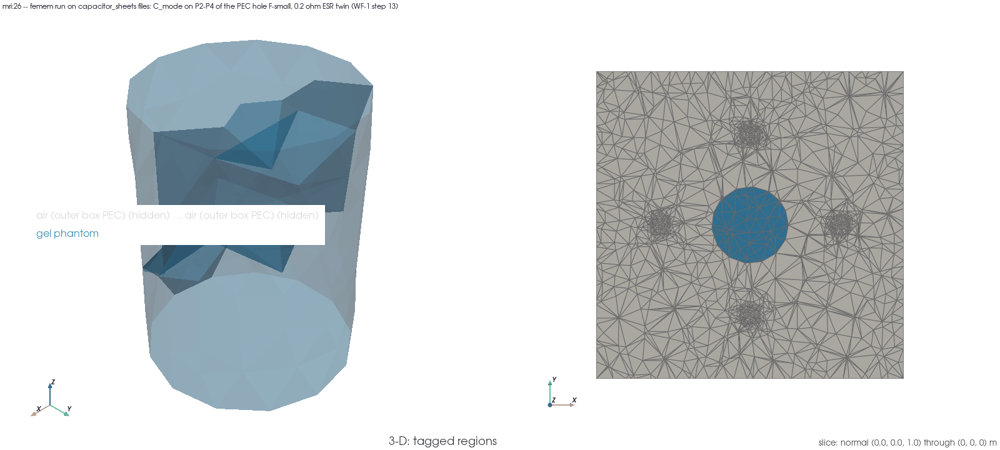

# `-e mri:26` — `femem run` on `capacitor_sheets` files: Route A through the file, the summary equals its Study, YAML equals Python, and a written file with the ruling's 0.2 Ω ESR

Guide for `examples/mri/26_femem_run_capacitor_sheets.py`.
Written to be followed without the source open.

## 1. What this demonstrates

**What `femem run` does with a `capacitor_sheets` excitation.** `WF-1` step 13 (item 496)
let a YAML file place lumped capacitors on gap ports. The block is

```yaml
excitation:
  kind: capacitor_sheets
  c_f: 6.626796421e-11     # a float with a dot (66e-12 would load as a string)
  esr_ohm: 0.0
  sheets: [P2, P3, P4]     # the key is `sheets`, never a bare `on`
```

`run_study_file` solves the reduced network once (the ports left over, here P1 only), and
writes the run's JSON summary. **There is no Touchstone file**: the reduced network has no
Z. The summary's `kept_ports` (`["P1"]`) and `capacitors` block (`c_f`, `esr_ohm`, `sheets`,
`impedance_ohm`) say what was loaded. No example ran such a file. This one does, on the
exact-rectangle PEC hole F-small birdcage (degree 1, 64 MHz, `-n 2`, κ off), through
`cli.main(["run", ...])` in-process with a call-through wrapper on
`fem_em_solver.study_yaml.run_study_file` (restored in `finally`, one call asserted per
run). Every record, band and helper is imported from
`tests/package/test_wf1_yaml_capacitors.py` (the ANS-1 rule).

**Why `sheets`, never `on`.** YAML 1.1 reads a bare `on:` as the boolean `True`. The
example writes that file deliberately (the tracked file with `sheets:` replaced by `on:`)
and shows (cX-on): the parser refuses at `excitation.on`, and `femem check` returns rc 2.
No mesh is built for any refusal.

**Four runs, four real builds** (no mesh cache, so nothing is shared between them):

- **B1, the tune file.** The 4×4 the identity reduces. (R0) cells and class means,
  (a) `C_mode` against `TH17_STEP3_C_MODE_RECORD_F`, (D-disk) the tune block read back from
  the run's JSON summary equals `C_1` by `float.hex`.
- **B2, the tracked capacitor file** (lossless, the transcribed `C_mode`). (a′) custody of
  that C, (I=) the summary equals the same Study's result bitwise, (I-A) Route A through
  the file.
- **B3, the Python `CapacitorSheets` Study.** (I-Py): YAML = Python. This is a *band*
  (`EXACT_IDENTITY_RTOL`) because B2 and B3 are two builds; the gate's own reading was on
  one cached mesh. Equal specs on two builds gave a bit-identical S11 here (hex equality is
  printed, not asserted).
- **B4, a file this example writes.** Its `c_f` is the Python float read from the tune run's
  JSON summary on disk (the tune → place chain across two files, carried by hex) and its
  `esr_ohm` is 0.2 Ω, the 2026-10-06 ESR ruling's value. Run through `femem run` like the
  others.

**(I-A) holds at any C.** The file's S11 equals
`reduce_terminated_ports(S0, z0, {1: zc, 2: zc, 3: zc})` (0-based indices, `zc` from the
excitation's own `impedance_ohm`) to 1.4e-5. That is a circuit = field identity, **not a
tuning statement**. (c1) shows the comparator reads C: the reduction at the k = 2
capacitance misses by 352.7× the band.

**Why the field costs one more solve.** `outputs.b1_plus` on a capacitor file is refused at
parse (cX-b1), and a loaded Study keeps no fields. The example re-solves once on the ESR
Study's kept problem (item 373's call) with `all_port_definitions` so the three capacitor
sheets are in. (S=-E): its S11 equals the S the file read. (P-E): the exact power identity
`P_src = Σ P_sheet + P_vol` closes, with the capacitor sheets' dissipation counted.

**The ESR readings are printed and ungated.** The tracked file is lossless and labelled
lossless; the written file is at r = 0.2 Ω. Item 496's scope does not license a solved-ESR
route through YAML as a gate, so the ESR arm asserts only custody and the two solver
identities above. Every ESR-physical number below is a printed reading, with its
predicted range, and no status rests on it.

Readings of record (flagged run, harness log `EX-124`,
`docs/testing/logs/20261017T021226Z_EX-124.log`; the unflagged control `EX-124-control`,
`docs/testing/logs/20261017T021448Z_EX-124-control.log`, reproduces them). The gate's run
of record is `docs/testing/logs/20261016T170623Z_WF-1-s13-W1.log`:

| Anchor | Reference | Reading (flagged log line) | Bound |
| --- | --- | --- | --- |
| (cX-all), (cX-on), (cX-b1), (check) | — | refuse at `excitation.sheets`, `excitation.on`, `outputs.b1_plus`; check rc (0, 0) (`:38`) | exact |
| (R0) cells; class means vs `"pec"` record | `ANS6_EXACT_STRIP_HOLE_CELL_RECORD`; `LEG_D0_REPRODUCTION_BAND` | 80 798; 5.052e-11 / 3.878e-11 / 5.875e-11 (`:914`) | 1e-9 |
| (a) C_1 vs `TH17_STEP3_C_MODE_RECORD_F` | `REDUCTION_BAND` | −2.976552e-04; C_1 = 6.626796421e-11 F, C_2 = 9.873468900e-11 F (`:915`) | 1e-3 |
| (D-disk) summary C_1 read back | `float.hex` | equal (`:915`) | exact |
| (a′) transcribed C vs in-run C_1 | `REDUCTION_BAND` | +6.139e-11 (`:1762`) | 1e-3 |
| (I=) summary = same Study's result | `float.hex`, JSON read-back | holds; no Touchstone, no `z_matrix`, no `*.s*p` file (`:1763`) | exact |
| S11 of the tracked file vs gate | record tolerance | −2.787323414e-01 + 9.590409206e-01j, rel 5.37e-11 (`:1764`) | 1e-8 |
| (I-A) file S11 vs circuit reduction | `REDUCTION_BAND` | 1.391811e-05 (`:1765`) | 1e-3 |
| (c1) reduction at C_2 misses | `REDUCTION_BAND` | 3.52681e-01, 352.7× band (`:1766`) | > 1e-3 |
| (I-Py) YAML vs Python, two builds | `EXACT_IDENTITY_RTOL` | 0.000e+00, hex equal (`:2613`) | 1e-10 |
| (cE-custody) | `float.hex`, spec diff | c_f and esr_ohm carried; diff vs tracked is exactly the two keys, lossless twin exactly `c_f` (`:3460`) | exact |
| (S=-E) field solve reproduces the file's S11 | `LEG_D0_REPRODUCTION_BAND` | 4.469e-16 (`:3477`) | 1e-9 |
| (P-E) power identity | `DISCRETE_IDENTITY_RTOL` | 2.269e-16 (`:3478`) | 1e-6 |
| (cE) Σ P_sheet(P2–P4) > 0 | lossless arm reads exactly 0 (`mri:24`) | 7.0236e-03 of P_src (`:3479`) | > 0 |

**Printed only (ungated; predicted range in brackets).**

- Re λ_k shifts by r while `C_mode` stays: max_k |Re(zkE − zk0) − r| / r = 8.327e-16
  (predicted ≤ 1e-12), the ruling's clause (i) on this 4×4. The imaginary part, relative to
  |Im zk0|, reads 1.829e-03 where ≤ 1e-12 was predicted. That is a miss of the prediction,
  with no status effect. Im zk0 is the small residual left after the C cancels the
  reactance, so the ratio magnifies a tiny absolute shift. The guide does not read more
  into it.
- S11 with ESR: |S11| 0.993642 against the lossless 0.998725 (predicted [0.985, 0.997]); the
  absorbed fraction 1 − |S11|² goes from 2.5488e-03 to 1.2676e-02.
- Route A at the lossy termination: 1.3968e-05 (predicted [3e-6, 1e-4]), still 0.014× the
  band.
- Where the power goes: P_sheet(P1) / P_src 0.99124, capacitor sheets 7.0236e-03, gel
  1.7360e-03. **The ESR share p_rc / (p_rc + P_vol) is 0.8018** (predicted [0.6, 0.95]):
  most of the dissipated power moves into the capacitors.
- The field barely moves at this unmatched feed: centre |B| 1.03404e-06 T per unit incident
  wave against the lossless `mri:24` field's 1.03902e-06 (ratio 0.9952, predicted
  [0.98, 1.01]); |B₁⁺| 5.13280e-07, |B₁⁻| 5.20725e-07.
- Wall: four builds 28.3–30.6 s each, field solve 4.7 s; summed peak RSS 1.80 GiB flagged;
  128 s harness elapsed flagged, 124 s control.

**Not claimed:** a solved-ESR-through-YAML gate; a tuned f₀, Q, R_in, match, efficiency or
absolute S₁₁ / Z_in (`ANS-7` stays 🟡); copper; degree 2; other frequencies; F-human
(refused at parse); a reduced Touchstone; an external check. The ESR value is the
ruling's, used on one fixture. **Not a tuning, resonance, f₀, Q, R_in, match, efficiency
or compliance claim.** `WF-1`, `WF-16`, `PORT-22`, `PORT-24` and `ANS-7` do not move.

## Setup figure



`examples/mri/figures/mri_26_femem_run_capacitor_sheets_setup.png`. Rendered right after the
ESR file's loaded Study is solved, from its mesh and cell tags
(`FEM_EM_SETUP_FIGURES=1`). Regions: "gel phantom" (translucent) and "air (outer box PEC)"
(hidden). The slice is normal to `z` through the origin. **The coil is drawn as a void:**
the hole route has no conductor cells, and the port sheets are facet tags, which the
renderer does not draw. The figure is geometry only.

## 2. How to run it

```
./scripts/run_examples.sh -e mri:26 -n 2 -t 420
```

**Complex build required** — the `mri:` group sources it automatically. Tier: **heavy by
ceiling** (`-n 2`, container `timeout -k 30 420`); `-n 2` is the record's own width and the
script asserts it. Four real mesh builds, one field solve and one B projection:
≈ 125 s of script wall (128 s harness elapsed flagged, 124 s control). Add
`FEM_EM_SETUP_FIGURES=1` to re-render the figure. The run directories and the written YAML
file sit under the gitignored `examples/mri/paraview_output/`.

## 3. How to analyze it, step by step

**Step 1 — the refusals and `femem check`.** Four lines appear before any mesh. The
malformed all-ports file refuses at `excitation.sheets`; the bare-`on` file at
`excitation.on` (the YAML 1.1 boolean); `outputs.b1_plus` on a capacitor file at
`outputs.b1_plus`; `femem check` on the tracked file returns rc (0, 0) and prints
`family: four_port_birdcage` and `excitation: CapacitorSheets`.

**Step 2 — the anchors through the file.** Read `[(R0)]`, `[(a)]` and `[(a')]`: the tune
file's cells, class means and `C_mode` equal the gate's to every printed digit. A miss is an
example/test divergence finding: report it, never widen a band or re-record from here.

**Step 3 — (I=) and (I-A).** The summary equals the same Study's result bitwise, the
directory holds only the JSON summary, and the file's S11 equals the circuit reduction of
B1's 4×4 to 1.4e-5. The same identity would hold at any C: the k = 2 control (c1) misses by
352.7× the band, so the comparator reads C. A control inside its band would be a blind
comparator.

**Step 4 — (I-Py).** YAML = Python across two real builds: a band, not a hex statement. A
red here is a finding about build determinism, never a reason to widen the band.

**Step 5 — tune → place, with the ESR.** The written file differs from the tracked one in
exactly `excitation.c_f` and `excitation.esr_ohm` (`[(cE-custody)]`), and its lossless twin
in exactly `c_f`: the tracked file *is* the chain's lossless twin, to the printed (a′). The
`[ESR printed]` lines then read what 0.2 Ω does: Re λ moves by r, C_mode is unmoved, S11
barely moves.

**Step 6 — the field and its checks.** (S=-E), (P-E), (cE). A solve that dropped
`esr_ohm` would read exactly 0 for the capacitor sheets' dissipation; here it is 0.70 % of
the source power, against 0.17 % in the gel.

**Step 7 — open it in ParaView.**
`File → Open → examples/mri/paraview_output/mri_26_femem_run_capacitor_sheets_combined.xdmf`
(with its sibling `examples/mri/paraview_output/mri_26_femem_run_capacitor_sheets_combined.h5`).
The file holds the cell grid with `B_esr_real` (vector CG1, real part of the phasor per unit
incident wave), nodal scalars `B_esr_abs`, `B1_plus_esr` and `B1_minus_esr` (nodal |·|, not
a point-evaluated |B₁⁺|), and `CellTags`.

1. **Slice** at z = 0 and colour `B_esr_abs` (log colour scale).
2. **Glyph** `B_esr_real` on the slice.
3. Compare `B1_plus_esr` with `B1_minus_esr`.
4. Open `mri:24`'s combined file beside it for the lossless loaded field on the same
   geometry.

**Step 8 — what a deviation means.** (R0), (a), (a′), (I=) or (I-A) fails → compare with the
item 496 gate at the same width: a divergence finding. (I-Py) fails with (I=) green → two
equal specs on two builds differ: a determinism finding. (S=-E) fails → the re-solve on the
kept problem does not reproduce its own S. (P-E) fails with (S=-E) green → the capacitor
sheets' dissipation is mis-accounted on PEC. (cE) reading 0 → `esr_ohm` did not reach the
field solve.

## Related

- `examples/mri/24_study_tune_then_capacitor_sheets.md` — the same capacitors through the
  Python API, lossless, with the open-gap control.
- `examples/mri/21_femem_run_tune_section.md` — `femem run` on the tune file.
- `examples/mri/09_study_from_yaml.md` — `femem run` on other YAML families.
- `examples/ports/21_capacitor_esr_sheet.md` — ESR on a capacitor sheet outside the `Study`.
- `tests/package/test_wf1_yaml_capacitors.py` — the gate this example imports.
- `tests/package/wf1/f_small_hole_pec_capacitors.yaml` — the tracked capacitor file.
- `tests/package/wf1/malformed_capacitor_sheets_all_ports.yaml` — the refused file.
