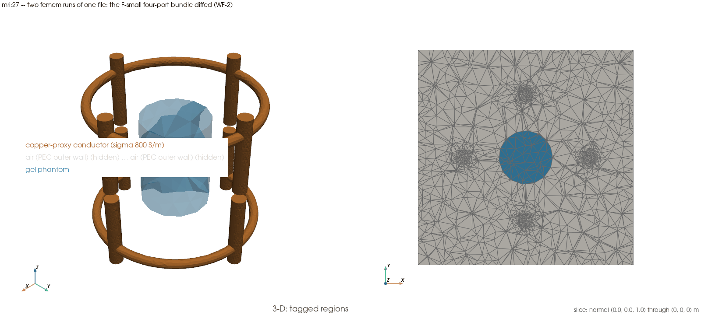

# `-e mri:27` — two `femem run`s of one study file: the output bundle and its diff, and the three plants each layer catches

Guide for `examples/mri/27_femem_run_bundle_reproducible.py`.
Written to be followed without the source open.

## 1. What this demonstrates

**What the bundle is.** `femem run study.yaml` writes a directory (the *bundle*): the run's
JSON summary (schema tag `femem`, `source`, `sha256` of the study file's bytes, `family`,
`degree`, `frequency_hz`, `ranks`, `cells`, `s_matrix`, `z_matrix`, `touchstone`,
`elapsed_s`) and, for a port study, the Touchstone file (the `.s4p`) that a circuit tool
reads. `WF-2` (`tests/package/test_wf2_bundle_reproducible.py`) gates that this bundle
reproduces at fixed width. No example had written two bundles of one file and diffed them.
This one runs the tracked `tests/package/wf1/f_small_four_port.yaml` in place (the F-small
four-port birdcage with the gel phantom, exact-rectangle ports, κ off, degree 1, 64 MHz,
`-n 2`, 117 206 cells) twice in one process, `run_a` through `cli.main(["run", …])` and
`run_b` through `run_study_file` (the function `cli.main` calls, so `run_b`'s in-memory
summary exists), and diffs the two bundles key by key. Every record, band and helper
(`L0_BAND`, the comparator, the records) is imported from the gate module; the example
states no band.

**The two layers, and why there are two.** `-n 2` MUMPS is not guaranteed bitwise from run to
run (known-issues, "Second fixture (2026-09-29)" row), so solve output is never compared
bitwise.

- **The deterministic layer, bitwise.** The summary's `femem`, `source`, `sha256`, `family`,
  `degree`, `frequency_hz`, `ranks`, `cells`, the Touchstone name, the key set, and the
  Touchstone header lines. None depends on the solve.
- **The floating layer, at `L0_BAND`.** S, and the S parsed back from the Touchstone.
- **Excluded by design:** `elapsed_s` (a wall clock; each rank has its own) and the
  Touchstone's `generated_utc` line (excluded by its exact prefix, not "all comment lines").

**Anchors of the gate on this file.** (D) the deterministic layer of `run_a` and `run_b`
agrees bitwise and `sha256` equals the hash recomputed from the file; (F) the summary file
equals the writer's in-memory summary, bitwise by `float.hex`, compared on every rank
against rank 0's broadcast copy (rank 1's own `elapsed_s` differs by design); (R) S of the
two runs within `L0_BAND`; (X) each against the earlier record `_record(1)` within
`L0_BAND`; (T) the Touchstone header lines bitwise, one `generated_utc` line per file, no
placeholder, the parsed matrices within `L0_BAND`.

**Cross-process check of the deterministic layer (new).** The gate asserted `sha256` only
against a hash recomputed in the same process. Here `sha256`, `cells` and the five header
lines are also compared with the record of a run made a week earlier in a different
process, the gate's `docs/testing/logs/20261009T053110Z_WF-2-W2-four-port.log` (`:3686`,
`:3688`, `:3693`). They are character-identical, in both of this example's windows.
This is one image: an image or mesher change moves `cells`, which is the record-reconciler's
job, not a reproducibility failure.

**Three plants, and which layer sees each.**

| Plant | What changes | Bitwise layer | Floating layer |
| --- | --- | --- | --- |
| (c1) degree 2 instead of 1 | `degree` and S | flags `degree` | S miss 0.04954, 4.95e+07 × `L0_BAND` |
| (c2) P1 ↔ P2 swap | S only, no deterministic key | **blind** (no flags) | S miss 0.2492, 2.49e+08 × `L0_BAND` |
| (c4) σ one ULP up (a third `femem run` of the control file) | the file's bytes | flags `sha256`, plus `source` and `touchstone` (names) | **blind**: S differs by 2.467e-15 / 1.703e-15, ≈ 1e-6 × `L0_BAND` |

So the bundle needs both layers. The swap edits no deterministic key, so only the floats
see it. The one-ULP σ file changes S by round-off, far below the band, so only the hash
sees it: **`sha256` is the only key derived from the file's content.** `source` and
`touchstone` record only where the file is and what it is called (the control's Touchstone is
named after the control's stem, so the flag set is exactly `{source, sha256, touchstone}`,
asserted as an exact set). `cells`, `degree`, `frequency_hz`, `ranks`, `family` and `femem`
are equal. The control's Touchstone header lines equal `run_a`'s: the header carries port
order, frequency and z0 only, so it is blind to σ too.

Further asserted plants: (c3) on the real `run_b` summary, `cells + 1` flags exactly
`{cells}`, one hex digit of `sha256` flags exactly `{sha256}`, a deleted `ranks` flags exactly
the key-set flag, a changed `elapsed_s` flags nothing; (c5) S × (1 + 1e-8) misses by
10 × `L0_BAND`, so the band resolves a 1e-8 change.

Readings of record (flagged run, harness log `EX-126`, file
`docs/testing/logs/20261017T020230Z_EX-126.log`; the unflagged control `EX-126-control`,
`docs/testing/logs/20261017T020430Z_EX-126-control.log`, reproduces them at the bands). The
gate's record is `docs/testing/logs/20261009T053110Z_WF-2-W2-four-port.log`:

| Anchor | Reference | Reading (flagged log line) | Bound |
| --- | --- | --- | --- |
| cells | `ANS4_EXACT_STRIP_CELL_RECORD` | 117 206 (`:5479`) | exact |
| (D) deterministic flags; `sha256` | recomputed; W2 `:3688` | `[]`; `7820a305…a4f7` equal (`:5482`) | exact |
| (F) file = writer's summary | bitwise | True (`:5483`); per-rank offs `[[], ['elapsed_s']]` (`:5481`) | exact |
| (R) S, run_b vs run_a | `L0_BAND` | 1.183e-15 (`:5484`) | 1e-9 |
| (X) vs `_record(1)` | `L0_BAND` | 9.557e-11 both (`:5485`) | 1e-9 |
| (T) header lines; parsed S | bitwise; `L0_BAND` | 5 / 5 equal, one `generated_utc` each; rel 0; parsed vs summary 9.952e-14 (`:5487`) | exact; 1e-9 |
| cond(I − S_a) | W2 `:3692` | 19.28 (`:5486`) | 1e-2 relative |
| (c1) | `L0_BAND` | flags `degree`; 0.04954 (`:5498`) | flags exact; > 1e-9 |
| (c2) | `L0_BAND` | 0.2492; bitwise flags on the swapped summary `[]` (`:5499`) | > 1e-9 |
| (c3) | exact | `cells`; `sha256`; `<keyset>`; none (`:5500`) | exact |
| (c4) | exact flag set | `sha256`, `source`, `touchstone` (`:5501`) | exact |
| (c5) | `L0_BAND` | 1e-08, 10 × band (`:5503`) | > 1e-9 |

The five header lines of both runs (`:5488`–`:5497`) are
`! FEM-EM Solver Touchstone export`, `! port_order: P1,P2,P3,P4`,
`! frequency_points_hz: 6.400000000e+07`, `! z0_ohm: 50.000000` and
`# Hz S RI R 50.000000`.

**Printed only (no band).** Wall times: `run_a` 35.1 s, `run_b` 34.6 s, control 35.4 s
(`:5479`–`:5480`). Z between the two runs 1.075e-15 beside cond(I − S_a) 19.28 (`:5486`).
Control S against `run_a` (c4, predicted ≤ 1e-12): 2.467e-15 (`:5502`). In the unflagged
control run, S and Z of the two runs read 0 (bitwise equal that time, `:5477` and `:5479` of
the control log): the gate never depends on that, and the flagged run's 1.183e-15 shows it is not
guaranteed. Summed peak RSS 2.06 GiB (flagged) and 1.84 GiB (control).

**Not claimed:** reproduction across widths (`-n 1` against `-n 2`), machines or images;
degree 2; the sphere bundle and its SAR (the gate's other test carries that half); the
earlier example manifest of `mri:1`; Z reproduction (printed only); the thermal summary; the
installed `femem` console script; any bundle-comparison package API (the comparator stays
test-side and is imported); the physics or accuracy of S; the partition in the XDMF as
reproducible. One fixture, degree 1, `-n 2`, one image, in-process `cli.main`.
`WF-2`, `WF-1` and `ANS-4` do not move.

## Setup figure



`examples/mri/figures/mri_27_femem_run_bundle_reproducible_setup.png`. Rendered right after
the two runs, from `run_b`'s mesh and cell tags (`FEM_EM_SETUP_FIGURES=1`). Regions: the
copper-proxy conductor, "gel phantom" (translucent) and the air box (hidden). The slice is
normal to `z` through the origin and cuts the phantom. The four port sheets are facet tags,
which the renderer does not draw. The figure is geometry only.

## 2. How to run it

```
./scripts/run_examples.sh -e mri:27 -n 2 -t 420
```

Heavy tier by ceiling, `-n 2`, complex build (the `mri:` group sources it). Measured wall
time ≈ 111 s (harness elapsed, flagged and unflagged), of which each of the three `femem
run` solves is ≈ 35 s. Output goes to `examples/mri/paraview_output/`, which is gitignored:
`mri_27_run_a/`, `mri_27_run_b/` and `mri_27_run_c/` (one bundle each, rebuilt fresh on every
run), `mri_27_femem_run_bundle_reproducible_combined.xdmf` with its `.h5`, and
`mri_27_femem_run_bundle_reproducible_diff.csv`. The setup figure is rendered only with
`FEM_EM_SETUP_FIGURES=1`. Every `cli.main` call passes `--output-dir`: the default
`femem_out/` is not gitignored.

## 3. How to analyze it, step by step

**Step 1 — the control file.** `examples/mri/27_femem_run_bundle_reproducible_sigma_ulp.yaml`
is `f_small_four_port.yaml` with two lines changed: the comment and `sigma:
0.5000000000000001` (`nextafter(0.5, 1)`). The example asserts, before any mesh, that the
parsed specs differ in exactly `material.sigma`, and that the two files' lines differ at
exactly those two indices.

**Step 2 — the bundles.** Three fresh directories, asserted distinct, each with a summary
file modified after the example started (a stale bundle would pass vacuously). `run_a`
and `run_b` are the same file; `run_c` is the control.

**Step 3 — the deterministic diff.** Open the diff table (Step 5) and filter `layer` =
`deterministic`: every row reads `equal` in `a_vs_b`. In `a_vs_c4` three rows read `differs`:
`sha256`, `source`, `touchstone`.

**Step 4 — the floating diff.** Filter `layer` = `floating`. `a_vs_b` is S and Z between the
two runs (≈ 1e-15 or exactly 0); `a_vs_c4` is the control against `run_a` (≈ 2e-15). All are
far below `L0_BAND` = 1e-9, so a float comparison cannot tell the σ control from the original.

**Step 5 — the table.** `examples/mri/paraview_output/mri_27_femem_run_bundle_reproducible_diff.csv`
has one row per summary key and one per Touchstone header line, with columns `key`, `layer`
(`deterministic` / `floating` / `wall_clock`), `a_vs_b`, `a_vs_c4` and `flagged_by` (which of
(c1)–(c5) flag the row). It holds no S, Z or matrix entry, only ratios and flags. Open it in a
spreadsheet and filter `layer`.

**Step 6 — read the plants.** `flagged_by` lists `s_matrix` under (c1), (c2) and (c5) and
`sha256` under (c3) and (c4); `degree` under (c1) alone. The (c2) swap has no row of its own
in the deterministic layer: that is the point of the table above.

**Step 7 — open it in ParaView.**
`File → Open → examples/mri/paraview_output/mri_27_femem_run_bundle_reproducible_combined.xdmf`.
The file holds the cell grid, `CellTags` and `owner_rank` (DG0, the MPI rank that owned each
cell). Colour by `owner_rank` to see the partition this run used, the origin of the summary's
`ranks: 2`; threshold `CellTags` to isolate the phantom. The partition is not compared across
runs and is not a reproducibility claim. No field solve is run, so there is no field to show;
`examples/mri/08_study_four_port_birdcage.md` shows the P1 field.

**Step 8 — what a deviation means.** (W) fails → not `-n 2`. `sha256` ≠ the record → the
file changed (a stale record, the review's to rule on) or a hashing defect. `cells` equal
between runs but ≠ the record → an image or mesher change (record-reconciler). `cells`
different between the two runs → meshing non-determinism. (F) fails → a JSON round-trip
defect. (R), (X) or (T) fails → a floating miss that contradicts the gate's readings. A
control that does not fire, or a (c4) flag set other than `{source, sha256, touchstone}` → a
blind comparator or a control file that changes more than σ.

## Related

- `examples/mri/09_study_from_yaml.md` — `cli.main(["run", …])` on a solid four-port YAML.
- `examples/mri/21_femem_run_tune_section.md` — `femem run` on a file with a `tune:` section; file equals memory for one block.
- `examples/mri/13_temperature_from_yaml.md` — `cli.main` against `run_study_file` for a thermal summary.
- `examples/mri/08_study_four_port_birdcage.md` — the same four-port fixture through the Python API.
- `tests/package/test_wf2_bundle_reproducible.py` — the gate this example imports.
- `tests/package/test_wf1_study_yaml.py` — the study-file parser tests.
