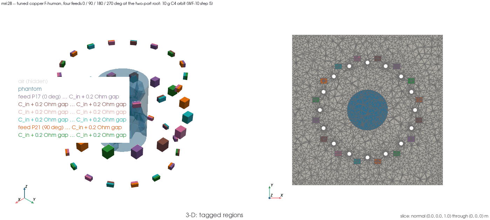

# `-e mri:28` — the 10 g lattice on the tuned copper F-human under the four-port drive: C4 holds, the two-port misses, and the spread per radius reads drive anisotropy

Script: `examples/mri/28_f_human_four_port_sar10g_c4.py` (`EX-127`)
Gates: `tests/validation/test_wf10_f_human_four_port_sar10g.py` (`WF-10` step 5, item 422) and the helper modules it imports

## 1. What this demonstrates

One build of the copper F-human hole mesh (369 387 cells, Leontovich wall, κ off, degree 1, 64 MHz, phantom at 0.015 m), C_in,F-human = 118.2437 pF with r = 0.2 Ω ESR on all 32 ring gaps. The same 12 z_c balls (three radii 15 / 30 / 45 mm, four azimuths 90° apart) are read at 10 g under two loadings of that one coil:

- **four-port** (feeds P17 / P21 / P25 / P29 at slots 0 / 4 / 8 / 12, ccw weights 1, −1j, −1, +1j, the other 28 gaps r + C);
- **two-port** (the clinical drive, feeds P17 / P21, ccw weights 1, −1j).

**The four-port drive is untuned**, as in `mri:18`: C is the two-port root. Degree 1, one fixture. Per-W values compare shapes; they are not tuned-coil SAR values. The script imports every helper and band from the gate module and repeats its test body's sequence (provenance in the script); nothing is restated, and no `test_*` name is called.

**Why the four-port loading is C4-invariant and the two-port's is not.** In CAD the four feeds sit at Thévenin impedance 90° apart and the other 28 gaps are identical r + C sheets, so a 4-slot rotation maps the loading onto itself. The ccw weights pick up a common phase under that rotation (a factor of −1j per slot step), so the field is rotated and phase-shifted, and the SAR (a quadratic form) is exactly C4-covariant up to the mesh's own asymmetry. The two-port loading has two feeds and 30 plain gaps; a 90° rotation does not map it to itself, so there is no C4 identity to expect.

**Why each radius's four balls are one C4 orbit, and why the max over m matters.** For each radius the four z_c balls at azimuth offsets 0 / 90 / 180 / 270° are one orbit of the 90° rotation (anchor (O) checks the centres to 3.1e-16). The gate compares row m against row 0 for m = 1, 2, 3 and takes the maximum. A 180° comparison alone is blind: at m = 2 both drives sit inside the band (four-port 0.7215 %, two-port 0.8080 %),. Only m = 1 and 3 separate them (17.3831 % and 16.1396 % for the two-port). The script never prints a single-m verdict.

**Results (run of record).**

| reading | four-port | two-port |
|---|---|---|
| (C4) rel L2, m = 1 / 2 / 3 | 1.8127 / 0.7215 / 0.2645 % (gate band 5 %, asserted) | 17.3831 / 0.8080 / 16.1396 % (asserted > band) |
| spread per radius 15 / 30 / 45 mm | 3.2122 / 4.2668 / 0.7809 % | 16.7267 / 20.9986 / 18.6041 % |
| ratio four-port / two-port | 0.192 / 0.203 / 0.042 | |

The verdict is `drive anisotropy` at all three radii (each four-port spread is at most ⅓ of the two-port's). Read plainly: the two-port's 17–21 % azimuthal spread of 10 g SAR is the drive's anisotropy, not the lattice's resolution (the 10 g ball spans ≈ 1.8 cells on the 0.015 m phantom), because the same balls on the same mesh are C4-covariant to 1.8 % under the four-port drive. The 68 record rows (cells, the 12 + 6 SAR values, ball masses, shares, per-watt figures) are compared with the gate's run of record at relative tolerance 10^−(d−2) for d printed digits; the largest relative difference is 7.962e-05. c\*₄ is `r=45 dz=+0 az17+270`, SAR10g 6.554475e-03 W/kg, a lattice argmax and not a global maximum.

Per watt, the untuned four-port gives SAR10g(c\*₄) / P_src,4 = 3.11817e-02 W/kg/W against the two-port's 5.607e-02, peak-to-mean 1.2031 against 1.309, and P_phantom / P_src,4 = 5.72978e-02 against 0.0947. These are shape comparisons at an untuned loading.

Example-side identities, all asserted: (O) 3.084e-16, (X1)₄ 3.331e-16 and (X1)₂ 2.220e-16 (the DG0 loss maps sum to the phantom power), and the gate's own anchors ((S_rep), (P_w), (Lin), (X4-P), (X4-L), (X4-K), (Σ_P)₄, (i)₄, (iv)).

Not claimed: a four-port tuning, f₀, Q, a match, S₁₁ / Z_in; an absolute, tuned-coil or pointwise SAR; compliance; an h-statement or the lattice's own resolution; degree 2; any AED or external check. No tuning, no compliance claim. The clinical fixture stays two-port.

## 2. How to run it

```
./scripts/run_examples.sh -e mri:28 -n 8 -t 590
```

Heavy tier, `-n 8` only (the gate's width is asserted), complex DolfinX build (the runner sources it for the `mri:` group). It needs two gitignored inputs: the stored 32×32 matrix under `logs/wf12/` and item 358's node record, named in the script as `NODE_JSON` and read on rank 0 before the builder rewrites it. `FEM_EM_WF10_DEGREE` must be unset. Measured wall time ≈ 376 s through the harness (script body 372.1 s; mesh 175.5 s on a slow host), summed RSS ≈ 10.08 GiB. Add `-e FEM_EM_SETUP_FIGURES=1` after `exec -T` to re-render the setup figure.

## Setup figure



`examples/mri/figures/mri_28_f_human_four_port_sar10g_c4_setup.png`. Air hidden, phantom translucent, the 32 ring-gap port boxes (feeds P17 / P21 / P25 / P29 at 0 / 90 / 180 / 270° named apart from the C_in + 0.2 Ω gaps) and the z-slice through z_c. The hole route has no conductor cells: the coil is drawn as a void.

## 3. How to analyze it, step by step

**Step 1 — the anchors.** `[anchor]` lines print (S_rep), the two-port (P_w) / (Lin) / Y_in per sense, and (P_RC), each at its imported band.

**Step 2 — the four-port construction.** `[four-port]` prints the feeds, the 90° steps, κ off, the solve kinds, (X4-P), (X4-L), P_src,4 / P_phantom,4 and the feed-ring k shares (k = 0 4.5411e-07, bin 15 0.999450).

**Step 3 — the 18-point table.** `[10 g] four-port table` prints SAR10g (W/kg) for the 12 z_c balls beside the two-port values, then the six off-plane balls (four-port only).

**Step 4 — the C4 gate and the control.** `(C4_4)` is asserted at the band; `control` is asserted above it; the 180° line is printed with its prediction.

**Step 5 — the record.** `spread per radius`, the ratio line and the `VERDICT` line.

**Step 6 — ParaView, one colour scale.** Open `examples/mri/paraview_output/mri_28_f_human_four_port_sar10g_c4_combined.xdmf` (with its `examples/mri/paraview_output/mri_28_f_human_four_port_sar10g_c4_combined.h5`). It holds DG0 `SAR_local_4port_per_W`, `SAR_local_2port_ccw_per_W`, `SAR_local_4p_over_2p_per_W`, `ZcBall` (1–12) and `C4Orbit` (1–3), plus `CellTags`. Threshold `ZcBall` ≥ 1 coloured by `SAR_local_4port_per_W`, then by `SAR_local_2port_ccw_per_W` on one colour scale; slice z = z_c on `SAR_local_4p_over_2p_per_W`; group by `C4Orbit`.

**Step 7 — the table.** `examples/mri/paraview_output/mri_28_f_human_four_port_sar10g_c4_zc_rows.csv` has label, radius, azimuth offset, centre, SAR10g for both drives per W of P_src, and the ball mass for the 12 z_c balls.

## Related

- `examples/mri/18_f_human_four_port_quadrature.md`
- `examples/mri/17_f_human_tuned_quadrature_b1_sar.md`
- `examples/mri/04_f_human_sar10g_hotspot.md`
- `tests/validation/test_wf10_f_human_four_port_sar10g.py`
- `tests/validation/test_wf10_f_human_tuned_sar10g.py`
