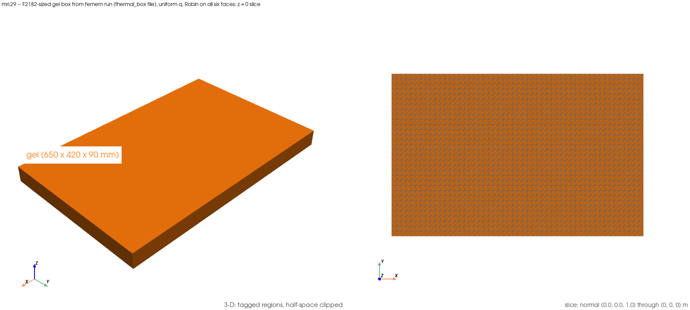

# `-e mri:29` — `femem run` on the three F2182 gel-box `thermal_box` files: the CLI, the JSON summary read back, θ_file = θ_Python

Guide for `examples/mri/29_femem_run_f2182_gel_box_files.py`.
Written to be followed without the source open.

## 1. What this demonstrates

**What a thermal-only file is.** `WF-1` step 15 (`U59`, §9 item 521b) let a YAML file carry a
`thermal_box` study: a uniform heat source in a gel box, Robin cooling on all six faces, **no EM
solve, no `frequency_hz`, no `material:`**. No example ran such a file. `mat:24` / `mat:25` build
Python objects (`ThermalBoxGeometry` → `Study.temperature`); `mri:20` / `21` / `26` / `27` run
EM birdcage files. Here the input is the text file and the output is the run bundle. The three
tracked files under `tests/package/wf1/`, read line by line:

| Key | `thermal_box_steady_m4.yaml` | `thermal_box_duty_m6.yaml` | `thermal_box_wrong_wall_m4.yaml` |
| --- | --- | --- | --- |
| `femem` | 1 | 1 | 1 |
| `geometry.kind` | `thermal_box` | `thermal_box` | `thermal_box` |
| `geometry.half_widths_m` | [0.325, 0.21, 0.045] | same | same |
| `geometry.divisions` | [52, 32, 8] (m = 4, 79 872 cells) | [78, 48, 12] (m = 6, 269 568 cells) | [52, 32, 8] |
| `excitation` | `uniform_heat_source`, 2000 W/m³ | same | same |
| `thermal.k_w_per_m_k` | 0.6 | 0.6 | 0.6 |
| `thermal.h_w_per_m2_k` | 10.0 | 10.0 | **20.0** (the control) |
| `thermal.t_inf_c` | 20.0 | 20.0 | 20.0 |
| `thermal.transient` | absent | `dt_s` 70.5375, `n_steps` 40, `rho_c_j_per_m3_k` 4.18e6 | absent |
| `thermal.duty` | absent | `period_s` 564.3, `duty` 0.5 | absent |

The example asserts the YAML mapping diff (F-diff): steady against duty differs in exactly
`geometry.divisions`, `thermal.transient`, `thermal.duty`; steady against the wrong-wall file
differs in exactly `thermal.h_w_per_m2_k`.

**The summary keys.** Both summaries carry `femem`, `source`, `sha256`, `family`
(`thermal_box`), `ranks`, `cells`, `temperature` and `elapsed_s`, and **no** `degree`,
`frequency_hz` or `touchstone`. The `temperature` block carries `half_widths_m`, `divisions`,
`thermal_degree`, `q_w_per_m3`, `transient`, `duty`, `source_power_w`, `theta_max_k` and `source`.
**Steady** adds `convected_power_w`; **duty** adds `source_multipliers` (41 entries) and
`max_balance_residual`.

**How the example runs them.** `cli.main(["check", f])` and `cli.main(["run", f, "--output-dir",
d])` in-process, rank width 2, complex build. `cli.main` imports `run_study_file` inside the call,
so a call-through wrapper on `fem_em_solver.study_yaml.run_study_file` (restored in `finally`)
captures the returned `StudyRun`; it changes nothing about what runs. `femem check` stdout is
captured and read on rank 0. Every record, band and helper is imported from the gate
`tests/package/test_wf1_yaml_thermal_box.py` (the ANS-1 rule); the example states no band. The
two solve legs are the gate's node bodies with only `cli.main` and the output directory
substituted.

**Anchors of the gate, re-asserted.** (K) `femem check` rc (0, 0) on all three good files, one
`family: thermal_box` line and `excitation: UniformHeatSource`; (UT) cells equal the Python
Study's and the record, geometry bitwise equal, and on the duty file the 41 multipliers equal;
(I-Py) θ_file = θ_Python at `L0_BAND`; (R) the MAT-21 records at `.4e` with `INTERIOR_BAND`,
`E_BAND` and `S2_GAUSS_BAND`; (I=) the summary equals its own thermal result by hex, and the
JSON on disk equals the summary.

**Readings new to the examples, each from the JSON loaded from disk on every rank.**

1. **(P-json).** `source_power_w` is Q · V = 2000 × 0.65 × 0.42 × 0.09 = 49.14 W to 2.0e-13
   (steady) and 2.6e-12 (duty), band `L0_BAND`.
2. **(S0-json).** The duty JSON's `source_multipliers` has 41 entries and equals the
   in-memory list; its mean is 0.5122 (printed only; near the 50 % duty).
3. **(G-json), printed only.** The steady balance `convected_power_w = source_power_w` holds
   to 2.2e-13, inside `S2_GAUSS_BAND`. Its band was a prediction; no earlier log had read the
   summary key itself.
4. **(F-diff)**, above.

Negative controls: (c-wall) the h-doubled **file**, through the CLI, misses the m = 4
comparand by 0.38048 (asserted > `INTERIOR_BAND`, < 1; the API's `WF15_S5_C_WALL` prints
beside it); (c3) the duty file against the continuous-source step response at t* misses by
0.50282 (asserted > `INTERIOR_BAND`); (cX) `malformed_thermal_box_duty_without_transient.yaml`
refuses at `thermal.duty`, `run` and `check` both return 2, and its directory is absent.

Readings of record (flagged run, harness log `EX-132`, file
`docs/testing/logs/20261019T050316Z_EX-132.log`). The gate's records are
`docs/testing/logs/20261018T185143Z_WF-1-s15-W1a-steady.log` (W1a) and
`docs/testing/logs/20261018T185201Z_WF-1-s15-W1b-duty.log` (W1b):

| Anchor | Reference | Reading (log line) | Bound |
| --- | --- | --- | --- |
| (K) check rc, lines | exact | (0, 0) × 3, lines True (`:40`–`:42`) | exact |
| (F-diff) | exact set | as stated above (`:43`) | exact |
| (cX) malformed file | exact | field `thermal.duty`; rc (2, 2) both; no directory (`:44`) | exact |
| (UT) steady cells | `STEP1_M4_CELLS`, W1a:63 | 79 872 / 79 872 / 79 872; geometry equal (`:53`) | exact |
| (I-Py) steady | W1a:64 1.479e-15 | 1.184e-15 (`:54`) | 1e-9 |
| (R) steady whole `.4e` | `STEP1_M4_WHOLE`, W1a:65 | 3.4599e-03 (`:55`) | exact string |
| (R) steady interior; Gauss | W1a:65 3.223613e-03; 2.708e-13 | 3.223613e-03; 2.708e-13 (`:55`) | 1e-2; 1e-9 |
| (c-wall) | W1a:66 3.8048e-01 | 3.8048e-01 (`:56`) | > 1e-2, < 1 |
| (P-json) steady | Q · V | 1.994e-13 (`:58`) | 1e-9 |
| (UT) duty cells; multipliers | `STEP1_M6_CELLS`, W1b:63; 41 | 269 568; 41 equal (`:62`) | exact |
| (I-Py) duty | W1b:64 4.792e-14 | 4.259e-14 (`:63`) | 1e-9 |
| (R) (T-duty) `.4e`; balance | `P26_T_DUTY`, W1b:65 9.4014e-04; 2.809e-12 | 9.4014e-04; 2.811e-12 (`:64`) | exact string; 1e-9 |
| (c3) | W1b:66 5.0282e-01 | 5.0282e-01 (`:65`) | > 1e-2 |
| (P-json) duty | Q · V | 2.572e-12 (`:67`) | 1e-9 |
| (S0-json) | gate (I=) | 41 entries, equal to in-memory (`:68`) | exact |

**Printed only (no band).** θ_max from the JSON: 12.0074 K steady (W1a:67 12.0074), 0.66726 K
duty (W1b:67 0.667259), ratio 18 (no band). Steady (G-json) 2.195e-13. File run times:
1.2 s steady (W1a:63 0.8 s) and 10.5 s duty (W1b:63 9.4 s). The owned θ arrays of the file
and the Python Study are **not** bitwise equal at `-n 2` (differences ≈ 1e-15 relative; the
gate asserts the band, not the hex). The CSV `mri_29_femem_run_f2182_gel_box_files_summary_readback.csv`
lists each JSON scalar beside the in-memory summary's value: 10 rows, all hex-equal.

**Not claimed:** the installed console script (`femem` on `PATH`) or `--ranks`; `--estimate`;
the transverse (quadratic) source from YAML; P2 / `thermal.degree: 2`; probes or point values
(`mat:24` / `mat:25`); a container wall; the real build; perfusion, EM or a coil; bundle
reproducibility (`mri:27`'s angle); F2182 compliance; any external check. `WF-1`, `WF-15`,
`MAT-21` and §2 do not move.

## Setup figure



`examples/mri/figures/mri_29_femem_run_f2182_gel_box_files_setup.png`. Rendered right after
the steady `femem run` returns, from the run's thermal sub-mesh (`FEM_EM_SETUP_FIGURES=1`).
One region: "gel (650 x 420 x 90 mm)", all cell tags 1. The slice is normal to `z` through the
origin; the 3-D view is half-space clipped. The box has no air, no coil and no EM: the figure is
geometry and the m = 4 mesh only. The Robin facets are facet tags, which the renderer does not
draw.

## 2. How to run it

```
./scripts/run_examples.sh -e mri:29 -n 2 -t 590
```

Heavy tier, `-n 2`, complex build (the `mri:` group sources it). Measured wall time ≈ 216 s
(harness elapsed; the script's own total 213.6 s: steady leg 11.1 s, duty leg 202.2 s, of
which the duty comparand's series interpolation is the bulk). The same call from a shell is
`femem run tests/package/wf1/thermal_box_steady_m4.yaml`; the example only wraps it to capture
the `StudyRun`. Output goes to `examples/mri/paraview_output/`, which is gitignored:

- `mri_29_femem_run_f2182_gel_box_files_steady_combined.xdmf` (with its `.h5`);
- `mri_29_femem_run_f2182_gel_box_files_duty_combined.xdmf` (with its `.h5`);
- `mri_29_femem_run_f2182_gel_box_files_summary_readback.csv`;
- the run bundles `mri_29_run_steady/`, `mri_29_run_wrong_wall/`, `mri_29_run_duty/`, and
  `mri_29_bad/` (which must not exist).

The setup figure is rendered only with `FEM_EM_SETUP_FIGURES=1`.

## 3. How to analyze it, step by step

**Step 1 — the files.** Open the three YAML files and compare them with the table above. There
is no `study:` mapping, no `material:` and no frequency: a `thermal_box` file is geometry,
excitation and a `thermal:` block.

**Step 2 — `femem check` first.** It reads inputs only and builds nothing. It prints
`family: thermal_box` and `excitation: UniformHeatSource` and returns 0 on all three.

**Step 3 — the refusal (cX).** The malformed file has a `thermal.duty` block and no
`thermal.transient`: a duty cycle needs a time axis. The loader's error field is
`thermal.duty`; `run` and `check` return 2; no directory is created.

**Step 4 — the steady run.** `femem run` returns 0; the wrapper saw exactly one
`run_study_file` call. The cell count (79 872) equals the Python Study's, and θ_file equals
θ_Python to ≈ 1e-15 (band 1e-9). The whole-box L2 error against the Robin-box series is
3.4599e-03, the interior 3.2236e-03.

**Step 5 — read the JSON summary alone.** Open the run directory's JSON summary. From it:
`source_power_w` / 49.14 − 1 ≈ 2e-13; `convected_power_w` / `source_power_w` − 1 ≈ 2e-13
(the steady energy balance); `theta_max_k` 12.0074 K. Nothing else is needed: no field, no mesh.

**Step 6 — the duty run.** Same call on the duty file (m = 6, 40 Crank–Nicolson steps of
70.5375 s, period 564.3 s, 50 %). The JSON carries 41 multipliers and
`max_balance_residual` (2.811e-12); θ at t* against the duty closed form is 9.4014e-04.

**Step 7 — the two controls.** The wrong-wall file misses the steady comparand by 0.38; the
step response misses the duty file by 0.50: the comparands resolve what the files differ in.

**Step 8 — ParaView.** Open both XDMFs, colour by `theta_file_minus_series`, then Plot Over
Line along y. The steady XDMF holds `theta_file_steady`, `theta_series_steady`,
`theta_file_minus_series`, `theta_wrong_wall` and the Robin facet tags; the duty XDMF holds
`theta_file_duty_tstar`, `theta_duty_series_tstar`, `theta_duty_minus_series` and
`theta_step_series_tstar`. All are P1 real parts, in kelvin above ambient.

## Related

- `examples/materials/24_f2182_gel_box_study_api_probes.md` — the same steady box through the Python `Study`.
- `examples/materials/25_f2182_gel_box_duty_probe_histories.md` — the duty box through the Python `Study`.
- `examples/mri/20_f_human_thermal_from_yaml.md` — a thermal block on an EM file.
- `examples/mri/27_femem_run_bundle_reproducible.md` — the run bundle and its reproducibility.
- `tests/package/test_wf1_yaml_thermal_box.py` — the gate.
- `tests/package/test_wf15_study_thermal_box.py` — the Python-route records.
