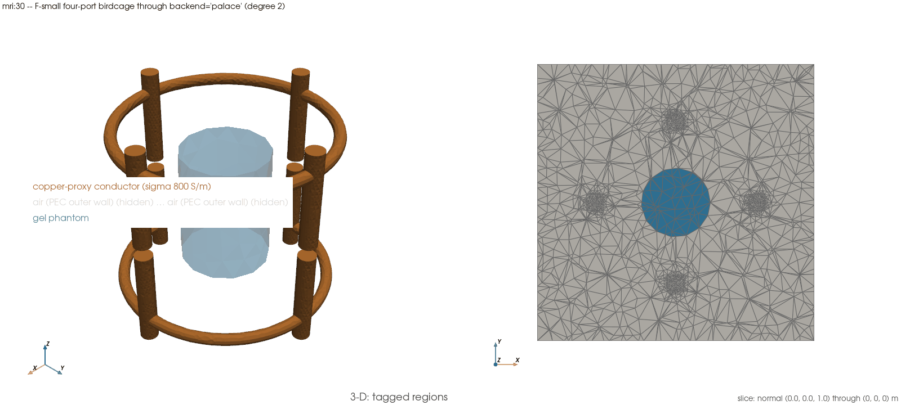

# `-e mri:30` — the F-small four-port case through `Study.solve(backend="palace")`

Guide for `examples/mri/30_study_palace_backend_f_small.py`.
Written to be followed without the source open.

## 1. What this demonstrates

**A three-stage workflow, run end to end into a fresh case directory.**

1. `Study.solve(comm, backend="palace", case_dir=...)` writes a Palace case and raises
   `PalaceRunRequired`.
2. A separate `fem-em-palace` harness window runs the command that stage 1 prints.
3. The same `Study.solve` call reads S back from Palace's output and returns a
   `PalaceStudyResult`.

**The Study cannot launch Palace.** Palace runs in its own image, and the solver
container has no docker socket (the 2026-10-18 03:00 ruling R2,
`docs/planning/chunks/ARCH-1.md`). So the script is two stages in one file, chosen by
what is on disk: no Palace output in the case directory means stage 1 (write), an
existing output means stage 3 (read). A corpus run (`-e all`) that meets an existing
output re-runs stage 3, which re-checks the case bytes.

**What the Palace figures are.** The `Study` is built with explicit arguments:
`FourPortBirdcageGeometry.f_small()` (exact CAD port rectangles, κ off),
`GelledSalinePhantomMaterial(SALINE_SIGMA, SALINE_EPSILON_R, FREQUENCY_64_HZ)`,
`LumpedPortDrive()`, 64 MHz, `degree=2` (Palace order 2). The Palace S is a
**cross-solver identity at matched order on a shared mesh**, tied to our degree-2
record. It is **not an accuracy level**, and no tuning, Q, AED comparison or
absolute `S₁₁` is claimed.

**Same input as `U16` and `OPS-61`.** Every record and band is imported from the gate
modules (the ANS-1 rule): `OPS61`, `D2_CASE`, `TIE2_BAND`, `TIE2_RECORDED`,
`C_ORDER_FLOOR` from `tests/package/test_arch1_palace_backend.py`;
`LEG_D0_REPRODUCTION_BAND`; `ANS4_EXACT_STRIP_S_P2_X1`; `ANS4_EXACT_STRIP_CELL_RECORD`;
and the saline constants. The script writes only under `examples/mri/paraview_output/`
and `examples/mri/figures/`.

Readings of record (stage 3, harness log `20261019T093732Z_EX-134.log`):

| Anchor | Stage | Reference | Reading | Bound |
| --- | --- | --- | --- | --- |
| (K) serial | 1, 3 | `comm.size == 1` | 1 | exact |
| (Arg) | 1 | argv `palace -np 8` plus the case config; cwd = the case directory | holds | exact |
| (W-case) | 1, 3 | the case equals `D2_CASE`'s manifest and config bytes, differs from `OPS-61`'s order-2 config in exactly `Problem.Output` and `Model.Mesh`, mesh bytes equal `OPS-61`'s | all four hold | exact |
| (c-stage) | 1 | no output exists after the raise | holds | by construction |
| (R) | 3 | `PalaceStudyResult`, backend `palace`, order 2, 64 MHz | 117 206 cells, `ANS4_EXACT_STRIP_CELL_RECORD` | exact |
| (E2) | 3 | `OPS-61`'s order-2 read | 2.636e-14 (entry max 4.816e-14) | `LEG_D0_REPRODUCTION_BAND` 1e-9 |
| (E2-u16) | 3 | the `U16` case output | 2.636e-14 (entry max 4.816e-14) | 1e-9 |
| (P) reciprocity / σ_max | 3 | `PORT-11` identities | 9.848e-11 / 0.999819887373 | 1e-3 / ≤ 1 + 1e-9 |
| (P) class spreads (self / adjacent / opposite) | 3 | — | 0.0371 / 0.0248 / 0.0500 % | `ADJACENT_SPREAD_BAND` |
| (Tie2) self / adjacent / opposite | 3 | `ANS4_EXACT_STRIP_S_P2_X1["64"]` class means | 2.464e-10 / 9.668e-11 / 9.883e-11 | `TIE2_BAND` 2.6e-10 |
| (c-order) self / adjacent / opposite | 3 | Palace order 1 | 6.6674 / 2.5442 / 4.5224 % | > `C_ORDER_FLOOR` 1e-6 |

(Tie2) reproduces the recorded 2.464e-10 / 9.668e-11 / 9.883e-11 to the printed digits.
(c-order) reproduces the recorded 6.6674 / 2.5442 / 4.5224 % to the printed digits: the
read is not blind to the case's order.

**Printed only, never asserted.** (c-freq): the Frobenius-relative distance to the
10 MHz Palace output is 0.8515 (predicted 0.8515). `palace_total_s` 260.361 s beside
the recorded 261.6 s. **A prediction missed:** (E2) and (E2-u16) were predicted
0.000e+00 (two earlier Palace re-runs of these bytes were bitwise equal) and read
2.636e-14 on this fresh case, 5 orders of magnitude inside the band. The two recorded
reads equal each other, so the difference is this run's Palace output. It has no
status effect.

**Not claimed:** `femem run --backend palace`, order 1, other frequencies or rungs,
sweeps or a Touchstone file, copper, hole or F-human fixtures, fields from Palace (SAR,
B₁⁺, loss partition, thermal), a Study that launches Palace, accuracy, tuning, Q, any
AED comparison, an XDMF that opens a field.

## Setup figure



`examples/mri/figures/mri_30_study_palace_backend_f_small_setup.png`. Rendered in
stage 3 from the extra geometry build (`FEM_EM_SETUP_FIGURES=1`): copper-proxy
conductor (σ 800 S/m, legs and rings), gel phantom (translucent), air hidden. The slice
is normal to `z` through the origin and cuts the phantom. The renderer takes cell tags
only, so the four narrowed port sheets (Palace attributes 21–24) are not drawn there;
they are written into the XDMF as facet tags.

## 2. How to run it

Three commands, each a separate window. The `mri:` group sources the complex build.

1. Stage 1, write the case (`-n 1` only, the writer is serial):
   ```
   ./scripts/run_examples.sh -e mri:30 -n 1 -t 180
   ```
   Measured 31 s (harness log `20261019T093220Z_EX-134-stage1-write.log`; predicted ≈ 40 s).
2. The Palace window. Stage 1 prints the exact command, a
   `docker compose -f docker/docker-compose.yml --profile palace run --rm -T fem-em-palace ...`
   line that changes into the case directory and runs Palace at `-np 8`. It is in the
   `[next]` line of the stage-1 log named above; this guide does not repeat it. Measured
   262 s window, `Total` 260.4 s, peak 6.0 G, 117 206 elements, 4 × 37 GMRES iterations
   (harness log `20261019T093301Z_EX-134-palace-d2.log`; predicted ≈ 265 s).
3. Stage 3, the first command again; it now finds Palace's output and reads S.
   Measured 60 s with `FEM_EM_SETUP_FIGURES=1` (harness log `20261019T093732Z_EX-134.log`;
   predicted ≈ 70 s): the read ≈ 27 s, one more geometry build ≈ 27 s.

The case directory is `examples/mri/paraview_output/mri_30_study_palace_backend_f_small_case`
(gitignored). To start again, remove that directory by hand: the writer never overwrites
and raises `FileExistsError` on a differing file.

## 3. How to analyze it, step by step

**Step 1 — stage 1 (write).** The Study writes a case config, a Gmsh mesh and a sha256
manifest, then raises `PalaceRunRequired`. The script catches it and asserts:

```
[(K)] comm.size 1 (serial writer)
[(Arg)] argv ['palace', '-np', '8', ...]; cwd .../mri_30_study_palace_backend_f_small_case (resolves to the case directory)
[(W-case)] manifest equal True; config bytes equal True; config diff vs OPS-61 ['Model.Mesh', 'Problem.Output']; mesh bytes equal True
[(c-stage)] PalaceRunRequired raised, no postpro directory after it; write stage 29.2 s (record 27.1 s, ...)
[stage 1 of 3] All stage-1 assertions hold.
```

(W-case) says the Study wrote **the same bytes** as item 517's `U16` case and
`OPS-61`'s mesh. (c-stage) is the control: with no Palace output the call returns no
S at all.

**Step 2 — the Palace log check.** Open the Palace log named in section 2 and confirm:
117 206 elements, `Rs = 4.375e+01 Ω/sq` on attributes 21–24, ω/2π = 6.400e-02 GHz,
`ND (p = 2): 753062`, and four `GMRES solver converged in 37 iterations` lines. All hold.

**Step 3 — stage 3 (read) and the identities.**

```
[(E2)] Frobenius-rel vs postpro of the OPS-61 order-2 run 2.636e-14 (predicted 0.000e+00; band 1e-09); entry max 4.816e-14
[U16a P-rec] reciprocity 9.848e-11 (band 0.001); sigma_max 0.999819887373 ...
[(Tie2)] self 2.464e-10, adjacent 9.668e-11, opposite 9.883e-11 (band 2.6e-10; ...)
```

(E2) says the Study's read equals the recorded Palace read to roundoff. (Tie2) is the
per-class tie to our degree-2 record, a cross-solver identity at matched order. A miss
on (E2) with the log check green is a "Palace re-run not reproducible" finding; a miss
on (Tie2) with (E2) green means a record moved. Report and stop; never widen a band.

**Step 4 — the negative controls.** (c-order) asserts each class mean differs from
Palace order 1 by more than `C_ORDER_FLOOR`; it reads 6.6674 / 2.5442 / 4.5224 %, the
weakest class clearing the floor by ≈ 2.5e4×. (c-freq) is printed: 0.8515 against the
10 MHz output.

**Step 5 — open it in ParaView.**
`File → Open → examples/mri/paraview_output/mri_30_study_palace_backend_f_small_combined.xdmf`.
It carries geometry and tags **only**: `CellTags`, `sigma_palace` (DG0, S/m: conductor,
gel, air 0, exactly the conductivities in the case's `Materials` block) and the four
narrowed port sheets as facet tags. There is **no field** because the Palace backend
returns S only, the case config has no `Save` key (adding one would change the input),
and a degree-2 DolfinX field is a second heavy solve at `-n 8`, which cannot share a
run with the serial writer; `mri:8` writes the DolfinX `|E|` on this fixture at degree 1.

The per-class table is `examples/mri/paraview_output/mri_30_study_palace_backend_f_small_s_classes.csv`
(|mean| and arg of the Palace read and of our degree-2 record, the (Tie2) gap and the
recorded gap, ≤ 6 significant digits).

**Step 6 — what a deviation means.** (W-case) fails → the writer or fixture drifted from
item 517's bytes. The log check fails → the case is not the `U16` input. (c-order)
fails → the read is blind to the case. Palace Status 124 → a price finding; never
lengthen the timeout.

## Related

- `examples/mri/08_study_four_port_birdcage.md` — the DolfinX twin, the same Study at degree 1.
- `docs/planning/chunks/ARCH-1.md` — the Palace backend brief.
- `tests/package/test_arch1_palace_backend.py` — the `U16` gate whose bands and records this example imports.
- `docs/guide/backends.md` — the backends guide.
