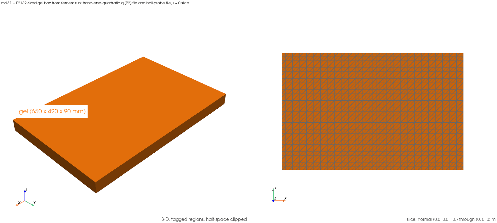

# `-e mri:31` — `femem run` on the transverse-quadratic-source and ball-probe gel-box files: P36's record and U60's five probe readings read back from the CLI's JSON summary

Guide for `examples/mri/31_femem_run_gel_box_source_and_probe_files.py`.
Written to be followed without the source open.

## 1. What this demonstrates

**Two firsts, on two separate sets of tracked files.** Both sets are `thermal_box` files under
`tests/package/wf1/`: a uniform-or-quadratic heat source in an F2182-sized gel box (650 × 420 ×
90 mm), Robin cooling on all six faces, **no EM solve, no `frequency_hz`, no `material:`**.

1. **A prescribed non-uniform heat source set in the file** (`WF-1` step 16, §9 item 528).
   `excitation.source: {kind: transverse_quadratic}` gives
   q(x) = 3 q (y² + z²) / (B² + C²) with q = 2000 W/m³ and B, C the box half-widths in y and z
   (0.21 m and 0.045 m). Its box mean is q, so the source power is Q · V = 49.14 W exactly as for
   the uniform file. `mri:20`'s heat comes from a solved EM field; `mri:29`'s files carry no
   `excitation.source`.
2. **A probe table read back from the run's JSON summary** (`WF-1` step 17, §9 item 539).
   `outputs.probes` is a list of balls (`centre`, `radius`); the run calls `Study.probe` and writes
   `probes.centres`, `probes.radii`, `probes.values_k` and `probes.volumes_m3` beside the
   `temperature` block. `mat:24` / `mat:25` build Python objects and read `Study.probe` in memory.

**No file here carries both `excitation.source` and `outputs`, and that combination is not yet
gated.** The example asserts that over all seven mappings it reads (F-none) and never writes a file
that has both.

**The quadratic-source files, line by line** (`thermal_box_quadratic_steady_m4.yaml`,
`thermal_box_quadratic_cn_m4.yaml`, `thermal_box_uniform_steady_m4_p2.yaml`):

| Key | quadratic steady | quadratic CN | uniform P2 (control) |
| --- | --- | --- | --- |
| `geometry.divisions` | [52, 32, 8] (m = 4, 79 872 cells) | same | same |
| `excitation` | `uniform_heat_source` form with `source: {kind: transverse_quadratic}`, 2000 W/m³ | same | uniform source, 2000 W/m³ |
| `thermal.degree` | 2 (116 025 P2 dofs) | 2 | 2 |
| `thermal.transient` | absent | present: 40 steps to t\* | absent |

(F-diff), asserted from the parsed mappings: quadratic steady against uniform P2 differs in exactly
`excitation.source`; quadratic steady against quadratic CN in exactly `thermal.transient`; uniform P2
against the degree-1 uniform m = 4 file in exactly `thermal.degree`.

**The probe files, line by line** (`thermal_box_steady_m4_probes.yaml`,
`thermal_box_wrong_wall_m4_probes.yaml`, `thermal_box_duty_m4_probes.yaml`):

| Key | steady | wrong wall (control) | duty |
| --- | --- | --- | --- |
| `thermal.h_w_per_m2_k` | 10.0 | **20.0** | 10.0 |
| `thermal.transient`, `thermal.duty` | absent | absent | 40 steps, period 564.3 s, 50 % |
| `outputs.probes` | the whole-box ball (radius 0.4 m, an identity probe) and five 13.5 mm balls at (0, 0, 0), (0, ±0.105, 0), (±0.1625, 0, 0) | the first five-ball centre only | the five balls |

(F-diff): the probe steady file differs from the uniform m = 4 file in exactly `outputs`; from the
wrong-wall file in `thermal.h_w_per_m2_k` and `outputs.probes`; from the duty file in
`thermal.transient`, `thermal.duty` and `outputs.probes`.

**The summary keys.** Every summary carries `femem`, `source`, `sha256`, `family` (`thermal_box`),
`ranks`, `cells`, `temperature` and `elapsed_s`. The `temperature` block carries `half_widths_m`,
`divisions`, `thermal_degree`, `q_w_per_m3`, `transient`, `duty`, `source_power_w`, `theta_max_k` and
**`source`** (`"transverse_quadratic"` or `"uniform"`, new with item 528). A steady block adds
`convected_power_w`; a transient block adds `max_balance_residual` and `source_multipliers` (a list
that holds the duty schedule: 41 entries on the duty file, **none** on the constant-source quadratic
CN file). The probe files add a `probes` block with the four keys above.

**How the example runs them.** `cli.main(["check", f])` and `cli.main(["run", f, "--output-dir", d])`
in-process, rank width 2, complex build. `cli.main` imports `run_study_file` inside the call, so a
call-through wrapper on `fem_em_solver.study_yaml.run_study_file` (restored in `finally`) captures the
returned `StudyRun`. Every record, band and helper is imported from the gate modules
`tests/package/test_wf1_yaml_thermal_box_quadratic.py` and
`tests/package/test_wf1_yaml_thermal_box_probes.py` (the ANS-1 rule); the example states no band. The
four solve legs are the gates' node bodies with only the CLI call, the output directories and the
printing precision substituted.

**Build, plainly.** The quadratic gate is a complex-build gate, and this example reproduces its
records to the digit. The probe gate ran in the **real** build; this example runs the probe files in
the complex build (the `mri:` runner has no real build). So the probe leg asserts the gate's **bands**
and only **prints** its digits beside U60's and `EX-130`'s complex `Study.probe` digits. The probe
readings here are **example records in the complex build, not a complex-build gate of the `WF-1`
step 17 route**.

**Anchors, re-asserted.** (K) `femem check` rc (0, 0) on all six files with the one `family:
thermal_box` line and the excitation class; (Pdeg) 116 025 P2 dofs on every quadratic solve; (UT) the
probe mesh equals the Python Study's; (I-Py) θ_file = θ_Python at `L0_BAND`; (R) the quadratic records
at their `.6e` strings (P36, step 3) with `INTERIOR_BAND`, `S2_GAUSS_BAND` and `E_BAND`; (R-box) the
five ball readings at `INTERIOR_BAND` and (A-box) the whole-box identity at `B_BAND`; (I=) / (U′) the
summary equals the run's own result and the JSON on disk equals the summary.

**Readings new to the examples, each read from the JSON loaded from disk on every rank.**

1. **(S-json).** `temperature.source` and `thermal_degree`: `"transverse_quadratic"` / 2 on both
   quadratic files, `"uniform"` / 2 on the P2 control, `"uniform"` with a `probes` block on the probe
   files.
2. **(P-json).** `source_power_w` / (Q · V) − 1 = 1.157e-13 on the quadratic steady file (asserted
   ≤ `L0_BAND`; the gate's Gauss run read +1.157e-13), and the same 1.157e-13 on the CN file
   (printed only).
3. **(G-json), printed only.** `convected_power_w` against `source_power_w`: 9.775e-14.
4. **(E-json).** The CN JSON's `max_balance_residual` is 2.288e-13 (asserted ≤ `E_BAND`); its
   `source_multipliers` equals the in-memory list, and both are **empty** (a constant source has no
   schedule). The 41 multipliers belong to the duty probe file, where (I-tr) asserts them equal.
5. **(R-json).** The five ball values in `probes.values_k` give the same five (R-box) ratios, to the
   printed `.4e` digits, as the in-memory run: 2.6992e-03, 2.6936e-03, 2.7066e-03, 2.6468e-03,
   2.6443e-03, equal to U60's and to `EX-130`'s complex digits (printed equality, not asserted); the
   whole-box identity from the JSON is 2.495e-13 with the volume ratio 2.509e-13.
6. **(C-json).** The JSON's `probes.centres` / `probes.radii`, by `float.hex`, equal the parse node's
   lists on the steady, wrong-wall and duty files.

**Negative controls.** (c-src′) the uniform P2 file against the quadratic series misses by 0.51471 and
(c-src) the quadratic file against the uniform series by 0.44856, both asserted > `INTERIOR_BAND`
(1e-2); a file that ignored `excitation.source`, or a summary that mislabelled it, would fail these.
(c-wall) the h-doubled probe file misses the ball value at (0, 0, 0) by 0.35712 (asserted >
`INTERIOR_BAND`, backed by U60 and `EX-130`). (c-z) the quadratic file against the no-z series, 0.047893
(4.8 × the band, printed only), and (c-src-T) the CN file against the uniform transient series, 0.69562
(printed only). (cX) `malformed_thermal_box_probe_radius_zero.yaml` refuses at
`outputs.probes[1].radius`, `run` and `check` both return 2 and its directory is absent.

**Readings of record** (flagged run, harness log `EX-135`, file
`docs/testing/logs/20261019T123750Z_EX-135.log`; an earlier run of the same script, file
`docs/testing/logs/20261019T123431Z_EX-135.log`, stopped at a printed-only line, see Deviations in the
journal). The gates' records are `docs/testing/logs/20261019T003608Z_WF-1-s16-W1a-steady.log` (Q1a),
`docs/testing/logs/20261019T003738Z_WF-1-s16-W1b-cn.log` (Q1b) and
`docs/testing/logs/20261019T033412Z_WF-1-s17-W1-probes.log` (P1, real build):

| Anchor | Reference | Reading | Bound |
| --- | --- | --- | --- |
| (K) check rc, lines | exact | (0, 0) × 6, lines True | exact |
| (cX) malformed file | exact | field `outputs.probes[1].radius`; rc (2, 2) both; no directory | exact |
| (Pdeg) dofs | 116 025 (Q1a:63) | 116 025 × 3 steady, × 2 CN | exact |
| (I-Py) steady / CN | Q1a:64 1.032e-15; Q1b:64 1.213e-14 | 0.000e+00; 1.092e-14 | 1e-9 |
| (S1-quad) | P36 7.219878e-05 | 7.219878e-05 | exact string; 1e-2 |
| (S2-quad) Gauss | P36 9.775e-14 | 9.775e-14 | 1e-9 |
| (U) uniform P2 whole; interior | step 3 2.489307e-05; 1.669359e-05 | 2.489307e-05; 1.669359e-05 | exact string |
| (T-quad) CN | P36 2.694340e-04 | 2.694340e-04 | exact string; 1e-2 |
| (E-quad) | Q1b:66 2.288e-13 | 2.288e-13 | 1e-9 |
| (c-src′), (c-src) | 5.1471e-01; 4.4856e-01 | 5.1471e-01; 4.4856e-01 | > 1e-2 |
| (UT) probe cells | 79 872 (P1:61) | 79 872 / 79 872; geometry equal | exact |
| (I-Py) probes | P1:62 1.184e-15 | 1.184e-15 | 1e-9 |
| (A-box) | P1:65 2.495e-13 / 2.509e-13 | 2.495e-13 / 2.509e-13 | 1e-10 |
| (R-box) five | U60 digits, P1:66–70 | the same five `.4e` digits | 1e-2 |
| (c-wall) | P1:71 3.5712e-01 | 3.5712e-01 | > 1e-2 |
| (I-tr) duty | P1:77 6.912e-14 | 5.849e-14; 41 multipliers equal | 1e-9 |
| (P-json) steady | Q · V | 1.157e-13 | 1e-9 |
| (E-json) | gate (E-quad) | 2.288e-13 | 1e-9 |
| (R-json), (C-json) | U60 / hex | same digits; hex equal on three files | bands / exact |

**Printed only (no band).** θ_max from the JSON: 13.7639 K (quadratic steady), 12.0040 K (uniform P2),
ratio 1.147; 2.9282 K for the CN file at t\*. File run times: 11.2 s quadratic steady (Q1a:63 11.5 s),
32.3 s CN (Q1b:63 32.5 s), 6.7 s probe steady (P1:61 6.6 s). The duty file's five probe values are 0.66604
to 0.666042 K with no comparand posed. The temperature-block-against-probe-re-solve identity reads
7.397e-15. The CSVs hold the read-back: every JSON scalar beside the in-memory value, all hex-equal.

**Not claimed:** the quadratic source with probes in one file (ungated); a duty-cycled transverse
source; any comparand on a transient or duty probe; probes at P2; scalar point values; a complex gate
of the probe-file route; the real build; the installed console script, `--ranks` or `--estimate`; EM,
a coil or a box EM SAR (the quadratic is a closed-form shape, not a solved field); perfusion; bundle
reproducibility (`mri:27`); F2182 compliance; any external check. `WF-1`, `WF-15`, `MAT-21` and §2 do
not move.

## Setup figure



`examples/mri/figures/mri_31_femem_run_gel_box_source_and_probe_files_setup.png`. Rendered right after
the quadratic steady `femem run` returns, from the run's thermal sub-mesh (`FEM_EM_SETUP_FIGURES=1`).
One region: "gel (650 x 420 x 90 mm)", all cell tags 1. The slice is normal to `z` through the origin;
the 3-D view is half-space clipped. The box has no air, no coil and no EM: the figure is geometry and
the m = 4 mesh only. The Robin facets are facet tags, which the renderer does not draw.

## 2. How to run it

```
./scripts/run_examples.sh -e mri:31 -n 2 -t 590
```

Heavy tier, `-n 2`, complex build (the `mri:` group sources it). Measured wall time ≈ 189 s (harness
elapsed; the script's own total 186.4 s: quadratic steady leg 70.3 s, CN leg 94.3 s, probe steady
leg 13.7 s, probe duty leg 7.7 s). The same calls from a shell are
`femem run tests/package/wf1/thermal_box_quadratic_steady_m4.yaml` and
`femem run tests/package/wf1/thermal_box_steady_m4_probes.yaml`; the example only wraps them to
capture the `StudyRun`. Output goes to `examples/mri/paraview_output/`, which is gitignored:

- `mri_31_femem_run_gel_box_source_and_probe_files_quadratic_steady_combined.xdmf` (with its `.h5`);
- `mri_31_femem_run_gel_box_source_and_probe_files_quadratic_cn_combined.xdmf` (with its `.h5`);
- `mri_31_femem_run_gel_box_source_and_probe_files_probes_combined.xdmf` (with its `.h5`);
- `mri_31_femem_run_gel_box_source_and_probe_files_probe_table.csv`;
- `mri_31_femem_run_gel_box_source_and_probe_files_summary_readback.csv`;
- the run bundles `mri_31_run_quadratic_steady/`, `mri_31_run_uniform_p2/`, `mri_31_run_quadratic_cn/`,
  `mri_31_run_probes_steady/`, `mri_31_run_probes_wrong_wall/`, `mri_31_run_probes_duty/` and
  `mri_31_bad/` (which must not exist).

The setup figure is rendered only with `FEM_EM_SETUP_FIGURES=1`.

## 3. How to analyze it, step by step

**Step 1 — the probe table first.** Open
`mri_31_femem_run_gel_box_source_and_probe_files_probe_table.csv`. Row 0 is the whole-box ball: its
value equals the P1 domain mean to 2.4955e-13 and its volume equals the mesh volume to the same order.
Rows 1–5 are the 13.5 mm balls: value, volume (1.0304e-05 m³, 0.9998 of the nominal sphere), the
closed-form ball mean they are compared with, the ratio (≈ 2.7e-03 each, band 1e-2), and U60's and
`EX-130`'s digits beside it, all equal. This table was read from the JSON on disk; nothing else was
needed.

**Step 2 — the files.** Open the YAML files and compare them with the tables above. There is no
`study:` mapping, no `material:` and no frequency.

**Step 3 — `femem check` first.** It reads inputs only and builds nothing. It prints `family:
thermal_box` and `excitation: TransverseQuadraticHeatSource` (quadratic files) or
`excitation: UniformHeatSource` (the P2 control and the probe files), and returns 0 on all six.

**Step 4 — the refusal (cX).** The malformed file has a probe with radius 0. The loader's error field is
`outputs.probes[1].radius`; `run` and `check` return 2; no directory is created. Whether stderr names the
field is printed, not asserted.

**Step 5 — the quadratic steady run.** θ_file equals θ_Python (the owned arrays agree bitwise here), the
interior L2 error against the quadratic series is 7.219878e-05 (P36's record), and the Gauss balance
9.775e-14. The uniform P2 file reproduces step 3's 2.489307e-05 / 1.669359e-05.

**Step 6 — read the JSON summary of the quadratic run alone.** From it: `temperature.source`
`"transverse_quadratic"`; `source_power_w` / 49.14 − 1 ≈ 1.157e-13; `convected_power_w` /
`source_power_w` − 1 ≈ 1e-13; `theta_max_k` 13.7639 K, 1.147 × the uniform file's 12.0040 K.

**Step 7 — the CN run.** 40 Crank–Nicolson steps to t\*, θ at t\* against the quadratic series
2.694340e-04, balance residual 2.288e-13 from the JSON. The `source_multipliers` list is empty.

**Step 8 — the probe runs.** Steady: five (R-box) ratios and the whole-box identity from the in-memory run
and from the JSON agree. Wrong wall: the h-doubled file misses by 0.357. Duty: an identity only (the
duty probe values equal the Python Study's at 5.8e-14, the 41 multipliers equal).

**Step 9 — ParaView.** Open the quadratic steady XDMF and colour by `q_transverse_quadratic`
(the source shape, display only), then by `theta_quadratic_minus_series`. The XDMF also holds
`theta_quadratic_file`, `theta_quadratic_series`, `theta_uniform_p2_file` and the Robin facet tags. The
CN XDMF holds `theta_quadratic_cn_tstar`, `theta_quadratic_cn_series_tstar`,
`theta_quadratic_cn_minus_series` and `theta_uniform_cn_series_tstar`. Open the probe XDMF and threshold
`probe_balls` at 0.5 to see the five 13.5 mm balls, over `theta_probe_file_steady` and
`theta_probe_wrong_wall`. All are P1 real parts (kelvin above ambient).

## Related

- `examples/mri/29_femem_run_f2182_gel_box_files.md` — the uniform-source thermal_box files through the CLI.
- `examples/materials/24_f2182_gel_box_study_api_probes.md` — the same steady box probes through the Python `Study`.
- `examples/materials/25_f2182_gel_box_duty_probe_histories.md` — the duty box probe histories through the Python `Study`.
- `tests/package/test_wf1_yaml_thermal_box_quadratic.py` — the quadratic-source gate.
- `tests/package/test_wf1_yaml_thermal_box_probes.py` — the probe-file gate.
- `docs/planning/chunks/WF-1.md` — the step 16 / step 17 briefs.
