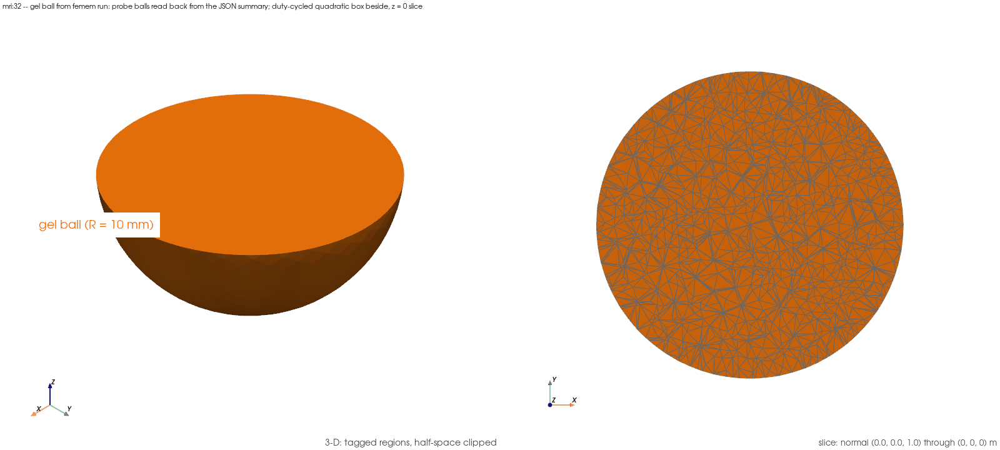

# `-e mri:32` — `femem run` on the duty-cycled transverse-quadratic gel-box file and the two ball-probe gel-ball files: P38's record and U60's three ball-probe readings read back from the CLI's JSON summary

Guide for `examples/mri/32_femem_run_ball_probes_and_duty_quadratic_files.py`.
Written to be followed without the source open.

## 1. What this demonstrates

**Two firsts, on two separate sets of tracked files**, all under `tests/package/wf1/`. No EM solve, no
`frequency_hz`, no `material:` anywhere: the heat is prescribed.

1. **A duty-cycled non-uniform source set in a file** (`WF-1` step 18, §9 item 540).
   `thermal_box_quadratic_duty_m4.yaml` is the F2182-sized gel box (650 × 420 × 90 mm, m = 4, 79 872
   cells, P2) with `excitation.source: {kind: transverse_quadratic}` and `thermal.duty`.
   q(x) = 3 q (y² + z²) / (B² + C²) with q = 2000 W/m³ and B, C the half-widths in y and z, so its box
   mean is q. The duty is a square wave: period 564.3 s, 50 %, applied over 40 Crank–Nicolson steps to
   t\*; the schedule is the 41-character string `11111000011110000111100001111000011110000`
   (`SCHEDULE`). `mri:31`'s quadratic file has no `thermal.duty`.
2. **The first `femem run` example on the ball geometry, with a probe table read back from the JSON
   summary** (`WF-1` step 19, §9 item 545). `thermal_ball_m19_probes.yaml` is MAT-19's gel ball
   (R = 10 mm, 19 489 cells, P1, CN to t\*) with `outputs.probes`; `thermal_ball_duty_a_probes.yaml` is
   the duty-cycled ball (151 548 cells) with two probes.

**The ball probe list, line by line** (`thermal_ball_m19_probes.yaml`):

| Index | Centre (m) | Radius (m) | Role |
| --- | --- | --- | --- |
| 0 | (0, 0, 0) | 0.02 | whole ball: an identity probe (value = P1 domain mean) |
| 1 | (0, 0, 0) | 0.002 | probe c0 |
| 2 | (0.0035, 0, 0) | 0.002 | probe c1 |
| 3 | (0.00375278, 0.00375278, 0.00375278) | 0.002 | probe c2 |
| 4 | (0.00317543, 0.00317543, 0.00317543) | 0.002 | displaced probe (negative control) |

The duty ball file has the whole-ball probe (radius 0.2 m) and one 0.02 m probe at the origin.

**The summary keys each family writes.** Every summary carries `femem`, `source`, `sha256`, `family`,
`ranks`, `cells`, `temperature` and `elapsed_s`. The box `temperature` block carries a **`source`** key
(`"transverse_quadratic"` here), `duty`, `source_multipliers`, `source_power_w`, `max_balance_residual`
and `theta_max_k`. **`source_power_w` is the full-on power** (Q · V = 49.14 W), not the duty mean. The
ball `temperature` block has `dt_s`, `n_steps`, `duty`, `wall`, `source_multipliers`, `source_power_w`,
`max_balance_residual` and `theta_max_k`, and **no `source` key**; a ball file with probes adds a
`probes` block with `centres`, `radii`, `values_k` and `volumes_m3`.
`source_multipliers` is empty on an unscheduled run (the m19 ball) and holds the schedule on a duty run
(41 entries on the quadratic box, 95 on the duty ball).

**No file here carries both a source and probes, and that combination is not yet gated.** Nor does any
ball file carry a wall (a walled ball with probes is refused). The example asserts both (F-none) over the
six mappings it reads and never writes a file.

**The ball-probe leg is an example record in the complex build, not a complex gate of `WF-1` step 19.**
The quadratic-duty gate is a complex-build gate and this example reproduces its records to the digit. The
ball-probe gate ran in the real build; the `mri:` runner has only the complex one, so the ball legs assert
the gate's **bands** and **print** its `.4e` digits beside U60's (the item 546 / `EX-135` pattern).

**How the example runs them.** `cli.main(["check", f])` and `cli.main(["run", f, "--output-dir", d])`
in-process, rank width 2. `cli.main` imports `run_study_file` inside the call, so a call-through wrapper on
`fem_em_solver.study_yaml.run_study_file` (restored in `finally`) captures the returned `StudyRun`. Every
record, band and helper is imported from the gate modules
`tests/package/test_wf1_yaml_thermal_box_quadratic_duty.py` and
`tests/package/test_wf1_yaml_thermal_ball_probes.py` (the ANS-1 rule); the example states no band. The
three solve legs are the gates' node bodies with only the CLI call, the output directories and the
printing precision substituted.

**Anchors, re-asserted.** (K) `femem check` rc (0, 0) on the three files, with one `family:` line and the
excitation class; (F-diff) the quadratic duty file differs from the quadratic CN file in exactly
`thermal.duty`, the duty-probe file from the plain duty ball file in exactly `outputs`, the m19 file from
the malformed file in exactly `outputs.probes`; (Pdeg) 116 025 P2 dofs; (UT) 79 872 / 79 872 and
19 489 / 19 489 cells, geometry equal; (S0) the schedule; (I-Py) θ_file = θ_Python at `L0_BAND`; (R) the
duty-quadratic interior error at its `.6e` string and `INTERIOR_BAND`, the balance at `E_BAND`;
(A-ball) the whole-ball identity at `B_BAND`; (T\*-ball) the three ball readings at `P_BAND`; (U′) / (I=)
the summary is the run's own result and the JSON on disk equals it.

**Readings new to the examples, each read from the JSON loaded from disk on every rank.**

1. **(S-json), (Sch-json), (P-json), (E-json)** on the quadratic duty file: source
   `"transverse_quadratic"`, degree 2, the duty hex-equal to {2 · HALF_T, DUTY}; the 41 multipliers
   rebuild `SCHEDULE`; `source_power_w` / (Q · V) − 1 = 1.157e-13 (asserted ≤ `L0_BAND`); the balance
   residual 2.289e-13 (asserted ≤ `E_BAND`).
2. **(R-json)** on the m19 ball: the three ball values in `probes.values_k` give (T\*-ball) 9.7501e-04,
   5.0491e-04, 9.4257e-04 (asserted ≤ `P_BAND` = 1e-2), the same `.4e` digits as U60's (a printed
   equality, not asserted). The whole-ball identity from the JSON is 6.014e-16 with the volume ratio
   1.332e-15. **The ball probe table read from disk alone reproduces U60.**
3. **(C-json)** The JSON's `probes.centres` / `probes.radii`, by `float.hex`, equal the parse node's lists
   on the m19 and duty ball files.
4. **(M-json)** The duty ball's 95 `source_multipliers` equal the in-memory list; the m19 JSON equals
   memory too (length 0, printed).

**Negative controls.** (c-step) the duty file against the unscheduled transient series misses by
5.0333e-01 (asserted > `INTERIOR_BAND`; P38 5.0333e-01); a file that ignored `thermal.duty` would fail
it. (c-disp) the displaced probe against c2's comparand misses by 5.4208e-02, equal to U60's, asserted
> `P_BAND` both in memory and from the JSON on disk (the comparand separation is 5.4663e-02). (cX)
`malformed_thermal_ball_probe_radius_zero.yaml` refuses at `outputs.probes[1].radius`; `run` and `check`
both return 2 and the directory is absent. (cX-duty) the duty file without `thermal.transient` raises at
`thermal.duty`.

**Readings of record** (flagged run, harness log `docs/testing/logs/20261019T171706Z_EX-136.log`). The
gates' records are `docs/testing/logs/20261019T094516Z_WF-1-s18-W1-qduty.log` (D18, complex) and
`docs/testing/logs/20261019T110412Z_WF-1-s19-W1-ball-probes.log` (B19, real build):

| Anchor | Reference | Reading | Bound |
| --- | --- | --- | --- |
| (K) check rc, lines | exact | (0, 0) × 3, lines True | exact |
| (F-diff), (F-none) | by construction | as stated, no file with both, no walled ball | exact |
| (cX), (cX-duty) | exact | `outputs.probes[1].radius`, rc (2, 2) both, no directory; `thermal.duty` | exact |
| (Pdeg) dofs | 116 025 (D18:63) | 116 025 / 116 025 | exact |
| (UT) cells | 79 872 (D18:64); 19 489 (B19:80) | 79 872 / 79 872; 19 489 / 19 489; geometry equal | exact |
| (S0) schedule | `SCHEDULE` | equal; multipliers equal Python | exact |
| (I-Py) quadratic duty | D18:66 2.221e-14 | 2.221e-14 | 1e-9 |
| (T-qduty) | P38 2.543310e-04 | 2.543310e-04 (380 725 P3 points) | exact string; 1e-2 |
| (E-qduty) | D18:68 2.288e-13 | 2.289e-13 | 1e-9 |
| (c-step) | D18:69 5.0333e-01 | 5.0333e-01 | > 1e-2 |
| (I-Py) m19 | B19:81 2.973e-13 | 2.379e-13 (block vs re-solve 3.568e-13) | 1e-9 |
| (A-ball) | B19:84 4.511e-16 / 1.332e-15 | 6.014e-16 / 1.332e-15 | 1e-10 |
| (T\*-ball) c0, c1, c2 | U60 9.7501e-04 / 5.0491e-04 / 9.4257e-04 | the same three `.4e` digits | 1e-2 |
| (c-disp) | B19:88 5.4208e-02 | 5.4208e-02 | > 1e-2 |
| (I-du) duty ball | B19:93 8.146e-15; 151 548 cells; 95 multipliers | 9.309e-15; 151 548 / 151 548; 95 equal | 1e-9 |
| (I-du) whole ball | B19:94 8.476e-15 / 6.994e-15 | 8.476e-15 / 6.994e-15 | 1e-10 |
| (P-json) | Q · V | 1.157e-13 | 1e-9 |
| (E-json) | gate (E-qduty) | 2.289e-13 | 1e-9 |
| (R-json), (C-json), (M-json) | U60 / hex / memory | same digits; hex equal; multipliers equal | bands / exact |

**Printed only (no band).** The quadratic duty θ_max at t\* is 1.4399 K, 0.4917 × the unscheduled CN
file's 2.9282 K (`mri:31`; predicted 0.4917, in range). The duty ball's two probe values are 2.3577 K and
3.02836 K with no comparand posed, and its balance residual is 2.632e-14. File run times: quadratic duty
32.1 s (D18:63 33.9 s), m19 3.9 s (B19:80 4.1 s). Leg times: 114.3 s, 9.1 s and 64.0 s. The CSVs hold the
read-back: every JSON scalar beside the in-memory value, all hex-equal.

**Not claimed:** a source with probes in one file (ungated); a walled ball with probes (refused); any
comparand on the duty-ball probes; probes at P2; scalar point values; a complex gate of the ball-probe
file route; the real build; the installed console script, `--ranks` or `--estimate`; EM, a coil or SAR
(the quadratic is a closed-form shape, not a solved field); perfusion; bundle reproducibility
(`mri:27`); F2182 compliance; any external check. `WF-1`, `WF-15`, `MAT-19`, `MAT-21` and §2 do not move.

## Setup figure



`examples/mri/figures/mri_32_femem_run_ball_probes_and_duty_quadratic_files_setup.png`. Rendered right
after the m19 ball `femem run` returns, from the probe mesh (`FEM_EM_SETUP_FIGURES=1`). One region: "gel
ball (R = 10 mm)", all cell tags 1. The slice is normal to `z` through the origin; the 3-D view is
half-space clipped. The ball has no air, no coil and no EM. The duty-cycled quadratic box is not drawn.

## 2. How to run it

```
./scripts/run_examples.sh -e mri:32 -n 2 -t 590
```

Heavy tier, `-n 2`, complex build (the `mri:` group sources it). Measured wall time ≈ 190 s (harness
elapsed; the script's own total 187.6 s: quadratic duty leg 114.3 s, m19 ball leg 9.1 s, duty ball leg
64.0 s). The same calls from a shell are
`femem run tests/package/wf1/thermal_box_quadratic_duty_m4.yaml` and
`femem run tests/package/wf1/thermal_ball_m19_probes.yaml`; the example only wraps them to capture the
`StudyRun`. Output goes to `examples/mri/paraview_output/`, which is gitignored:

- `mri_32_femem_run_ball_probes_and_duty_quadratic_files_quadratic_duty_combined.xdmf` (with its `.h5`);
- `mri_32_femem_run_ball_probes_and_duty_quadratic_files_ball_m19_combined.xdmf` (with its `.h5`);
- `mri_32_femem_run_ball_probes_and_duty_quadratic_files_ball_duty_combined.xdmf` (with its `.h5`);
- `mri_32_femem_run_ball_probes_and_duty_quadratic_files_probe_table.csv`;
- `mri_32_femem_run_ball_probes_and_duty_quadratic_files_summary_readback.csv`;
- the run bundles `mri_32_run_quadratic_duty/`, `mri_32_run_ball_m19/`, `mri_32_run_ball_duty/` and
  `mri_32_bad/` (which must not exist).

The setup figure is rendered only with `FEM_EM_SETUP_FIGURES=1`.

## 3. How to analyze it, step by step

**Step 1 — the probe table first.** Open
`mri_32_femem_run_ball_probes_and_duty_quadratic_files_probe_table.csv`. Row 0 of `ball_m19` is the
whole-ball probe: its value 0.0461482 K equals the P1 domain mean (ratio 6.0144e-16) and its volume
4.17365e-06 m³ equals the mesh volume. Rows 1–3 are the 2 mm balls: value, volume (3.353e-08 m³), the
closed-form ball mean they are compared with, the ratio (9.7501e-04, 5.0491e-04, 9.4257e-04 against the
band 1e-2) and U60's digit beside it, all equal. Row 4 is the displaced probe: against c2's comparand it
misses by 5.4208e-02, five times the band. The `ball_duty` rows carry no comparand. This table was read
from the JSON on disk; nothing else was needed.

**Step 2 — the files.** Open the YAML files and compare them with the tables above. There is no `study:`
mapping, no `material:` and no frequency.

**Step 3 — `femem check` first.** It reads inputs only and builds nothing. It prints `family:
thermal_box` and `excitation: TransverseQuadraticHeatSource` for the duty box and `family: thermal_ball`
and `excitation: UniformHeatSource` for the two ball files, and returns 0 on all three.

**Step 4 — the refusals.** The malformed ball file has a probe with radius 0: loader field
`outputs.probes[1].radius`, `run` and `check` return 2, no directory. The duty box file without
`thermal.transient` raises at `thermal.duty`.

**Step 5 — the quadratic duty run.** θ_file equals θ_Python to 2.221e-14, the interior L2 error against
the duty-cycled quadratic series is 2.543310e-04 (P38's record), the balance residual 2.289e-13 and
(c-step) 5.0333e-01.

**Step 6 — read the JSON summary of the duty run alone.** `temperature.source`
`"transverse_quadratic"`; `source_power_w` / 49.14 − 1 ≈ 1.157e-13 (the full-on power); 41
`source_multipliers` rebuilding the schedule; `theta_max_k` 1.4399 K.

**Step 7 — the ball runs.** m19: five probe values from memory and from the JSON agree, (T\*-ball) at U60's
digits. Duty ball: an identity only (θ_file = θ_Python at 9.3e-15, 95 multipliers equal).

**Step 8 — ParaView.** Open the quadratic-duty XDMF and colour by `theta_quadratic_duty_minus_series`,
then by `theta_unscheduled_series_tstar`; it also holds `theta_quadratic_duty_tstar`,
`theta_quadratic_duty_series_tstar`, `q_transverse_quadratic` (display only) and the Robin facet tags.
Open the m19 XDMF and threshold `probe_balls` at 0.5 to see the four 2 mm balls, over
`theta_ball_probe_file` and `theta_ball_python`. The duty ball XDMF holds `theta_ball_duty_file_tend`. All
are P1 real parts (kelvin above ambient).

## Related

- `examples/mri/31_femem_run_gel_box_source_and_probe_files.md` — the quadratic source (unscheduled) and the box probes through the CLI.
- `examples/mri/29_femem_run_f2182_gel_box_files.md` — the uniform-source thermal_box files through the CLI.
- `examples/mri/25_study_transient_duty_and_wall.md` — the duty-cycled ball through the Python `Study`.
- `examples/materials/13_virtual_probe_in_gel_ball.md` — MAT-19's ball probes without a file.
- `tests/package/test_wf1_yaml_thermal_box_quadratic_duty.py` — the duty-quadratic gate.
- `tests/package/test_wf1_yaml_thermal_ball_probes.py` — the ball-probe gate.
- `docs/planning/chunks/WF-1.md` — the step 18 / step 19 briefs.
