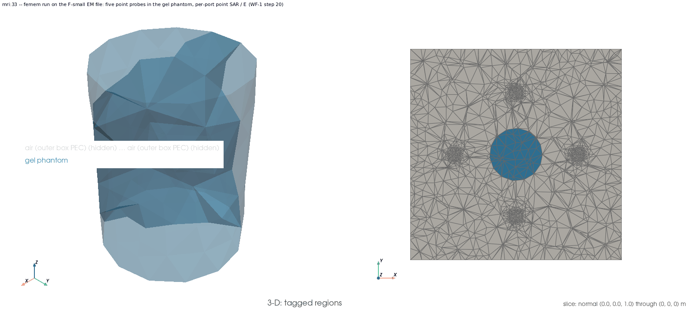

# `-e mri:33` — `femem run` on the four-port F-small EM file with point probes: per-port point SAR and |E| read back from the JSON summary, file = Python Study, a 1 mm displaced probe misses

Guide for `examples/mri/33_femem_run_em_file_point_probes.py`.
Written to be followed without the source open.

## 1. What this demonstrates

**The first example whose output is a point SAR / |E| table written by `femem run` from an EM study file.**
`WF-1` step 20 (§9 item 564) let `outputs.probes: {points: [...]}` ride on a `four_port_birdcage` file.
Every earlier probe example (`mri:29` … `mri:32`) is a thermal ball or box average; none ran point probes
on an EM file. The run input is the tracked `tests/package/wf1/f_small_em_probes.yaml`, which the example
reads and never writes: item 192's four-port F-small fixture (PEC, degree 1, 64 MHz, exact-rectangle
ports, κ off, 117 206 cells) at `-n 2`, complex build.

**The probe block, line by line** (`outputs.probes.points`):

| Index | Point (x, y, z) in m | Role |
| --- | --- | --- |
| 0 | (0.02, 0, 0) | near the P1 side |
| 1 | (0, 0.02, 0) | near the P2 side |
| 2 | (−0.02, 0, 0.01) | near the P3 side, 10 mm up |
| 3 | (0, −0.02, −0.01) | near the P4 side, 10 mm down |
| 4 | (0.014, 0.014, 0.02) | off-axis, 20 mm up |

Each is an `[x, y, z]` triple in metres. A point outside the phantom is refused naming its index before any
mesh is built (`[0.0, 0.0, 0.05]` as the second point gives `outputs.probes.points[1]`; `[0.031, 0, 0]`
gives `outputs.probes.points[0]`); σ and ρ in the table are the phantom's (0.5 S/m, 1000 kg/m³).

**What the JSON summary carries.** `probes.points` (the five triples), `probes.owner` (`lowest_original_cell`),
`probes.sigma_s_per_m`, `probes.rho_kg_m3`, and `probes.values.P1` … `P4`, each with `sar_w_per_kg` and
`e_abs_v_per_m`, five numbers each. The owner rule (`POST-8`) makes a point on a cell facet read the same
at any rank width. **The values are per 1 V single-port drive**, one drive per port — not a quadrature drive
and not a superposition: the table has no phases, so a combined-drive SAR cannot be rebuilt from it.

**How the example runs it.** `cli.main(["check", f])` and `cli.main(["run", f, "--output-dir", d])`
in-process at `-n 2`. `cli.main` imports `run_study_file` inside the call, so a call-through wrapper on
`fem_em_solver.study_yaml.run_study_file` (restored in `finally`, `is original` asserted) captures the
returned `StudyRun`, whose `run.study.fields_result` is the kept per-port fields. Every record, band and
helper is imported from the gate module `tests/package/test_wf1_yaml_em_probes.py` (the ANS-1 rule); the
example states no band. The solve body is the gate's `test_wf1_s20_em_probes_n2` with only the CLI call,
the output directory and the printing changed, and it does **not** write the gate's `.npz`.

**Anchors, re-asserted.** (B) complex build, `-n 2`; (K) the file's Study equals `f_small_four_port.yaml`'s
(spec diff `[]`), the five points hex-equal, `femem check` rc (0, 0); (X-out) the two refusals above;
(R) 117 206 cells and ‖S − P1‖/‖P1‖ ≈ 9.56e-11 ≤ `LEG_D0_REPRODUCTION_BAND`; (U′) the summary is `point_sar` on
the run's own fields (same five-point batch, `array_equal`), bitwise across ranks, JSON == memory, and
|E|² σ/(2ρ) equals SAR to ≈ 2e-16; (J-disk) the example's own claim: **the probe table read from disk
alone carries the gated values**; (I-Py) the same table from an independent Python `Study` agrees to
`L0_BAND` (measured 1.232e-12 on the closing window, `docs/testing/logs/20261104T032240Z_EX-138.log`; the gate read
0.000e+00). **The twin is on the public field route:** it is `twin.solve_sweep((f,), comm, fields_at=f)` with `f`
read from the `Study` itself (`WF-16` step 18's `fields_at`, U115), and the fields are read from `sweep.results[0]`;
the example no longer calls the `Study` class's private port-field method (`WF-17` step 29). The file route (`femem run`)
keeps its internal call; that is the package's.

**Negative control (asserted).** (c-disp): point 0 moved 1 mm radially, (0.021, 0, 0), read through
`point_sar` on the same fields, differs from the table's point-0 SAR by 5.6e-02 to 2.1e-01 per port — a
table that ignored its coordinates would miss by zero.

**Printed only.** The 40 per-port values at `.6e` beside the gate strings (all 40 equal); the largest-SAR
point per port (P1 → 0, P2 → 1, P3 → 2, P4 → 3, each port's own near point); owner=None equals the owner
rule on all four ports. **No C4 or symmetry claim:** the points sit at different z, so the four near-point
SARs need not agree.

**ParaView recipe.** Open `examples/mri/paraview_output/mri_33_femem_run_em_file_point_probes_combined.xdmf`,
colour by `E_abs_P1`, threshold `probe_sites` > 0 (k + 1 on cells within 2 mm of probe k; 6 for the
displaced point), then colour by `local_sar_P1`. These display fields are P1 / DG0 interpolations and are
never compared with the table.

## Setup figure



`examples/mri/figures/mri_33_femem_run_em_file_point_probes_setup.png`. Rendered after the run's fields
exist, from the run mesh and cell tags (`FEM_EM_SETUP_FIGURES=1`). Regions: "gel phantom" (translucent)
and "air (outer box PEC)" (hidden). The slice is normal to `z` through the origin. The coil appears as
mesh refinement around the legs; the port sheets are facet tags the renderer does not draw. Geometry only.

## 2. How to run it

```
./scripts/run_examples.sh -e mri:33 -n 2 -t 300
```

**Complex build required** — the `mri:` group sources it automatically. `femem run
tests/package/wf1/f_small_em_probes.yaml` is the same call from a shell. Tier: standard by prediction,
heavy by ceiling (`-n 2`, container `timeout -k 30 300`). Measured on the closing window
(`docs/testing/logs/20261104T032240Z_EX-138.log`): femem run 71.3 s, Python twin 37.0 s (the sweep route;
the earlier run of record, on the private call, read 34.7 s), 114 s harness wall; summed peak RSS 2.16 GiB.

Outputs: `examples/mri/paraview_output/mri_33_femem_run_em_file_point_probes_combined.xdmf`,
`examples/mri/paraview_output/mri_33_femem_run_em_file_point_probes_probe_table.csv`, the run bundle
directory `examples/mri/paraview_output/mri_33_run_em_probes/` and the setup figure above.

## 3. How to analyze it, step by step

1. **Read the probe table CSV first**, `mri_33_femem_run_em_file_point_probes_probe_table.csv`: one row per
   port and point with the SAR and |E| read from disk (`.6g`), the Python twin's SAR, the relative
   difference (≈ 1e-13 and below) and whether the digits equal the gate's; then four displaced-point rows
   with the miss.
2. **Check the (K) / (X-out) lines** at the top of the log: spec diff `[]`, points hex-equal, `check` rc
   (0, 0); the two refusals name `outputs.probes.points[1]` and `outputs.probes.points[0]`.
3. **Check (R)**: 117 206 cells and S tied to item 192's record at ≈ 9.56e-11 (gate 9.558e-11).
4. **Read the 40 values** and the `[REC digits]` line (40 / 40 equal), then the largest-SAR point per port.
5. **Check (U′), (J-disk), (I-Py)**: exact equality with `point_sar` on the run's fields, the on-disk table
   equal to memory, and the Python twin within `L0_BAND`.
6. **Check (c-disp)**: the 1 mm displaced point misses by 5.6e-02 at the smallest, 5.6e7 times `L0_BAND`.
7. In ParaView, follow the recipe in section 1.

## Related

- `examples/mri/14_study_sar_and_b1.md` — 10 g SAR and |B₁⁺| through `Study` methods on this fixture, no file.
- `examples/mri/27_femem_run_bundle_reproducible.md` — two `femem run`s of the four-port file, no probes.
- `examples/mri/32_femem_run_ball_probes_and_duty_quadratic_files.md` — the thermal ball-average probes.
- `tests/package/test_wf1_yaml_em_probes.py` — the gate module.
- `tests/package/wf1/f_small_em_probes.yaml` — the run input.
- `docs/planning/chunks/WF-1.md` — step 20.
