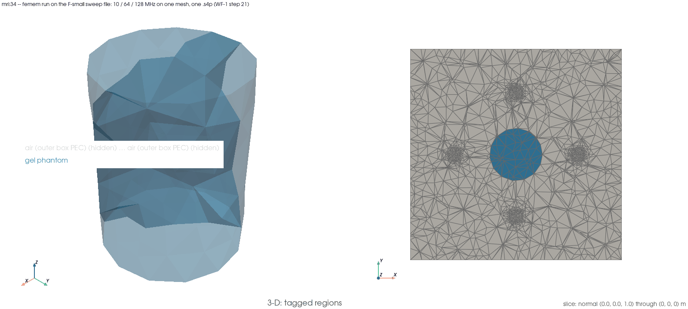

# `-e mri:34` — `femem run` on the four-port F-small sweep file: one multi-frequency `.s4p` and the JSON summary read back from disk, each frequency tied to its `P1` record, file = Python sweep, the 10 ↔ 128 MHz swap misses

Guide for `examples/mri/34_femem_run_sweep_file_touchstone.py`.
Written to be followed without the source open.

## 1. What this demonstrates

**The first example whose input is one YAML file listing several frequencies and whose output is one
multi-frequency Touchstone plus a JSON summary, both written by `femem run`.** `WF-1` step 21 (§9 item 572)
let `study.sweep_hz` ride on a `four_port_birdcage` file. Every earlier `femem run` example (`mri:21`, `26`,
`27`, `29`, `31`, `32`, `33`) writes one single-frequency S or a thermal result. `mri:11` is the Python-side
twin: it builds the Study in code and reads its `.s4p` in memory; here the input is a text file and the
output is the bundle on disk.

**The file, line by line** (`tests/package/wf1/f_small_sweep.yaml`, read and never written):

- `study.frequency_hz: 64000000.0` — still required; it is **not** a sweep point by rule.
- `study.degree: 1` — PEC proxy, κ off, exact-rectangle ports, 117 206 cells.
- `study.sweep_hz: [10000000.0, 64000000.0, 128000000.0]` — decimal literals with a dot. YAML 1.1 reads `1e7`
  as a string, which is the `"10 MHz"`-style refusal's case (`study.sweep_hz[0]`). The list must be non-empty,
  positive and strictly increasing.
- `geometry.kind: four_port_birdcage`, `preset: f_small`; `material` sigma 0.5 S/m, epsilon_r 78;
  `excitation.kind: lumped_port_drive`.

**One mesh, three solves.** The CLI meshes once and solves each frequency with the material constant across
the sweep (`dataclasses.replace(…, frequency_hz=f)`, `study.py:999`). The three `PortStudyResult`s share
one mesh object, which the example asserts. The gel is constant-property: no frequency dispersion is claimed.

**What is written.** `f_small_sweep.s4p` (Touchstone 1.0, RI format, one block per frequency) and the JSON
summary with `sweep_hz`, `cells`, `s_matrices`, `z_matrices`, `touchstone`, `mesh_time_s` and `sweep_times_s`
(plus `femem`, `source`, `sha256` of the YAML, `family`, `degree`, `frequency_hz`, `ranks`, `elapsed_s`).
Timings are each rank's own clock and only rank 0's reach the disk, so JSON == memory is asserted with the
timing keys excluded off rank 0 (full equality on rank 0).

**What is refused, and why** (by field, before any mesh): a decreasing list (`study.sweep_hz`), an entry that
is a string (`study.sweep_hz[0]`), a copper file (`study.sweep_hz`; `solve_sweep` has no conductor route),
and a sweep beside `outputs.probes` (`study.sweep_hz`). Hole and capacitor files, sphere and F-human files, SAR
/ B₁⁺ / `tune` are refused the same way at the gate. `--backend palace` with a sweep is refused naming
`--backend` and writes nothing, on every rank.

**`femem check` lists the sweep** (since `WF-1` step 23, §10 U75, 2026-10-22; corrected on this page after
the example's window, which did not re-run). On a sweep file it prints `sweep_hz: [10000000.0, 64000000.0,
128000000.0]` on the line after `frequency_hz` (64000000.0); every other file's `check` lines are unchanged.
When this example ran, `check` printed no `sweep_hz` line; the `(K)` line below is the parse's print, not
`check`'s, and the example asserts only `check`'s rc. `Study.solve_sweep` on a Python Study with a conductor
is now refused too, with the YAML's reason (`conductor: …`).

**How the example runs it.** `cli.main(["check", f])` and `cli.main(["run", f, "--output-dir", d])` in-process
at `-n 2`, complex build, with a call-through wrapper on `fem_em_solver.study_yaml.run_study_file` (restored in
`finally`, `is original` asserted, exactly one capture). The gate drove `run_study_file` directly; this is the
first `cli.main(["run", …])` on a sweep file. Every record, band and helper is imported from
`tests/package/test_wf1_yaml_sweep.py` through `t` (the ANS-1 rule); the example states no band and reads
nothing under the gate's `logs/wf1/s21/` directory.

**Anchors, re-asserted.** (B) complex, `-n 2`; (K) spec diff `[]` against the plain four-port file, sweep
hex-equal, `check` rc (0, 0); (X-sweep) the four refusals and the Palace refusal; (R′) 117 206 cells and
‖S − P1‖/‖P1‖ per frequency 6.60e-11 / 9.56e-11 / 9.45e-11 (all three equal the gate's digits) ≤
`LEG_D0_REPRODUCTION_BAND`; (T′) `f_small_sweep.s4p` has three points, |Δf| = 0, max|ΔS| 5.5e-14 / 6.9e-14 /
5.0e-14 ≤ `ANCHOR_TOL`; (G′) reciprocity ≤ 2.5e-15 and σ_max 0.999994 / 0.999760 / 0.999136 ≤ 1 +
`PASSIVITY_SIGMA_TOLERANCE`; (U′) no differing keys, JSON == memory, summary S == sweep S exactly,
`study.result is None`; (I-Py) an independent Python `solve_sweep` agrees to 6.3e-15 / 0 / 0 ≤ `L0_BAND`
(the gate read 9.0e-15 / 9.1e-16 / 0).

**The example's own claim (D-disk).** After a barrier, on every rank, the two files on disk alone carry the
gated per-frequency records: the JSON's `sweep_hz` is hex-equal, `cells` equals the record, `touchstone`
names `f_small_sweep.s4p`, and its S blocks equal the in-memory blocks; and the **`.s4p` alone** ties to the
`P1` record per frequency at 6.60e-11 / 9.56e-11 / 9.45e-11 (≤ `LEG_D0_REPRODUCTION_BAND`; `EX-95` read
≤ 9.556e-11 on a Python-written file).

**Negative control (asserted).** (c-swap): the file's 10 MHz block against the 128 MHz record reads 1.2367 and
its 128 MHz block against the 10 MHz record 1.2763 — both equal the hand table and the gate, and about 1.2e9
times the bar. A file whose frequency labels did not reach the solve, or whose blocks were written out of
order, fails it.

**Printed only.** The run and twin seconds beside the gate's (run 52.7 s vs 50.3 s; mesh 27.0 s vs 25.3 s;
sweeps 8.78 / 8.12 / 8.05 s); the YAML digest in the summary equals the SHA-256 of the file bytes; per
frequency |S11| and |S21| from the `.s4p`: 10 MHz −7.7314 / −6.4915 dB, 64 MHz −4.5817 / −7.4734 dB,
128 MHz −2.4430 / −9.0576 dB. **No resonance or tuning reading is made of these.**

**ParaView recipe.** Open
`examples/mri/paraview_output/mri_34_femem_run_sweep_file_touchstone_combined.xdmf`, colour by `CellTags`,
then by `sigma_s_per_m` (display only), then show the facet block for the four exact-rectangle port sheets.
There is no field map: `solve_sweep` keeps no fields; the |E| at 64 MHz on this fixture is the XDMF of
`mri:11`. The S table is read in any Touchstone reader (`scikit-rf`, as in `mri:11`).

## Setup figure



`examples/mri/figures/mri_34_femem_run_sweep_file_touchstone_setup.png`. Rendered from the sweep's own mesh
and cell tags (`FEM_EM_SETUP_FIGURES=1`). Regions: "gel phantom" (translucent) and "air (outer box PEC)"
(hidden). The slice is normal to `z` through the origin; the coil appears as mesh refinement around the
legs, and the port sheets are facet tags the renderer does not draw. Geometry only.

## 2. How to run it

```
./scripts/run_examples.sh -e mri:34 -n 2 -t 300
```

**Complex build required** — the `mri:` group sources it automatically. `femem run
tests/package/wf1/f_small_sweep.yaml` is the same call from a shell. Tier: standard by prediction, heavy by
ceiling (`-n 2`, container `timeout -k 30 300`). Measured: the run of record was 106.5 s in the script
(femem run 52.7 s, Python twin 50.5 s) and 109 s harness wall; summed peak RSS 1.84 GiB.

Outputs: `examples/mri/paraview_output/mri_34_femem_run_sweep_file_touchstone_combined.xdmf`,
`examples/mri/paraview_output/mri_34_femem_run_sweep_file_touchstone_s_table.csv`, the run bundle directory
`examples/mri/paraview_output/mri_34_run_sweep/` (the JSON summary and `f_small_sweep.s4p`) and the setup
figure above.

## 3. How to analyze it, step by step

1. **Read the S table CSV first**, `mri_34_femem_run_sweep_file_touchstone_s_table.csv`: one row per
   frequency and (i, j) with Re, Im (`.6g`) and |S| in dB from the `.s4p`, the block's relative difference
   against `P1` (≈ 1e-10) and against the Python twin (≈ 1e-14 and below); then two rows for the swapped
   blocks and their miss (1.2367 and 1.2763).
2. **Check the (K) / (X-sweep) lines** at the top of the log: spec diff `[]`, sweep hex-equal, `check` rc
   (0, 0); the four refusals name `study.sweep_hz` (three times) and `study.sweep_hz[0]`; the Palace line
   names `--backend` with nothing written.
3. **Check (R′) and (T′)**: 117 206 cells, S tied per frequency, one mesh, three points in the file.
4. **Check (G′) and (U′)**: reciprocity and passivity per frequency, JSON == memory, no scalar solve.
5. **Check (D-disk) and (I-Py)**: the `.s4p` alone against `P1`, and the Python twin within `L0_BAND`.
6. **Check (c-swap)**: the swapped blocks miss by 1.2 or more.
7. In ParaView, follow the recipe in section 1.

## Related

- `examples/mri/11_study_frequency_sweep.md` — the Python-side `solve_sweep` twin, `.s4p` read through `scikit-rf`.
- `examples/mri/27_femem_run_bundle_reproducible.md` — two `femem run`s of the four-port file at one frequency.
- `examples/mri/33_femem_run_em_file_point_probes.md` — the same `cli.main` call-through on an EM probe file.
- `tests/package/test_wf1_yaml_sweep.py` — the gate module.
- `tests/package/wf1/f_small_sweep.yaml` — the run input.
- `docs/planning/chunks/WF-1.md` — step 21.
