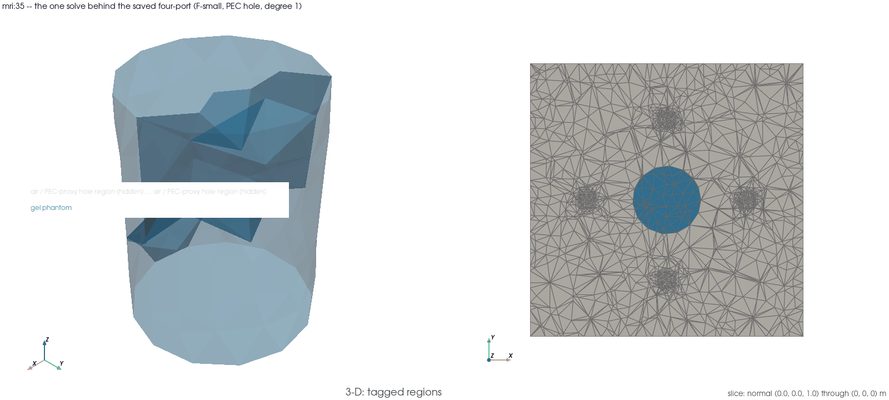

# `-e mri:35` — tune a saved four-port with no field solve: `Study.load_result` and `femem run` on a Touchstone file, and a swapped file that misses

Guide for `examples/mri/35_tune_a_saved_result.py`.
Written to be followed without the source open.

## 1. What this demonstrates

**The first example whose tuned capacitance comes from a file rather than a field solve.** `WF-16` step 14
(U94) let a `Study` read a single-frequency four-port Touchstone back into `Study.result`, and `WF-1` step 24
(U99) put the same read behind a `load_result:` key in a `femem run` file. Before this example, `mri:27` and
`mri:34` called `load_touchstone` only to compare matrices; none loaded a saved result into a `Study`.

**What a Touchstone file holds, and what it cannot.** The `.s4p` holds one frequency and a 4×4 complex S at
the port reference impedance. It holds no mesh, no field and no material: `Study.load_result` returns a
`LoadedPortResult` (S, frequency, port ids, source path) and nothing else. So `sar`, `b1_plus`, `b1_plus_at`,
`temperature` and `mean_sar` refuse it with a `TypeError` naming `load_result`; only `tune` reads it. The
file's frequency must match the Study's `frequency_hz` to a relative 1e-12.

**Why `tune` needs only S.** On a C4-symmetric four-port ring the S (hence Z) matrix is circulant, so the ring
reduction diagonalises it by the 4-point DFT. The mode-`k` eigenvalue `z_k` is a scalar, and `C_mode` follows
from `z_k + 1/(jωC) = 0` for the imaginary part. No field enters. The four `z_k` of this run are printed
(`z_1` ≈ 0.025 + 37.5j Ω). The off-diagonal residual (3.8e-5) says how far the matrix is from circulant.

**The routes.**

1. One solve: the degree-1 PEC-hole F-small Study of `WF-16` step 6(b) (exact-rectangle ports, 64 MHz,
   `-n 2`, κ off), then `write_touchstone` to `examples/mri/paraview_output/mri_35_run/f_small_saved.s4p`.
2. **API**: a fresh Study, `load_result(path)`, `tune(k=1)`.
3. **YAML**: `tests/package/wf1/f_small_hole_pec_tune.yaml` plus `load_result: f_small_saved.s4p`, through
   `run_study_file`. The path resolves against the YAML's directory (a relative name beside the file).
4. **The swapped copy**: the same S with ports P1 and P2 exchanged (`_swap12`), written to
   `f_small_swap12.s4p`, through both routes.

**Why the swapped file misses.** The exchange permutes rows and columns, so the matrix is no longer
circulant in the port order the ring reduction assumes: the DFT mixes the wrong entries and `C_mode` moves
by about 20 %. A file whose port order was wrong would give a confident, wrong capacitance with no error
raised; this is the control that shows the instrument can see it.

**F-human is a separate step.** The 32-port F-human load is `WF-1`'s later item (item 680); nothing here
claims it, nor F-clinical.

**Anchors, asserted.** Every band and record is imported by name (`ITEM429_C_MODE_F` and `_study` from
`tests.package.test_wf16_study_tune_capacitors`, `_swap12` and `_write` from
`tests.package.test_wf16_study_load_result`, `LEG_D0_REPRODUCTION_BAND` from
`tests.validation.test_port_birdcage_four_port`); the example states no band.

- **(CM)** both routes' `C_mode` = 6.626796421e-11 F = `ITEM429_C_MODE_F`, relative difference 6.140e-11 ≤
  `LEG_D0_REPRODUCTION_BAND` (1e-9); the `.9e` digits also agree (printed).
- **(S0)** a counter wrapped around `Study.solve` and `Study._solve_ports` reads 0 over all four loaded runs.
- **(=)** the YAML summary's `c_mode_farad` and the API's are `float.hex`-equal
  (`0x1.2373183ff85f7p-34`), as is the off-diagonal residual.
- **(c-sw), negative control:** the swapped file misses `ITEM429_C_MODE_F` by 0.19679 through both routes
  (C = 7.930914516e-11 F), 1.97e8 times the band, equal to U99's record.

**Printed only.** The solve took 34.2 s (U99's W1 solve: 29.8 s) against 0.007 s for load + tune through the
API and 0.004 s through `run_study_file`; the round-trip |S_loaded − S_solved| is 5.9e-14.
Run of record: `docs/testing/logs/20261028T033751Z_EX-160.log`.

**ParaView recipe.** Open `examples/mri/paraview_output/mri_35_tune_a_saved_result_combined.xdmf` and colour by
`E_abs` (the P1-drive |E|, from the solved Study's own problem — a loaded result has no field to export), then
by `sigma` (DG0, display only) and `CellTags`. Colour by CellTags first to see the gel and the hole regions.

## Setup figure



`examples/mri/figures/mri_35_tune_a_saved_result_setup.png`. Rendered from the one solve's mesh and cell tags
(`FEM_EM_SETUP_FIGURES=1`). Regions: "gel phantom" (translucent); everything else (air and the PEC-proxy hole
region) hidden. The slice is normal to `z` through the origin; the port sheets are facet tags the renderer
does not draw. Geometry only.

## 2. How to run it

```
./scripts/run_examples.sh -e mri:35 -n 2 -t 300
```

**Complex build required** — the `mri:` group sources it automatically. Tier: standard, `-n 2`, container
`timeout -k 30 300`. Measured: 43.7 s in the script (solve 34.2 s, field export 7.4 s), 46 s harness wall.

Outputs: `examples/mri/paraview_output/mri_35_tune_a_saved_result_combined.xdmf`, the run directory
`examples/mri/paraview_output/mri_35_run/` (the two `.s4p` files, the two YAMLs, and the summaries under
`out_ok/` and `out_sw/`), and the setup figure above.

## 3. How to analyze it, step by step

1. **Read the `[solve]` line**: 80 798 cells, the solve seconds, the two files written.
2. **Read (S0)**: 0 solve calls, with the load + tune time in milliseconds beside the solve's seconds.
3. **Read (CM) and (=)**: both routes at 6.626796421e-11 F, rel 6.140e-11, hex-equal.
4. **Read the `z_k` line**: the four modal impedances; k = 1 and k = 3 equal by reciprocity.
5. **Read (c-sw)**: the swapped file misses by 0.19679 through both routes.
6. In ParaView, follow the recipe above.

## Related

- `examples/mri/27_femem_run_bundle_reproducible.md` — `femem run` twice on the four-port file.
- `examples/mri/34_femem_run_sweep_file_touchstone.md` — the multi-frequency `.s4p` that `femem run` writes.
- `docs/guide/tuning_a_saved_result.md` — the user-facing page on this route.
- `tests/package/test_wf1_yaml_load_result.py` — the YAML gate; `tests/package/test_wf16_study_load_result.py` — the API gate.
