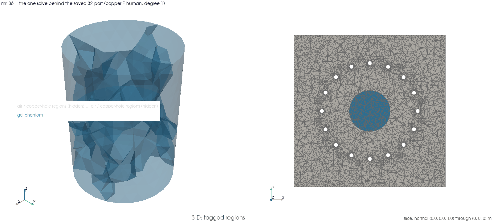

# `-e mri:36` — tune a saved human-scale birdcage with no second solve: the 32-port copper F-human through `Study.load_result`

Guide for `examples/mri/36_tune_a_saved_human_scale_result.py`.
Written to be followed without the source open.

## 1. What this demonstrates

**The same no-solve tune as `mri:35`, at human scale.** `WF-16` step 15 (U100) let a `Study` read a
single-frequency 32-port Touchstone (`.s32p`) back into `Study.result`, and ring-tune it. No earlier example
loads a saved human-scale result: `mri:35` loads a four-port, and `mri:20` builds the F-human from YAML for heat
with no Touchstone.

**Why the human-scale case is where saving the matrix pays.** The copper F-human hole mesh has 369 387 cells and
32 ring-gap ports; the 32-column solve takes about four minutes at `-n 8` (231.0 s in the run of record; U100's
was 227.9 s). The file holds the 32×32 complex S, 40 kB of text. Loading it and tuning takes milliseconds
(0.003 s printed beside the solve). Anyone who wants a different capacitor value, a different mode or a
different drive set pays the minutes once and the milliseconds afterwards.

**What a Touchstone file holds, and what it cannot.** One frequency and a 32×32 complex S at the port
reference impedance, with the port names. It holds no mesh, no field and no material. `Study.load_result`
returns a `LoadedPortResult`; `sar`, `b1_plus` and `temperature` refuse it with a `TypeError`. A loaded
result has **no field by design**, so the ParaView file of this example carries the mesh's cell tags and σ
(DG0, display only) and no field. A second 32-column `keep_fields` sweep would have doubled the window.

**What `n_slots=16` means on 32 ring-gap ports.** The birdcage has 16 legs and a ring gap at each end: 16
bottom and 16 top ports, 32 in all. `tune(1, n_slots=16)` takes the ring-mode index `k = 1` over the 16 slots,
reading the port-to-slot map from the port names in the file (`P17` … `P48`, in file order, printed). The
two ends form a 2×2 block per mode; the printed off-block residual (4.195925e-03) says how far the matrix is
from block-diagonal in that basis.

**The routes.**

1. One solve: U100's copper F-human Study (degree 1, hole mesh, 64 MHz, κ off, `-n 8`), the in-memory
   `tune(1, n_slots=16)`, and `write_touchstone` to `examples/mri/paraview_output/mri_36_run/f_human_cu_d1_n8.s32p`.
2. A fresh Study, `load_result(path)`, `tune(1, n_slots=16)` with class-level spies on `Study.solve` and
   `Study._solve_ports`.
3. The swapped copy: the same S with ports 1 and 2 exchanged in the data (names kept), written to
   `f_human_swap12_n8.s32p`, loaded into a third fresh Study and tuned.

**Why the swapped file misses.** The exchange permutes rows and columns of the data under unchanged names, so
the ring reduction pairs the wrong entries and `C_mode` moves from 1.181186e-10 F to 1.683769e-10 F, a miss of
0.4254907. No error is raised: a file whose port order disagrees with its names tunes confidently and wrongly.
This is the control that shows the instrument can see it.

**Anchors, asserted.** Every band and record is imported by name (`_study`, `WF12_STEP3_C_MODE_CU_F`,
`RECORD_RANK_WIDTH` from `tests.package.test_wf16_study_tune_f_human_copper`; `_write_named`, `_swap12_n`,
`N_SLOTS` from `tests.package.test_wf16_load_result_f_human`; `REDUCTION_BAND` from
`tests.validation.test_port_lumped_rlc_termination`; `LEG_D0_REPRODUCTION_BAND` from
`tests.validation.test_port_birdcage_four_port`); the example states no band.

- **(CM)** loaded `C_mode` = 1.181185799070e-10 F = `WF12_STEP3_C_MODE_CU_F`, relative difference 3.691e-13 ≤
  `REDUCTION_BAND` (1e-3).
- **(T=)** loaded = in-memory, relative difference 1.554e-14 ≤ `REDUCTION_BAND`. No bitwise equality is
  claimed: Touchstone text round-trips at ≈ 6e-14.
- **(S0)** the class-level spies read 0 calls to `Study.solve` and `Study._solve_ports` on the fresh Study and
  on the swapped one.
- **(c-sw), negative control:** the swapped file misses `WF12_STEP3_C_MODE_CU_F` by 4.254907e-01, 4.25e8 times
  `LEG_D0_REPRODUCTION_BAND` (1e-9), equal to U100's record.

**Printed only.** Solve seconds beside the load + tune seconds; the 32 port names in order; the off-block
residual, loaded and in-memory (both 4.195925e-03).
Run of record: `docs/testing/logs/20261028T170623Z_EX-163.log`.

**Not claimed:** a 64-port (F-clinical) load, a field from a loaded file, degree 2, any resonance / Q / match
statement.

**ParaView recipe.** Open `examples/mri/paraview_output/mri_36_tune_a_saved_human_scale_result_combined.xdmf`
and colour by `CellTags` (gel, air, the copper-hole regions), then by `sigma` (DG0). There is no field array.

## Setup figure



`examples/mri/figures/mri_36_tune_a_saved_human_scale_result_setup.png`. Rendered from the one solve's mesh and
cell tags (`FEM_EM_SETUP_FIGURES=1`). Regions: "gel phantom" (translucent); air and the copper-hole regions
hidden. The slice is normal to `z` through the coil mid-plane (`z = 0`); the white discs are the 16 leg cavities
cut by the slice. Geometry only.

## 2. How to run it

```
./scripts/run_examples.sh -e mri:36 -n 8 -t 540
```

**Complex build required** — the `mri:` group sources it automatically. Tier: heavy, `-n 8` (asserted: the
script refuses any other width), container `timeout -k 30 540`. Measured: 234.6 s in the script (solve
231.0 s), 238 s harness wall.

Outputs: `examples/mri/paraview_output/mri_36_tune_a_saved_human_scale_result_combined.xdmf` (and its `.h5`),
the run directory `examples/mri/paraview_output/mri_36_run/` (the two `.s32p` files), and the setup figure above.

## 3. How to analyze it, step by step

1. **Read the `[solve]` line**: 369 387 cells, the solve seconds, the file written.
2. **Read (S0)**: 0 / 0 solve calls, with the load + tune time in milliseconds beside the solve's minutes.
3. **Read (CM) and (T=)**: loaded, recorded and in-memory `C_mode` agree to 3.7e-13 and 1.6e-14.
4. **Read the `[ports]` line**: the 32 names in file order, `P17` … `P48`.
5. **Read (c-sw)**: the swapped file misses by 0.4254907.
6. In ParaView, follow the recipe above.

## Related

- `examples/mri/35_tune_a_saved_result.md` — the four-port version, through the API and `femem run`.
- `examples/mri/23_f_human_study_tune_ring.md` — the in-memory ring tune on the F-human.
- `docs/guide/tuning_a_saved_result.md` — the user-facing page on this route.
- `tests/package/test_wf16_load_result_f_human.py` — the gate (opt-in, `FEM_EM_WF16_S15=1`).
