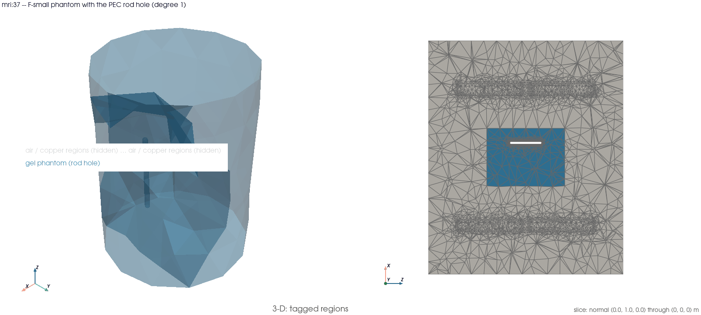

# `-e mri:37` — a rod in the coil-driven phantom through a `Study`, against the same study with the rod removed

Guide for `examples/mri/37_implant_rod_through_a_study.py`.
Written to be followed without the source open.

## 1. What this demonstrates

**The rod as one argument on a `Study`.** `FourPortBirdcageGeometry(implant_rod=rod)` puts a thin perfectly
conducting rod (radius 1 mm, length 30 mm, centre 15 mm off the axis, along `z`) inside the F-small birdcage's
saline phantom. The YAML twin is an `implant:` section with a `rod:` mapping (`radius_m`, `length_m`, `centre_m`,
`axis`). No earlier example drives it: `imp:3`, `imp:10` and `imp:15` call the mesh generators directly. The page
`docs/guide/implant_rod_in_a_study.md` is the tutorial; this example is the demonstration, with every reading
asserted against the gate modules.

**What the rod's PEC wall tag does.** The rod is a hole in the mesh. Its surface carries facet tag 402, and the
solve imposes zero tangential E there. Gate (E) reads the field on exactly those dofs for all four drives. With
`implant_rod=None` there are no tag-402 facets at all (asserted 0).

**How small the rod's effect on S is, against its effect at the tip.** The rod moves the 4×4 S-matrix by only
about 1.5e-4 in relative norm (item 717's miss 1.462391e-04; the printed (c-off) reading is this run's). That is
small against the sheets' own physics but ≈ 1.5e8 times `IDENTITY_BAND` (1e-12), so the instrument separates the
two studies cleanly. The effect at the rod tips is a different order: the printed tip 1 g Q per drive reads
4–5 for the P1 drive and ≈ 1.2–3.9 for the others (item 717). **It is not a tip ratio.** The off arm's phantom
cannot hold a 1 g ball at the tip location (item 664), so the denominator is a reading with no record. The
example prints it and asserts nothing about it.

**The routes.**

1. The rod `Study` (degree 1, 64 MHz, four-port `LumpedPortDrive`, κ off). Its `Study.sar` call runs the one
   field-keeping solve; the S, cells and fields are read from it.
2. The direct build: `_build_rod(leg_sheet_strip_fraction=GATED_WIDTH_FRACTION)` +
   `build_four_port_sweep`, the comparand of item 709.
3. The same `Study` with `implant_rod=None`.

**Anchors, asserted.** Every band and record is imported by name (`ROD_EXACT_CELL_RECORD` from
`tests.package.test_wf15_study_implant_rod`; `IDENTITY_BAND`, `RECIPROCITY_BAND`,
`PASSIVITY_SIGMA_TOLERANCE`, `PEC_WALL_MAX_E`, `CELL_COUNT_BAND`, `ANS4_EXACT_STRIP_CELL_RECORD` from their gate
modules); the example states no band. All gates are collected, printed, then asserted together.

- **(Cells)** rod Study = direct build = `ROD_EXACT_CELL_RECORD` (168 507); the off Study within
  `CELL_COUNT_BAND` of `ANS4_EXACT_STRIP_CELL_RECORD` (117 206); tag-402 facets > 0 with the rod and 0 without.
- **(S)** the Study's S equals the direct S within `IDENTITY_BAND`.
- **(i)** reciprocity within `RECIPROCITY_BAND`; **(ii)** σ_max ≤ 1 + `PASSIVITY_SIGMA_TOLERANCE` and every column
  power ≤ 1.
- **(E)** max |E| on the rod's wall ≤ `PEC_WALL_MAX_E`.
- **(c-off), negative control:** the off `Study` misses the rod S by more than `IDENTITY_BAND` (asserted). The
  ceiling is item 717's 1.462391e-04; the printed reading sits beside `POOLED_SEPARATION_FLOOR`.

**Printed only.** (M), the σ_y pairs; the tip 1 g Q per drive (above).
Records: item 709's W1 `docs/testing/logs/20261101T104952Z_WF-15-s10-W1.log:5588–5600`.
Run of record: `docs/testing/logs/20261101T212457Z_EX-167.log` (S vs direct 1.295e-15, (i) 9.935e-16, (E) 0.0 on 7437 wall dofs, tag-402 facets 4958 / 0, (c-off) miss 1.462391e-04 = 1.462e8 × `IDENTITY_BAND`).

**Not claimed:** a tip ratio, a coil-driven tip SAR accuracy, a sweep, degree 2, a tissue model. A rod `Study` is
refused at any degree but 1 and with `CapacitorSheets` (item 729), so the example passes `degree=1`.

**Disclosed:** (E) needs the build's facet tags, which the result does not keep; the example wraps
`FourPortBirdcageGeometry.build` for the run (restored after), as item 709's fixture does.

**ParaView recipe.** Open `examples/mri/paraview_output/mri_37_implant_rod_through_a_study_combined.xdmf`.
Threshold `CellTags` to the phantom, colour by `E_abs` (|E| of the P1 drive with the rod) and slice through
`y = 0` to see the field around the rod hole.

## Setup figure



`examples/mri/figures/mri_37_implant_rod_through_a_study_setup.png`. Rendered from the rod Study's mesh and cell
tags (`FEM_EM_SETUP_FIGURES=1`). The gel phantom is translucent; air and the copper regions are hidden. The slice
is normal to `y` through `y = 0`, so it cuts the rod lengthwise. Geometry only.

## 2. How to run it

```
./scripts/run_examples.sh -e mri:37 -n 2 -t 560
```

**Complex build required** — the `mri:` group sources it automatically. Tier: heavy, `-n 2` (asserted: the
script refuses any other width), container `timeout -k 30 560`. Measured: 208.4 s in the script (rod Study 88.1 s, direct 62.0 s, off Study 56.2 s), 211 s harness wall.

Outputs: `examples/mri/paraview_output/mri_37_implant_rod_through_a_study_combined.xdmf` (and its `.h5`) and the
setup figure above.

## 3. How to analyze it, step by step

1. **Read the `[time]` line**: the three build + solve windows.
2. **Read (Cells)**: 168 507 for the rod, the same for the direct build; the off Study's count.
3. **Read (S), (i), (ii)**: the Study equals the direct build to the 1e-12 band, and passes reciprocity and
   passivity.
4. **Read (E)**: the field on the rod wall is zero to 1e-12 for all four drives.
5. **Read (c-off)**: without the rod the S is off by the printed amount.
6. **Read the tip 1 g Q lines** as readings only.
7. In ParaView, follow the recipe above.

## Related

- `docs/guide/implant_rod_in_a_study.md` — the tutorial for this route.
- `examples/implants/03_rod_in_birdcage_tip_sar.md` and `examples/implants/15_rod_heating_matched_phantom.md` — `imp:3` and `imp:15`, the rod through the generators directly.
- `examples/mri/35_tune_a_saved_result.md` — another `Study` route.
