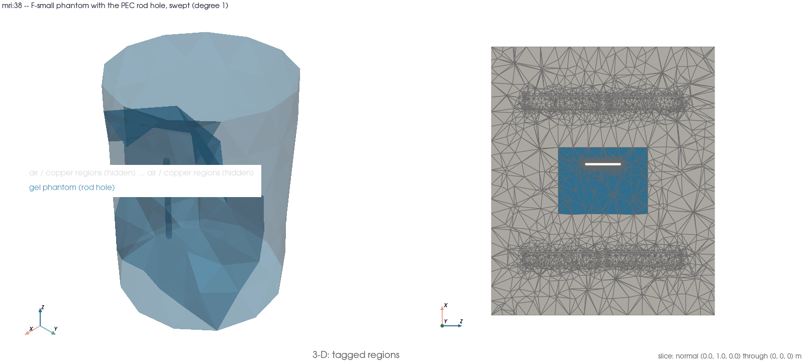

# `-e mri:38` — a rod in the coil-driven phantom on a two-frequency sweep, against its one-frequency solves

Guide for `examples/mri/38_implant_rod_on_a_sweep.py`.
Written to be followed without the source open.

## 1. What this demonstrates

**The rod `Study` through `Study.solve_sweep`.** `mri:37` runs the rod `Study`
(`FourPortBirdcageGeometry(implant_rod=ROD)`, radius 1 mm, length 30 mm, centre 15 mm off the axis) at one
frequency. This example runs the same `Study` at the two Larmor frequencies, 64 and 128 MHz, through
`Study.solve_sweep`, and then through two one-frequency `Study.solve` calls, and asserts that the routes agree.

**What sweeping shares, and what it saves.** The sweep builds **one mesh** (168 507 cells, the rod hole and the
exact-rectangle port sheets included) and runs **one assembly route** at each frequency on it; each
one-frequency `Study.solve` builds its own mesh. The mesh is the expensive part. Measured on the run of
record: the sweep 75.6 s (mesh 48.9 s, then 12.9 s and 13.1 s for the two solves), the two one-frequency
Studies 123.4 s together (the closing window, `docs/testing/logs/20261103T225531Z_EX-170.log`). **A timing is a record, not a promise**; it is printed, never asserted.

**The routes.**

1. `Study.solve_sweep((64 MHz, 128 MHz))`: one mesh, a `PortStudyResult` per frequency.
2. The two one-frequency Studies, with the phantom's frequency set to match
   (`dataclasses.replace(phantom, frequency_hz=f)`), the route of `tests/package/test_wf15_study_rod_sweep.py`
   written out in the example (never a fixture or a `test_*` name; `FREQS`, `ITEM_709_SIGMA`, `_rel`,
   `_phantom`, `_study` and the bands are imported by name).
3. The sweep itself keeps the 64 MHz drive fields: `solve_sweep(FREQS, comm, fields_at=64 MHz)` (the public
   route of `WF-16` step 18). The ParaView file is written from that result; there is no separate view solve
   and no private `Study` method. No gate reads the fields.

**Anchors, asserted.** All gates are collected, printed, then asserted together (13 gates).

- **(Cells)** 168 507 on every build (sweep and point, at both frequencies), equal to `ROD_EXACT_CELL_RECORD`.
- **(S)** the sweep's S equals the point solve's at each frequency within `IDENTITY_BAND`, in matrix norm and
  in the worst entry. The closing window reads 9.342e-14 (64 MHz) and 1.076e-13 (128 MHz) in matrix norm, worst entry 1.686e-13 and
  2.135e-13: the two routes agree to rounding.
- **(i)** reciprocity within `RECIPROCITY_BAND`: 1.767e-15 at 64 MHz, 5.533e-16 at 128 MHz.
- **(ii)** σ_max ≤ 1 + `PASSIVITY_SIGMA_TOLERANCE` and every column power ≤ 1, at each frequency.
- **(c-f), negative control:** the sweep's 64 MHz matrix misses the 128 MHz point solve by 5.5237e-01, that
  is 5.524e+11 × `IDENTITY_BAND` (asserted `>`). A sweep that returned one frequency twice would fail it. The
  ceiling is the gate's own record, 5.5237e-01, `docs/testing/logs/20261101T195622Z_WF-15-s11-W1.log`.

**Printed only.** σ_max and the worst column power per frequency:

| f | σ_max | worst column power |
|---|-------|--------------------|
| 64 MHz | 0.999767876817 | 0.8205266 |
| 128 MHz | 0.999152329797 | 0.8702433 |

and item 709's 64 MHz σ_max beside this run's (|diff| 1.494e-13; the same number to the printed digits).
Records: item 728's W1 `docs/testing/logs/20261101T195622Z_WF-15-s11-W1.log`.
Run of record: `docs/testing/logs/20261103T225531Z_EX-170.log` (the closing window, Status 0, 13 of 13 gates
holding); the setup figure was rendered by the earlier flagged window `docs/testing/logs/20261102T060200Z_EX-170-figure.log`
and is unchanged.

**Not claimed:** a tuned coil, a resonance, a tip Q ordering across frequency. Both frequencies are the
one-frequency Larmor points of the same untuned F-small coil; the two S-matrices are self-consistency
identities on one fixture, not an absolute-accuracy statement. A rod `Study` is refused at any degree but 1 and
with `CapacitorSheets` (item 729), so the example passes `degree=1`.

**ParaView recipe.** Open `examples/mri/paraview_output/mri_38_implant_rod_on_a_sweep_combined.xdmf`.
Threshold `CellTags` to the phantom, colour by `E_abs` (|E| of the P1 drive at 64 MHz with the rod) and slice
through `y = 0`. The file is written from the sweep's own 64 MHz result, which keeps its fields through `fields_at`.

## Setup figure



`examples/mri/figures/mri_38_implant_rod_on_a_sweep_setup.png`. Rendered from the sweep's mesh and cell tags
(`FEM_EM_SETUP_FIGURES=1`). The gel phantom is translucent; air and the copper regions are hidden. The slice is
normal to `y` through `y = 0`, so it cuts the rod lengthwise. Geometry only: the same mesh serves both
frequencies.

## 2. How to run it

```
./scripts/run_examples.sh -e mri:38 -n 2 -t 560
```

**Complex build required** — the `mri:` group sources it automatically. Tier: heavy, `-n 2` (asserted: the
script refuses any other width), container `timeout -k 30 560`. Measured on the closing window: 199.2 s in the script (sweep 75.6 s, two point Studies 123.4 s; there is no
separate ParaView solve), 202 s harness wall.

Outputs: `examples/mri/paraview_output/mri_38_implant_rod_on_a_sweep_combined.xdmf` (and its `.h5`) and the
setup figure above.

## 3. How to analyze it, step by step

1. **Read the `[time]` line**: the sweep against the two point Studies.
2. **Read (S)**: sweep equals point at each frequency to the 1e-12 band (here exactly).
3. **Read (i), (ii)**: reciprocity and passivity at each frequency.
4. **Read (Cells)**: 168 507 on every build.
5. **Read (c-f)**: the 64 MHz matrix is not the 128 MHz one, by the printed amount.
6. In ParaView, follow the recipe above.

## Related

- `examples/mri/37_implant_rod_through_a_study.md` — `mri:37`, the same rod `Study` at one frequency.
- `examples/mri/35_tune_a_saved_result.md` — `mri:35`, another `Study` route.
