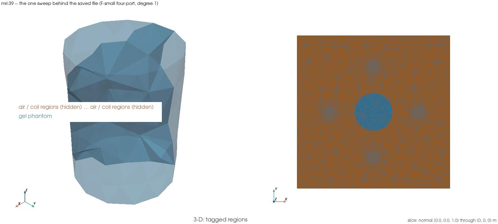

# `-e mri:39` — sweep once, tune at any of its frequencies, with no second solve: `load_result` and `femem run` `tune.at_hz` on a file this run wrote

Guide for `examples/mri/39_tune_any_frequency_of_a_sweep.py`.
Written to be followed without the source open.

## 1. What this demonstrates

**The swept-file route, end to end on a clean clone.** `WF-16` step 17 (U108) let a `Study` load a
multi-frequency four-port Touchstone and pick a column with `tune(k, at_hz=f)`; `WF-1` step 27 (U111) put
`at_hz` behind the `tune:` block of a `femem run` file. Both gates read a gitignored file that another gate's
window left on disk, so a clean clone has nothing to run them on. This example writes its own file, then reads
it back, and every later step touches no mesh and no solver.

**What `tune(at_hz=f)` does.** The file holds three 4×4 S matrices (10, 64 and 128 MHz). `tune` takes the
file's **nearest** frequency to `at_hz` and uses that column and that frequency's ω. It never interpolates:
`at_hz` between two stored frequencies returns the nearer column, and an `at_hz` outside the stored span raises
`ValueError`. A multi-frequency file with no `at_hz` also raises, because there is no single column to take.

**What `C_mode` is here.** The mode-1 capacitance follows from `z_1 + 1/(jωC) = 0` for the imaginary part, with
`z_1` the DFT-diagonal of the circulant Z built from that column's S. It is a lossless circuit-model read of
three stored matrices. It is **not** a resonance, a match or a Q statement, and nothing here tunes a coil to
anything.

**The routes.**

1. **One sweep**: `Study.solve_sweep` at 10 / 64 / 128 MHz on the degree-1 F-small four-port (PEC proxy,
   exact-rectangle ports, `-n 2`; the file `tests/package/wf1/f_small_sweep.yaml` describes the same Study),
   then `write_touchstone` to `examples/mri/paraview_output/mri_39_run/f_small_sweep_saved.s4p`.
2. **API**: a fresh `Study`, `load_result(path)`, `tune(k=1, at_hz=f)` at each of the three frequencies.
3. **YAML**: the sweep file's YAML with `study.sweep_hz` removed (a `load_result` file refuses it), plus
   `load_result: f_small_sweep_saved.s4p` and `tune: {k: 1, at_hz: f}`, through `run_study_file`, once per
   frequency. The relative `load_result` path resolves against the YAML's directory. `femem run` prints no
   `C_mode`; the example reads the summary's `tune` block.
4. **After the sweep**, mesh builds, solves and `gmsh.initialize` are replaced by a raising wrapper for the
   whole loaded section and restored in `finally`.

**Anchors, asserted.** Every band and record is imported by name (`ITEM722_C_MODE_F` from
`tests.package.test_wf1_yaml_load_result_sweep`, `REDUCTION_BAND` from
`tests.validation.test_port_lumped_rlc_termination`, `FREQS` from `tests.package.test_wf16_load_result_sweep`);
the example states no band. Collected first, then asserted.

- **(C=)** each `C_mode` equals `ITEM722_C_MODE_F` at `REDUCTION_BAND` (1e-3): 2.472675544637e-09,
  6.166035421775e-11 and 1.513380716932e-11 F at 10, 64 and 128 MHz. This run's own sweep reproduces the
  gate's column to a relative round-off bound of 2e-13 on every frequency (the flagged window read
  1.935e-13 / 5.218e-15 / 1.912e-13; the 10 MHz term moves between windows at round-off, always within the bound).
- **(I=)** the API's `C_mode` and the YAML summary's are `float.hex`-equal at each frequency
  (64 MHz `0x1.0f2f6316ff159p-34`, 128 MHz `0x1.0a3c9bbb69f6ep-36`, the same in two windows; the 10 MHz
  value moves in its last hex digits between windows, at round-off, and is printed by each run), as are the
  off-diagonal residual, `z_k` and the selected frequency.
- **(f=)** the selected frequency equals the requested one exactly, through both routes.
- **(S0)** 0 mesh-build, solve or `gmsh.initialize` calls after the sweep (the wrapper raises and counts).
- **(c-next), negative control:** the column one frequency along misses the record by 0.975063 (10 → 64 MHz)
  and 0.754562 (64 → 128 MHz), far above `REDUCTION_BAND`. The second equals the gate's own control record
  (0.754562, `20261101T210812Z_WF-1-s27-W1.log`), so the bar is reachable and the instrument sees a wrong column.
- **(Ref)** `at_hz` = 192 MHz, past the 128 MHz end of the span, raises `ValueError` naming `at_hz`.

**Printed only.** On the flagged window (`20261102T062150Z_EX-172-figure.log`) the sweep took 51.5 s (mesh
26.7 s, three solves of 8.1 / 7.9 / 8.2 s), against 0.006 s for load plus three tunes through the API and
0.009 s for three `run_study_file` calls. A timing is a record, not a promise. The sweep's mesh has 117 206
cells.

**ParaView recipe.** Open `examples/mri/paraview_output/mri_39_tune_any_frequency_of_a_sweep_combined.xdmf`
and colour by `CellTags`, then by `sigma` (DG0, the gel's 0.5 S/m, display only). A loaded result has no field,
so the export carries the mesh, tags and conductivity only.

## Setup figure



`examples/mri/figures/mri_39_tune_any_frequency_of_a_sweep_setup.png`. Rendered from the sweep's mesh and cell
tags (`FEM_EM_SETUP_FIGURES=1`). The gel phantom is translucent; air and the coil regions are hidden. The slice
is normal to `z` through the origin. Geometry only: the one mesh serves all three frequencies, and the port
sheets are facet tags the renderer does not draw.

## 2. How to run it

```
./scripts/run_examples.sh -e mri:39 -n 2 -t 300
```

**Complex build required** — the `mri:` group sources it automatically. Tier: standard, `-n 2` (asserted: the
script refuses any other width), container `timeout -k 30 300`. Measured on the flagged window: 53.4 s in the
script, 56 s harness wall.

Outputs: `examples/mri/paraview_output/mri_39_tune_any_frequency_of_a_sweep_combined.xdmf` (and its `.h5`),
the scratch file `examples/mri/paraview_output/mri_39_run/f_small_sweep_saved.s4p`, and the setup figure above.

## 3. How to analyze it, step by step

1. **Read the `[sweep]` line**: cells, the sweep's time, and the file written.
2. **Read (S0)**: 0 calls after the sweep, and the load-and-tune time against the sweep's.
3. **Read (C=)**: each `C_mode` against the gate's record, with the round-off-level relative difference.
4. **Read (I=)**: API and YAML `float.hex` equal at each frequency, and the selected frequency equal to the
   requested one.
5. **Read (c-next)**: the neighbouring column is a different capacitance by the printed amount.
6. **Read (Ref)**: the out-of-span request is refused.
7. In ParaView, follow the recipe above.

## Related

- `examples/mri/35_tune_a_saved_result.md` — `mri:35`, `load_result` on a one-frequency file.
- `examples/mri/36_tune_a_saved_human_scale_result.md` — `mri:36`, the 32-port file.
