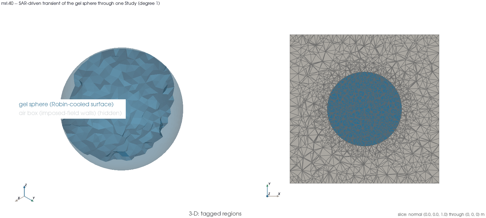

# `-e mri:40` — the SAR-heated gel sphere over time, through one `Study`

Guide for `examples/mri/40_study_sar_driven_transient_sphere.py`.
Written to be followed without the source open.

## 1. What this demonstrates

**One electromagnetic solve, then the temperature in time.** `WF-15`'s `Study`
solves the lossy sphere (`MAT-4` step 1: the imposed 1 V/m field at 64 MHz, gel
σ = 0.57 S/m, εᵣ = 78). `study.temperature(cool, transient=TransientSpec(...))`
hands that solved field to `MAT-12`'s θ-scheme transient of the Robin-cooled gel
ball: the DG0 heat source q = G · σ|E|²/2 on the sphere submesh, heat capacity ρc,
conduction k, convection h, starting from θ = 0 with T∞ = 0 (so θ = T).

```python
study = _study(degree=1)
res = study.solve(comm)                                            # the one EM solve
cool = RobinCooling(K, H, 0.0, source_scale=G)
thA = study.temperature(cool, transient=TransientSpec(T_STAR / N_MAIN, N_MAIN, RHO_C))
thS = study.temperature(cool, transient=TransientSpec(DT_1, 1, RHO_C, theta=1.0,
                                                      startup_half_steps=0))
thQ = study.temperature(cool)                                      # steady, for the control
```

* **A** is Crank–Nicolson, N = 40 steps to t* (two backward-Euler half-steps
  first); its θ(t*) is the output quantity. **S** is one backward-Euler step of
  Δt₁, used for the calorimetric identity. **Q** is the steady solve.
* t* = 0.2 · R²ρc/k, a fifth of the sphere's conduction time. θ(t*) is a
  **fraction of the steady rise**, not the steady rise: at the centre it reaches
  ≈ 0.49 of it (below). The steady θ is therefore the wrong answer for θ(t*) by
  ≈ 100 % — that is the negative control.
* The `Study` makes **one** EM solve for all three temperatures: `study.result is res`
  after the calls, asserted as (Once).
* Every `temperature()` call builds its own submesh; each comparison against a
  closed form is built on that call's own mesh.

**What is imposed and what is not.** The field is imposed on the box wall: no coil,
no tissue, one mesh, **degree 1** — the degree of `MAT-12`'s records. The `Study`
default is degree 2; that leg is gated separately by `WF-15` step 16 and is not
run or quoted here.

The example states no k, h, G, σ, ρ, ρc, t* or R of its own: every constant, band,
helper and printed record is imported by name from `tests/package/test_wf15_study_sphere_transient.py`,
`tests/validation/test_mat12_transient_sar_heating_sphere.py`,
`tests/validation/test_mat10_sar_to_heat_sphere.py` and
`tests/validation/test_mat5_em_coupled_sphere.py`. The only literal is T∞ = 0.

On record (closing run, label `EX-187`, `-n 2`, complex build; EM solve and mesh
≈ 14 s, the two transients ≈ 1.7 s together):

| Quantity | Reference | Record | Bound |
| --- | --- | --- | --- |
| (Once) | `study.result is res` | true after all three calls | exact |
| (UT) sphere submesh cells | 19 496 (version-tagged) | 19 496 | exact |
| (I-dir) A and S vs `MAT-12`'s own `_cn` / `_be_one` | same submesh, facets, source | at round-off, below 1e-15 | `L0_BAND` 1e-9 |
| (A_t) interior rel L2 vs the series, `.4e` | `MAT-12` print 3.4708e-02 | 3.4708e-02 | `A_BAND` 0.11 |
| (S2) volume-mean calorimetric `\|ratio − 1\|`, `.4e` | `MAT-12` print 4.9994e-05 | 4.9994e-05 | `S2_BAND` 1e-4 |
| (E) per-step energy balance, A and S | identity | below 5e-15 on both (the last digits move run to run) | `E_BAND` 1e-9 |
| (c-qs) steady θ standing in for θ(t*) | `MAT-12` control (b) 1.0108e+00 | 1.0108e+00 | must exceed `A_BAND` 0.11 |
| max \|Im θ\| on A | complex-build residue | 0 | 0 |

(A_t) compares the Study's θ(t*) with the series on the interior r < 0.9 R; (S2)
says that one short step deposits exactly ρc · mean θ = Δt₁ · mean q (to 5e-5);
(E) is the per-step conservation of energy in the stepper.

**Printed only (no band):** θ at the sphere centre.

| | FEM (degree 1) | Closed form |
| --- | --- | --- |
| θ(0, t*) | 0.0619172 K | 0.0595643 K |
| steady θ(0) | 0.1268224 K | 0.1223499 K |
| θ(t*)/θ(∞) | 0.4882199 | 0.4868360 |

The FEM sits ≈ 3.5–4 % above the closed form at the centre — the same degree-1
electromagnetic bias that sets (A_t) — but the **fraction** of the steady rise
reached at t* agrees to ≈ 0.3 %, because that bias cancels in the ratio. This is
arithmetic on the printed values, not a gate.

**Not claimed:** EM degree 2, duty cycle, perfusion, probes or a YAML key on the
sphere (`Study.probe` refuses a transient on it), a coil, tissue, a compliance
figure; the centre figures are a record.

## Setup figure



`examples/mri/figures/mri_40_study_sar_driven_transient_sphere_setup.png`. Rendered
right after the `Study` is solved (`FEM_EM_SETUP_FIGURES=1`). The sphere ("gel
sphere (Robin-cooled surface)") is translucent; the air box ("air box
(imposed-field walls)") is hidden. The slice is normal to `z` through the origin.
The figure is geometry only.

## 2. How to run it

```
./scripts/run_examples.sh -e mri:40 -n 2 -t 180
```

**Complex build required** — the `mri:` group sources it automatically.
Tier: **standard** (`-n 2`, container `timeout -k 30 180`). One degree-1 EM solve
(≈ 14 s), two transients, one steady solve, and the XDMF write; under a minute.

## 3. How to analyze it, step by step

**Step 1 — the study and the one EM solve.**

```
[study] degree 1, -n 2, k 0.6, h 100, T_inf 0, G 2.5e+07, R 0.01 m; t* 139.3333 s, A: dt 3.483333 s x 40 (theta 0.5, startup 2); S: dt 6.966667e-03 s x 1; q_cf 2002.088514 W/m^3
[(UT)] sub cells 19496 (MAT10_SUB_CELLS 19496); (Once) True
```

t* = 139.33 s and Δt = t*/40 = 3.4833 s. q_cf is the closed-form heat source, G · ρ ·
SAR, 2002.09 W/m³.

**Step 2 — the gates.**

```
[(I-dir)] A ... S ...  (band 1e-09); layouts True / True
[(A_t)] interior rel L2 = 3.47082938..e-02 [3.4708e-02] (band 0.11; record 3.4708e-02)
[(S2)] ... |ratio - 1| = 4.9994e-05 (band 1e-04; record 4.9994e-05)
[(E)] max balance A ... S ...  (band 1e-09)
```

(I-dir) says the Study's route and `MAT-12`'s direct stepper give the same field at
round-off; (A_t) and (S2) reproduce `MAT-12`'s printed digits. A miss on any is an
example/test divergence finding: report and stop, never widen a band or re-record.

**Step 3 — the negative control.**

```
[(c-qs)] steady theta for theta(t*): interior rel L2 = 1.0108e+00 (must miss 0.11; MAT-12 control (b) 1.0108e+00)
```

Handing the steady θ to the (A_t) comparator in place of θ(t*) misses by a factor
of 1.0108 in relative L2 — ≈ 9 times the band, and `MAT-12`'s recorded control.
A comparator blind to time would not move.

**Step 4 — open it in ParaView.**
`File → Open → examples/mri/paraview_output/mri_40_study_sar_driven_transient_sphere_combined.xdmf`.
It lives on the sphere submesh (the air box is not in the file) and holds
`theta_Study_tstar` (the Study's θ(t*), K), `theta_closed_form_tstar` (the series at
t*, interpolated into the thermal space) and `theta_steady` (the Study's steady θ,
K — the example prints which one it wrote).

1. Colour by `theta_Study_tstar`, then by `theta_steady` on the same colour range: the
   steady field is about twice the t* field everywhere.
2. **Plot Over Line** along x through the centre on all three: the t* profile is the
   flatter, lower curve, with the Robin surface value still well below the steady one.

**Step 5 — what a deviation means.** (UT) or the `.4e` equalities fail → the mesher
or the `Study` path changed: a `WF-15` / `MAT-12` regression, version tag the first
suspect. (I-dir) red with the bands green → the route moved. Any of these: report and
stop.

## Related

- `examples/mri/10_study_temperature.py` (`mri:10`) — the same sphere, steady only
  ("No transient heating").
- `examples/mri/25_study_transient_duty_and_wall.py` (`mri:25`) — the transient API
  with no EM solve (thermal-only balls).
- `examples/materials/04_sar_heats_gel_ball.py` (`mat:4`) — `MAT-12`'s transient through the direct helpers,
  not the `Study`.
- `tests/package/test_wf15_study_sphere_transient.py` — the `WF-15` step 15 gate this
  example reproduces.
- `tests/validation/test_mat12_transient_sar_heating_sphere.py` — `MAT-12`, the
  closed-form gate and its helpers.
