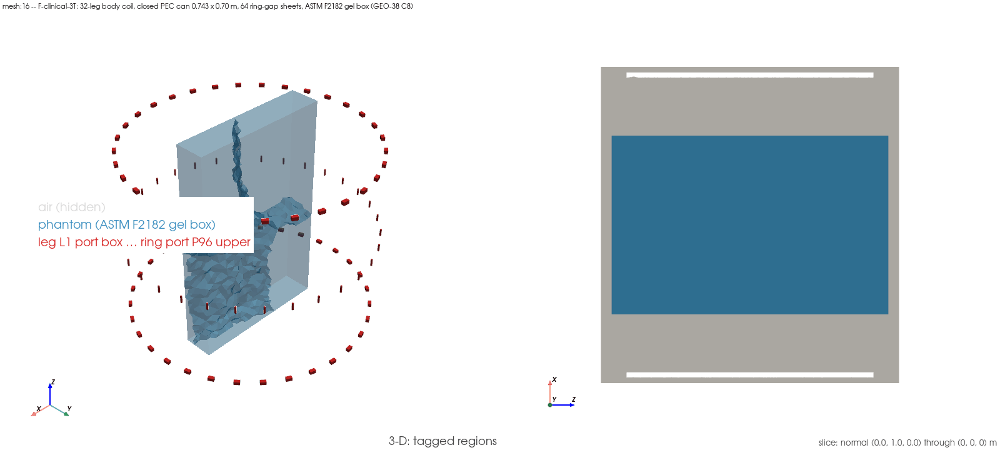

# `mri:41` — the field-strength lever on one page: F-clinical at 1.5 T and 3 T per accepted watt (EX-193)

A record page: it makes **no solve and builds no mesh**. It reads two tracked
`GEO-38` C6a harness logs, `xl` entry 52 (1.5 T, 64 MHz, node C = 193.5996 pF) and
entry 58 (3 T, 128 MHz, node C = 44.0525 pF), and C33's closing log, and sets the
two field strengths of the F-clinical birdcage, loaded with the ASTM F2182 gel box,
side by side per accepted watt. Its new angle is the **factoring** of the lever:

- the SAR10g(c\*) ratio per accepted watt is how much more of the accepted power the
  gel box takes (P_box / P_acc) times how much more SAR each box watt makes at c\*;
- the mean `|B₁⁺|` ratio factors the same way, with a square root;
- the hotspot "move" is read as a **margin** over the runner-up ball.

**What these numbers are.** They are degree-1 internal records, each at its own
unloaded in-model root (Im Y_in with the box loaded is printed, and is not zero).
The lattice is 18 balls, and c\* is the lattice argmax, not a box-wide maximum. There
is no tuning, absolute, compliance, homogeneity or external claim, no `ANS` case (a
3 T case is the weekly's to pose) and no degree-2 figure (`xxl` entry 62).

## 1. What this demonstrates

Every digit below is a print of the closing window `EX-193`
(`docs/testing/logs/…_EX-193.log`), or arithmetic on those prints.

- **C33's table, reproduced to the digit (R33).** The page re-derives the four
  3 T / 1.5 T ratios through the C33 reader's own `side` / `ratios` and the `ans:11`
  page's parser, and each equals the string C33's closing log
  (`20261109T103601Z_GEO-38-C33-W1-n1-r2.log`) printed:

  | quantity | 1.5 T | 3 T | ratio |
  |---|---|---|---|
  | lattice mean `|B₁⁺|`_ccw per √P_acc [T/√W] | 6.083305e-08 | 8.581609e-08 | 1.410682 |
  | centroid mean `|B₁⁺|`_ccw per √P_acc [T/√W] | 8.488944e-08 | 1.140944e-07 | 1.344035 |
  | SAR10g(c\*) per P_acc [W/kg/W] | 2.274234e-03 | 9.327634e-03 | 4.101440 |
  | P_box / P_acc | 5.285093e-02 | 1.952049e-01 | 3.693500 |

- **The SAR lever factors (Dec-S).** 4.101440 = 1.110448 × 3.693500: the box takes
  ≈ 3.7× more of the accepted power at 3 T, and each box watt makes ≈ 1.11× the SAR at
  c\*. The two sides agree to a relative 9.6e-08, inside the sum of the six printed
  tokens' half-units, 8.45e-07.
- **The `|B₁⁺|` lever factors (Dec-B).** 1.344035 = 0.6993450 × 1.921848, where
  1.921848 is the square root of the P_box / P_acc ratio; relative 3.2e-07 inside
  1.18e-06.
- **The hotspot moves as a near-tie, not as a hot region.** At 1.5 T, c\* is
  x−105 mm dz−50 mm and leads its mirror ball x+105 mm dz−50 mm by a relative
  **6.269e-04**. At 3 T, c\* is x+105 mm dz+50 mm and leads the same ball (x+105 mm
  dz−50 mm) by 8.237e-03. So "the hotspot moves" means a near-tie resolved differently.
  At the fixed ball x−105 mm dz−50 mm (1.5 T's c\*) the SAR10g-per-P_acc ratio reads
  4.020640, against 4.101440 at each side's own c\*.
- **SAR per `|B₁⁺|²`.** SAR10g(c\*) per P_acc ratio over the square of the `|B₁⁺|`
  ratio reads 2.061000 for the lattice mean and 2.270466 for the centroid mean.
- **Power split.** P_acc / P_src is 0.7334445 at 1.5 T and 0.3505616 at 3 T.
- **The 18-row per-point table** (`|B₁⁺|`_ccw per √P_acc and SAR10g per P_acc at
  every lattice label on both sides, with their ratios) is printed in full by the run.
- **Im Y_in at the two roots,** cw before ccw, P33 before P41, side by side and never a
  ratio: cw P33 −1.255077e-03 | +1.879628e-03 S; cw P41 +2.957785e-03 | −1.976459e-03 S;
  ccw P33 +4.009155e-04 | +1.031944e-03 S; ccw P41 +4.413545e-03 | −1.347375e-03 S.

Gates (35, all green in the closing window): (X) node strings, 18 lattice lines per
side, equal labels in order; (D) `check_side` on both sides at C33's own half-unit
bounds; (R33) as above plus both c\* labels; (Dec-S); (Dec-B); (Lat) the 18 parsed
tokens reproduce each side's lattice mean (rel ≤ 1e-12); (Arg) the runner-up is not
c\* on either side and the margin is positive.

Negative controls (asserted in the same run):

- (N-norm) the per-P_src ratio in place of the per-box-watt ratio makes (Dec-S) miss by
  a relative 0.7654, against the same bound 8.45e-07;
- (N-plant) one digit planted in the 4th significant place of the 3 T per-box-watt
  string makes (Dec-S) miss by 2.092e-04, and (R33) stays green on the planted copy,
  so the two gates are independent;
- (N-swap) the sides swapped miss C33's strings on all four rows, and the (Node) check
  of `check_side(p58, ENTRY52_NODE_PF, …)` is red.

**Context, not a comparand.** In a quasi-static picture the SAR would scale as ω²σ at
equal σ, which is 4 between 64 and 128 MHz. This page neither prints nor asserts that
number. It need not hold here: 128 MHz in gel is far from quasi-static on a 650 mm
box, and the records above are what was measured.

## Setup figure



`examples/mri/figures/mri_41_f_clinical_field_strength_lever_setup.png` is a
byte-identical copy of `mesh:16`'s committed render
(`examples/meshing/figures/meshing_16_f_clinical_3t_coil_astm_box_setup.png`) of the
3 T twin of the build; the 1.5 T twin is `mesh:15`. Entry 58's mesh is C20's, with the
rod mapped to gel. This page parses logs and draws nothing and builds no mesh, so the
figure was not rendered here. It is geometry only and carries no field, power or SAR
value.

## 2. How to run it

```
./scripts/run_examples.sh -e mri:41 -n 2 -t 120
```

The `mri:` group sources the complex DolfinX build (the `ans:11` page the reader
loads imports dolfinx). The run takes a few seconds (smoke tier) and writes nothing.
Related pages: `ans:11` (entry 52 alone), `mesh:15`, `mesh:16`, `mri:17`.

## 3. How to analyze it, step by step

1. Read the `[PASS]` / `[FAIL]` lines: each gate prints its comparand and bound.
2. Read the C33 table block, then the two factored lines: the SAR lever is
   (P_box / P_acc) × (SAR per box watt), and the `|B₁⁺|` lever is the same split with a
   square root.
3. Read the two runner-up margins: the 1.5 T lead is ≈ 6e-04 and the 3 T lead is
   ≈ 8e-03, so the hotspot label is a near-tie at both field strengths.
4. Read the per-point table for where the ratio is far from the lever (the x = 0
   column at dz = −150 … +150 mm, where `|B₁⁺|` per √P_acc is lower at 3 T than at 1.5 T).

## Not claimed

The decision rule's branch on entry 58 (the weekly's), any 3 T `ANS` case, degree 2, a
box-wide 10 g maximum, homogeneity, compliance, an absolute figure, a quasi-static law
or any band on a ratio.
