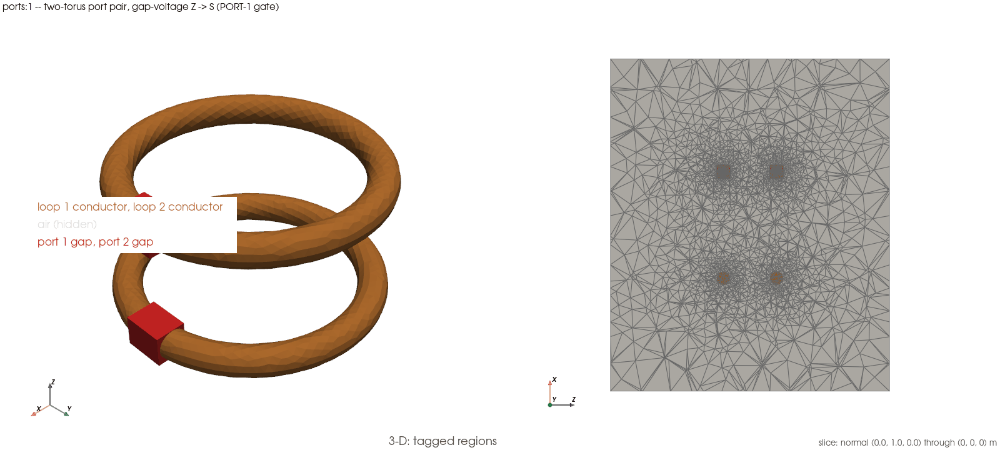

# EX-18 — gap-voltage port pair → Z → S on the two-torus fixture

The first example in this repository that produces **port** quantities from a
solved field.

## 1. What this demonstrates

Exactly the capability `PORT-1` steps 3b-xvii/3b-xviii gated on 2026-08-13, and
nothing beyond it:

1. the **gapped two-torus fixture** — two partial tori (cell tags 1/2), each
   bridged by a rectangular dielectric gap box (101/102), all fragmented
   conformally into one air box (3) inside a PEC truncation box at padding 0.08;
2. one solve per port, driven by an impressed `+ŷ` current density across that
   port's gap box, conductors at σ = 800 S/m, f = 10 MHz;
3. `I_k` from the meshed conduction current, `V_i` from the
   **terminal-to-terminal** tangential path integral `−∫E·t̂ dl` along the
   centreline arc, and `Z_ik = V_i / I_k`;
4. the two named systematics through
   `fem_em_solver.ports.systematics.mutual_systematics_ladder()`;
5. `S = (Z − Z₀I)(Z + Z₀I)⁻¹` through
   `fem_em_solver.ports.sparameters.sparameters_from_impedance()` at Z₀ = 50 Ω.

## Setup figure



*Left:* the gapped two-torus fixture (`MeshGenerator.two_torus_domain`,
`port_gap=True`) on the one mesh both port solves reuse. Each partial torus —
loop 1 (tag `1`, `z < 0`) and loop 2 (tag `2`, `z > 0`) — is the `conductor`
colour class (brown) and shares the one azimuthal gap location, centred on
the `+x` axis, where a rectangular dielectric box (tag `101` for loop 1, `102`
for loop 2) bridges the arc ends; both gap boxes are the `port` colour class
(red), one visible per loop in this view. The air box (tag `3`) is hidden.
*Right:* the slice at `y = 0` (the x–z plane through the mesh centre). Near
the top (large `+x`, where the axis triad puts `X` pointing up) the two gap
boxes appear side by side along `z` — loop 1's port 1 on the left (`z < 0`),
loop 2's port 2 on the right (`z > 0`) — since the gap sits at the same `+x`
azimuth for both loops; near the bottom (`x` near `-major_radius`, the
azimuth diametrically opposite the gap) the two intact conductor
cross-sections appear at the same two `z` positions. No phantom in this
fixture, so nothing is drawn translucent.

Census `ok` 43→44 `missing` 14→13 `broken` 0 (`20260927T124156Z_EX-57-next.log`
pre → post census below), docrefs `dead=0 guide=0 exit=2` both sides
(`20260927T124614Z_EX-57.log` pre); legacy-path 0.11-image records (`OPS-34`), superseded by `POST-8` 3b-ii-e4;
kept as a labelled record: `EX-18` records (177998 cells, raw
0.894516 / corrected 0.939822 / symmetry 3.1121e-05 / spectral 0.861357)
identical flagged (`20260927T124659Z_EX-57.log`, 132 s) vs unflagged
(`20260927T124920Z_EX-57-control.log`, 133 s), no `[setup-figure]` line in
the unflagged run; PNG 431 KiB.

## 2. How to run it

```bash
./run_examples.sh -e ports:1 -n 2 -t 540
```

It needs the complex DolfinX build; the `ports:` runner group sources
`/usr/local/bin/dolfinx-complex-mode` automatically. Measured cost at `-n 2`:
146.8 s on the script's own timer — mesh 28.4 s (177 998 cells), two solves
24.4 s + 24.3 s (`docs/testing/logs/20261022T110209Z_POST-8-step3b-ii-e4-ports1-n2.log:685`,
`POST-8` 3b-ii-e4, §9 item 600); the earlier 134 s / 178 055 cells
(`20260813T110940Z_EX-18-example-n2-v3.log`) predate `OPS-34`.

## 3. How to analyze it, step by step — the numbers it prints, and the one it prints first

| rung | ratio to `ωM₁₂` | deviation |
|---|---|---|
| raw | 0.894636 | **−10.54% — a miss** |
| + PEC box (`D∞ = +0.0169`, `p = 1.657`) | 0.911536 | −8.85% |
| + gap physics (`÷(1 − 0.030224)`) | 0.939944 | −6.01% |

Digits from the owner-rule `-n 2` run
`20261022T110209Z_POST-8-step3b-ii-e4-ports1-n2.log:669–671` (`POST-8`
3b-ii-e4, §9 item 598); the earlier 0.894543 / 0.911443 / 0.939849 predate
`OPS-34`.

The raw number is printed **first and labelled a miss**: the unmoved 10% band
would not accept it. Only after both measured systematics does the mutual land
inside. An example that showed the corrected number alone would be advertising
a gate that does not exist.

Network identities on the same Z:

* `|Z₁₂ − Z₂₁|/|Z₁₂|` = 7.8052e-04 (printed — two solves, two integrands, one
  operator, so this is a *measured* reciprocity, not an algebraic one);
* `‖S − Sᵀ‖/‖S‖` = 3.4127e-05, `‖S‖₂` = 0.861324 ≤ 1 (passive) — asserted
  against their records since `OPS-34`, the symmetry to
  `REPRODUCTION_BAND_SYMMETRY_ABSOLUTE` = 1e-6 (absolute) and the spectral
  norm to `REPRODUCTION_BAND_RELATIVE` = 1e-6, from
  `20261022T110209Z_POST-8-step3b-ii-e4-ports1-n2.log:684`. Superseded
  history, kept: before `OPS-34` these were printed beside their records,
  never asserted (`EX-30` leg (ports) re-record, 2026-08-26, from
  `20260826T123139Z_EX-30-ports-run-1to2.log`; the v0.7.2
  digits were 2.5494e-05 / 0.861449 — this route is the terminated-Z
  conversion, so its records moved with the 0.11 image, not with the
  `PORT-9` leg (d3) power-wave assembly).

## Gates

All asserted values are allreduced. The bands cite
`docs/testing/logs/20260813T020352Z_PORT-1-step3bxviii-pairgate-n2.log` and are
deliberately **looser** than the digits they cite — a reproduction band, never
to be tightened onto the measurement, and never to be widened to make a run
pass.

* pre-solve geometry: terminal angles from facet tags 201/202 equal
  `arcsin(half_y/a) = 0.175335123` rad to 1e-6 — the integration limits against
  the meshed geometry, checked *before* two solves are bought;
* quadrature precondition: the **undriven** port's path integral agrees between
  Gauss orders 2049 and 4097 to < 1e-3 (measured 2.6056e-04 / 2.3522e-04). The
  driven diagonal is printed and not gated — step 3b-x's standing disposition:
  its path runs through the impressed source's own terminals and does not
  converge in the quadrature (3.4e-3 / 6.8e-3), which is a property of `Z₁₁`,
  which nothing here reads;
* raw and corrected mutual reproduce the record to
  `REPRODUCTION_BAND_RELATIVE` = 1e-6 (the record re-based `(1*)` onto Part
  B's `-n 2` digits, item 586);
* corrected mutual inside the unmoved `MUTUAL_TOLERANCE = 10%`;
* **negative control**, cited not recomputed: step 1's *unfragmented* ancestor
  of this fixture returned `Im Z₁₂` identically zero
  (`20260731T213222Z_PORT-1-step1-costprobe.log`). The same ladder on that
  number reads **−98.26%**, and the example asserts it *fails* the band — a
  band that accepted the blind fixture would be gating nothing;
* `‖S − Sᵀ‖/‖S‖ < 1e-3` and `‖S‖₂ ≤ 1`.

## What this is not

* **Not an `S₁₁` claim.** `PORT-1` step 2b localised an electric-energy excess
  on this fixture's diagonal (`W_e/W_m = 6.524`), so no `Z_in` and no `S₁₁` may
  be read off it. The gated quantity is the mutual. `S₁₁`/`S₂₂` are printed
  because a 2×2 S-matrix has them, not because they mean anything here.
* **Not a birdcage port**, and not a general port capability: `PORT-1` stays 🟡
  and the package's *other* S-parameter path (`ports/excitation.py`) is still
  the ⚠️ heuristic of known-issues 3.
* **Not portable corrections.** Both systematics were measured on *this*
  geometry at *this* padding and must be re-measured anywhere else. The PEC-box
  term is an effective-range extrapolation and is never to be quoted without
  its exponent `p = 1.657` (pinning the dipolar `p = 3` moves it to −1.43 pp).

## ParaView

Writes `examples/ports/paraview_output/ports_01_two_torus_port_pair_combined.xdmf`
(+ `.h5`): mesh, `CellTags`, and the port-1 drive's `E_real` / `E_imag` /
`E_magnitude` as CG1 Lagrange interpolants (XDMF cannot carry N1curl; the
writers take Lagrange only — the `EX-14`/`EX-17` lesson). Threshold on
`CellTags` to isolate the gap boxes (101/102) and the conductors (1/2).

## Owner-rule records (`POST-8` 3b-ii-e4)

`_path_voltage` samples under the owner rule (`owner="lowest_original_cell"`).
The four records were re-based `(1*)` at `-n 2` from
`20261020T214423Z_POST-8-step3b-ii-e2d-ports1-measure-n2.log:677`
(raw 0.8946356119123071 / corrected 0.9399444943082806 / symmetry
3.4126695369442954e-05 / spectral 0.8613244573231138) and are reproduced by
this item's `-n 2` log `20261022T110209Z_POST-8-step3b-ii-e4-ports1-n2.log`
(raw miss 4.6e-13); the 1e-6 bands are unmoved. The cross-width spread against
the `-n 2` record is printed, not asserted: at `-n 4`
(`20261022T110501Z_POST-8-step3b-ii-e4-ports1-n4.log`) raw 5.5e-10 / corrected
5.4e-10 / symmetry 2.0e-11 abs / `||S||_2` 5.1e-10, at `-n 1`
(`20261022T110738Z_POST-8-step3b-ii-e4-ports1-n1.log`) 2.5e-10 / 2.4e-10 /
3.5e-11 abs / 2.2e-10. The legacy-path `OPS-34` record
(`LEGACY_PATH_RECORD_0P11`) misses the owner-rule run by raw 1.33e-04 /
corrected 1.31e-04 at every width, asserted above the band.
