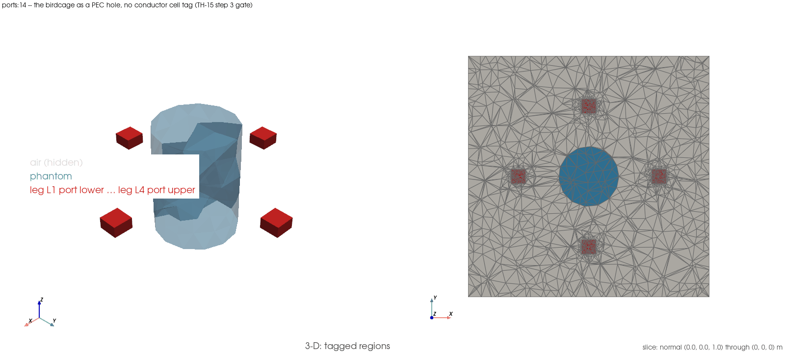

# `ports:14` — the birdcage as a PEC hole in ParaView

Script: `examples/ports/14_birdcage_pec_hole_ports.py` (`EX-54`)
Gate: `tests/validation/test_th15_birdcage_pec_hole.py` (`TH-15` step 3)

## 1. What this demonstrates

`TH-15` step 3 (closed 2026-09-13) gated the gapped 4-leg birdcage meshed as
a **PEC hole**: the coil is cut out of the box entirely (no conductor
cells), its cavity wall is facet group `BIRDCAGE_CONDUCTOR_SURFACE_TAG`
(401), and that wall is PEC by construction — `pec_facet_tags=None`
(`TimeHarmonicProblem`'s default) pins every exterior facet, and tag 401's
facets are themselves exterior on this mesh. Four lumped-sheet ports drive
it exactly as `PORT-9`/`PORT-11` drive the solid coil. `EX-50` showed the
hole *mesh* only (no solve, no ports); this is the first example that solves
it.

**It asserts, it does not merely render.** Every record, band and helper
used here is imported from `tests/validation/test_th15_birdcage_pec_hole.py`
— reciprocity (`RECIPROCITY_BAND`), passivity
(`PASSIVITY_SIGMA_TOLERANCE`), the C4 class spread (`ADJACENT_SPREAD_BAND`)
and the power identity (`POWER_IDENTITY_BAND`) — never restated, asserted
here on the identical construction (`_hole_rung`, the gate module's own
fixture body).

**Rule (a) additive return keys, disclosed.** `_hole_rung` reduced
everything to scalars and returned no mesh, tags or field — nothing an
example needs to render anything. Four keys were added to its return dict:
`mesh`, `cell_tags`, `wall_facet_tags` (carries tag 401), `sheet_facet_tags`
(the ports' narrowed sheet tags, a different meshtags object), `fields`.
Nothing existing was renamed,
removed or recomputed; the gate module was re-run green from `main` in this
slot after the change (see §2 below for the rerun log).

**No copper, no Larmor-accuracy, no `TH-14` claim.** This is the *hole*
route only (an empty cavity, saline phantom, PEC wall) at 10 MHz. `TH-14`'s
copper surface-impedance hole is a different fixture (a third-kind boundary
term, not a PEC wall) and is not imported here.

## Setup figure



*Left:* `TH-15` step 3's PEC-hole route — the coil is cut from the box
entirely, so there is **no conductor cell tag** to colour; disclosed
rather than invented. `air` (hidden) and `phantom` (translucent) fill the
volume; the four gap boxes, each split into a lower/upper lumped-sheet
half, are the only surviving trace of the coil's own geometry in the cell
tags, and read as the four small red boxes with nothing joining them —
there is no birdcage silhouette to see. *Right:* the slice at `z = 0`, the
port-gap mid-plane, same as `ports:4`–`9`/`13`, showing the phantom disc
and the four port cross-sections sitting in the otherwise-uniform air
mesh. The cavity wall (facet group 401, PEC by construction) is not a
cell tag and is not drawn by this helper. Placed right after the fixture
prints (the solve already ran inside `_hole_rung` — no earlier hook, the
`ports:10` precedent), before the imported gates.

Third and last of the drained-queue fallback batch (`ports:12`/`13`/`14`,
one group, no cut). Every imported record (reciprocity, passivity
`sigma_max`, the three C4 class spreads, the power identity) reproduced
to the printed digit flagged (`20260928T113525Z_EX-57.log`, 34.7 s,
`-n 2`) vs unflagged (`20260928T113612Z_EX-57.log`, 34.0 s), no
`[setup-figure]` line in the unflagged run — the reciprocity and power
identity readings themselves move between the two windows (1.175e-14 vs
1.468e-14, 1.277e-12 vs 1.534e-10), the same parallel non-associativity
`ports:3`'s near-zero identities already show at femto/pico scale, both
many orders inside their 1e-3 bands, not a setup-figure effect. PNG 344
KiB.

**Batch post-census** (`ports:12`/`13`/`14`, predicted `ok`→57 `missing`→0
from the pre-census on `ports:12`'s commit): measured
`examples=57 ok=57 missing=0 broken=0` (`20260928T113739Z_EX-57.log`) —
**exact match**; docrefs `dead=0 guide=0 exit=0`, `stale` 3→0
(`20260928T113746Z_EX-57.log`) — all three flagged runs refreshed their
own `paraview_output/`, matching the prediction. `EX-57` census now
`missing=0`.

## 2. How to run it

First, the gate module was re-run green after the additive return-key change
(disclosure for rule (a)):

```
docker compose exec -T fem-em-solver bash -lc \
  'cd /workspace && PYTHONPATH=/workspace/src TH15_STEP3_FREQ_MHZ=10 \
   timeout -k 30 300 mpiexec -n 2 python3 -m pytest \
   tests/validation/test_th15_birdcage_pec_hole.py -v --tb=short'
```

Then the example itself:

```
./run_examples.sh -e ports:14 -n 2 -t 300
```

Needs the complex DolfinX build (`source /usr/local/bin/dolfinx-complex-mode`
— the runner sources it automatically for the `ports:` group). Tier:
**standard** (host-runner window <= 300 s; the §7 row predicted ≈62 s at
`-n 2`, one `_hole_rung` call — the gate module's own construction, no
second solve).

## 3. How to analyze it, step by step

**Step 1 — read the fixture line.** Cell count, mesh/solve time, and tag
401's owned-facet count with `n_cavity_interior` (must read `0` — every
tag-401 facet is exterior, which is what lets `pec_facet_tags=None` pin it).

**Step 2 — read the three imported gates plus the power identity.** The
`[gates]` line prints reciprocity against `RECIPROCITY_BAND`, `sigma_max`
against `1 + PASSIVITY_SIGMA_TOLERANCE`, the three C4 class spreads against
`ADJACENT_SPREAD_BAND`, and the power identity's relative deviation against
`POWER_IDENTITY_BAND` — all four assertions in the script use exactly these
imported bands. `ALL GATES HOLD` on the same line confirms it.

**Step 3 — read the hole's 4x4.** `S_hole_1k`..`S_hole_4k`, printed row by
row.

**Step 4 — read the solid record beside it.** `S_solid_1k`..`S_solid_4k` is
`PORT-11`'s own `LEG_D_S_MATRIX_10MHZ` (imported, never restated) — a
*different* fixture (real copper-conductor cells, not a hole), so this is
not a bracket or an accuracy claim, only an observational comparison.
`max|Delta S|` is printed per C4 class (self / adjacent / opposite): there
is no pre-registered band on this delta, so it is printed only.

**Step 5 — read the cavity wall's `|n x E|`.** The `[printed, no band]
cavity wall` line reports `sqrt(int|n x E|^2 dS / area)` over facet group
401 and the wall's area. Predicted approx 0 up to the N1curl interpolation
floor: tag 401 is PEC by construction, so tangential `E` is Dirichlet-zero
there. This is a printed sanity reading on the PEC enforcement, not an
asserted band.

**Step 6 — open the mesh in ParaView.** `File -> Open ->`
`examples/ports/paraview_output/ports_14_birdcage_pec_hole_ports_combined.xdmf`.

- Threshold `CellTags` on the phantom tag (`PHANTOM_CELL_TAG`, `3`) and
  colour by `E_magnitude` (DG0, `|E|` from the P1-drive phasor) to see the
  field in the saline phantom.
- The facet grid (written via `facet_tags=`) carries facet group 401 — the
  cavity wall — alongside the four sheet tags; threshold on `401` to see the
  wall surface itself (no conductor cells exist on this mesh, so the wall is
  the only surface tag present besides the sheets).

**Step 7 — what a deviation means.** Every gated anchor here is imported
from `TH-15` step 3's gate module, so a miss through this script's path is
an example/test **divergence**, not a new physics finding:

- **Any of the four asserted gates (reciprocity, passivity, class spread,
  power identity) misses its imported band** while the gate module still
  holds it — an example/test divergence: a known-issues entry naming this
  example, and a stop, never a re-record from the example side and never a
  loosened band.
- **`n_cavity_interior != 0`** — the mesh's tag-401 facets are no longer all
  exterior; the PEC-pinning argument this example (and `TH-15` step 3) relies
  on no longer holds. Stop, do not proceed to the gates.
- **The cavity wall's `|n x E|` reading grows far above the N1curl
  interpolation floor** (no fixed band, but an order-of-magnitude jump from
  a prior run's reading is a finding, not a call to make in-slot) — journal
  and let a review register a band before treating it as pass/fail.

## Related

- The hole *mesh* only, no ports, no solve: `EX-50`.
- The solid coil's own four-port sweep and 10 MHz record
  (`LEG_D_S_MATRIX_10MHZ`): `examples/ports/04_birdcage_four_port_sparameters.md`.
- `TH-14`'s copper surface-impedance hole (a different boundary condition on
  the same tag): `PROJECT_PLAN.md` §7, `TH-14` row.
