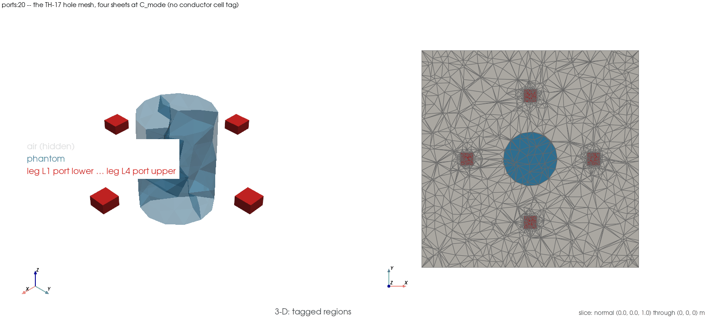

# `ports:20` — the tuned birdcage's own modes in ParaView

Script: `examples/ports/20_birdcage_eigenmodes.py` (`EX-76`)
Gate: `tests/validation/test_th17_birdcage_eigenmodes.py` (`TH-17`)

## 1. What this demonstrates

`TH-17` solved the generalised eigenproblem (G1) of the gapped 4-leg
birdcage on `TH-15` step 3's **PEC-hole** mesh, with the four lumped-sheet
gaps carrying a series capacitor `C_mode` chosen from one driven 64 MHz
sweep. The gate reduced the answer to frequencies. This example keeps the
eigenvectors: the k = 1 pair at 64.33 MHz and the k = 2 singlet at
78.39 MHz above it, `|E|` of all three in ParaView.

**It asserts, it does not merely render.** Every helper and band is
imported, never restated: the fixture, the (G1) solve, the driven sweep and
the frequency map from the `TH-17` module; `KAPPA`
(`STEP2D_C_OVER_TERMINAL_64MHZ_P1`) and `ADJACENT_SPREAD_BAND` from the
modules that gate imports them from. Asserted: (a) both pair members within
`KAPPA` of 64 MHz; (b) the pair split within `ADJACENT_SPREAD_BAND` and
`f_pair < f2`; (d') `|(f_pair(2C)/f_pair(C)) sqrt2 - 1| <= KAPPA`; the
negative control (at `2 C_mode` the pair misses 64 MHz by more than
`KAPPA`); and the mode identity `||Ax - lambda Bx|| / ||lambda Bx|| <= 1e-6`
per exported vector.

**Rule (c), `src/`, disclosed.** `solve_general_mesh_modes` returned no
eigenvectors. An additive `return_vectors` keyword (default `False`; the
unset path is byte-identical) passes through to
`_solve_pencil_nonhermitian`, `EX-60`'s precedent. The test helper
`solve_modes` got the same keyword and appends one dict
`{"vectors", "V", "eps", "forms", "k0_sq"}`. The `TH-17` step-3 test was
re-run green in the same slot (`20261002T140514Z_EX-76-th17-regate.log`,
13 passed per rank, 198 s, its records identical to the W3 log).

**Scope.** `C_mode`, degree 1, `-n 4`. No gate-(c) circuit scan, no
eigenvector class labels (the k = 1 partners are an arbitrary basis of a
near-degenerate pair — their polarisation is not labelled), no AED, no B1,
no Q claim. The hole mesh has no conductor cell tag.

## Setup figure



*Left:* the `TH-15` step 3 hole mesh with `air` hidden and `phantom`
translucent; the coil is cut from the box, so there is no conductor cell
tag to colour, and the four gap boxes (each split into a lower and upper
lumped-sheet half) are the only trace of the coil in the cell tags. *Right:*
the slice at `z = 0`, the port-gap mid-plane, the `ports:14` pattern.
Rendered once with `FEM_EM_SETUP_FIGURES=1` (`20261002T140934Z_EX-76.log`,
346 KiB) right after the mesh is built.

## 2. How to run it

```
./scripts/run_examples.sh -e ports:20 -n 4 -t 300
```

Needs the complex DolfinX build (the runner sources it for the `ports:`
group). Tier: **heavy** (`-n 4`; measured 71 s flagged, 65 s unflagged).

## 3. How to analyze it, step by step

**Step 1 — fixture line.** 80 181 cells, `kappa = 1.060762e-02`, spread
band `0.005`.

**Step 2 — `C_mode`.** One 64 MHz driven sweep, `z1 = 0.5 (z_k1 + z_k3)`,
`C_mode = 1/(omega Im z1)`: `6.628769508e-11 F`, beside the `TH-17` W3
record (`20261001T124845Z_TH-17-gate-c-W3.log`) at a relative difference of
6e-11.

**Step 3 — the pair and `f2`.** (a) errors 5.1549e-03 / 5.2109e-03 =
0.486 / 0.491 `KAPPA`; pair 6.432991449e+07 / 6.433349959e+07 Hz, equal to
`GATE_E_STEP3_PAIR_HZ` to 6e-11; (b) split 5.573e-05, `f2 = 7.838759746e+07`
Hz (W3 value to 2e-11).

**Step 4 — the mode identity.** Residuals 1.1e-12 / 1.4e-12 / 9.5e-12
(flagged run), 2.2e-12 / 1.9e-12 / 4.1e-12 (unflagged), band 1e-6. They move
between runs — the eigenvector arithmetic is parallel and non-associative —
and sit six orders inside the band.

**Step 5 — `2 C_mode`.** The pair sits at 4.566096892e+07 Hz; (d') =
3.7719e-03 (0.356 `KAPPA`); the negative control misses 64 MHz by
2.8653e-01 = 27.01 `KAPPA`, the W3 record.

**Step 6 — open it in ParaView.**
`examples/ports/paraview_output/ports_20_birdcage_eigenmodes_combined.xdmf`:
threshold `CellTags` on the phantom tag (`3`) or colour the whole volume by
`E_mode1a`, `E_mode1b` or `E_mode2` (DG0 `|E|`, unit peak by the global
maximum; eigenvector phase and scale are arbitrary).

**Step 7 — what a deviation means.** A band red here while the `TH-17` gate
holds it is an example/test **divergence**: a known-issues entry and a stop,
never a re-record from the example side and never a loosened band. A
residual above 1e-6 means the vector extraction is wrong.

## Related

- The same hole mesh, driven: `examples/ports/14_birdcage_pec_hole_ports.md`.
- The tuned circuit and its resonance curve: `ports:17`, `ports:19`.
