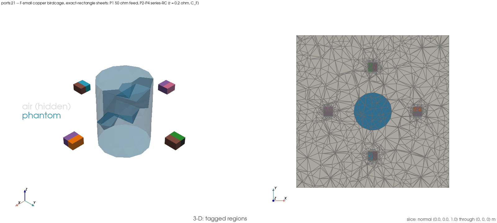

# `ports:21` — the capacitor ESR sheet on the copper birdcage

Script: `examples/ports/21_capacitor_esr_sheet.py` (`EX-105`)
Gate: `tests/validation/test_port24_series_rc_sheet.py` (`PORT-24` step 2)

## 1. What this demonstrates

The operator's ruling of 2026-10-06 says every lumped capacitor carries
r = 0.2 Ω of ESR, and lossless records stay labelled lossless. This example
is the runnable recipe: on the F-small exact-rectangle hole mesh at 64 MHz
(degree 1, κ off, copper by Leontovich on tag 401), a capacitor sheet is

```
LumpedSheetPortSpec(port_impedance_ohm=series_rlc_impedance(f, r_ohm=0.2, l_h=0, c_f=C_F))
```

on an exact CAD rectangle with `width_correction_kappa=None`. Nothing is new
physics: the sheet law already takes a complex `Z_p`. The example asserts
that an ESR-carrying capacitor sheet behaves as its circuit element, and
then reads what the ESR does to the loss partition.

**The angle.** At r = 0.2 Ω the three capacitor sheets take **70.8 %** of
the non-port loss, because copper's own loss on this coil is small. The loss
ratio Q(r)/Q(0) prints 0.2923.

**It asserts, it does not re-implement.** The three arms (r = 0.2 Ω, r = 0,
and a 0.4 Ω planted sheet) are the `PORT-24` step 2 gate's own, called
through the module-level `_run_port24_arm` lifted out of that module's
fixture (additive: a `return_fields=False` keyword, default path unchanged;
no assertion in the gate was added, removed or re-banded). Every band and
constant (`REDUCTION_BAND`, `LEG_D0_REPRODUCTION_BAND`,
`DISCRETE_IDENTITY_RTOL`, `C_F`, `REFERENCE_IMPEDANCE_OHM`, `ESR_OHM`,
`PLANT_OHM`, `PLANT_INDEX`, `FREQUENCY_HZ`, `DEGREE`, `POWER_DRIVEN`) is
imported by name, with an `is` check against the gate module's object.

**Asserted** (on every rank, at the gate's bands): (I) each sheet's
field-solved 3×3 equals the circuit reduction with that sheet in its
series-RC, in the r = 0.2 Ω and r = 0 arms; (Z) at r = 0 the sheet equals the
capacitor-only sheet; (P) the exact power identity, the RC sheets' own
dissipation counted, in every arm; (R0) the r = 0 sheets dissipate exactly
0 W; (Pl) the planted sheet breaks the 0.2 Ω identity, and only there.

**Printed, not asserted:** the ESR loss share, where it sits, the
copper/phantom split, the Q reading, and the omitted-dissipation residual.

## 2. How to run it

Needs the complex DolfinX build; the runner sources it for the `ports:`
group automatically.

```
./run_examples.sh -e ports:21 -n 2 -t 590
```

Tier: **heavy**, `-n 2` (the gate's width). Measured 336 s wall (333.2 s
in-script) for all three arms in one process, so the 590 s window has about
250 s of margin. Verification runs go through the logging harness with the
runner's emitted command (`./scripts/run_examples.sh -e ports:21 -n 2 -t 590
--dry-run`), never with the host runner wrapped inside it. Add
`-T -e FEM_EM_SETUP_FIGURES=1` after `exec` to re-render the setup figure.

## Setup figure



`examples/ports/figures/ports_21_capacitor_esr_sheet_setup.png`, air hidden,
the phantom translucent, the slice normal to `z` through the port sheets.
The lifted gate body exposes no hook before its solves, so the figure is
rendered from the r = 0.2 Ω arm's returned mesh right after that arm
returns; the mesh is the same object the solves used.

## 3. How to analyze it, step by step

Quote lines are from `docs/testing/logs/20261009T040158Z_EX-105.log`
(flagged, Status 0, 336 s at `-n 2`). The gate's logs for the same arms are
`docs/testing/logs/20261008T170256Z_PORT-24-step2-r02.log`,
`docs/testing/logs/20261008T170618Z_PORT-24-step2-r0.log` and
`docs/testing/logs/20261008T170439Z_PORT-24-step2-plant.log`; the lift was
re-run green on all three arms in the same slot
(`docs/testing/logs/20261009T035600Z_EX-105-port24-regate-r02.log`,
`docs/testing/logs/20261009T035741Z_EX-105-port24-regate-plant.log`,
`docs/testing/logs/20261009T035919Z_EX-105-port24-regate-r0.log`), which is
this example's same-width control. The printed `[PORT-24 s2]` rows equal the
gate's at every printed digit, except seconds and the round-off columns.

1. **(I), per sheet, both arms.** Read the four `(I)` rows of each arm
   (`:916–919` for r = 0.2 Ω; `:1811–1814` for r = 0). Each is
   ‖S′_meas − S′_pred‖_F / ‖S′_pred‖_F, with S′_pred the 4×4 reduced by
   `reduce_terminated_ports` on that sheet's series-RC. All eight sit at
   ≈ 0.03 × `REDUCTION_BAND`. The printed Z column also equals
   `series_rlc_impedance(f, r_ohm=r, l_h=0, c_f=C_F)`, asserted in-script.
2. **(Z), r = 0.** The terminated 3×3 reproduces the capacitor-only sheet to
   round-off (`:1811–1814`, ≈ 1e-14 to 1e-16 against the band 1e-9). The
   digits of these round-off columns vary between runs; only the band is
   meaningful.
3. **(P), power.** One P1 drive, P2–P4 in the arm's series-RC:
   `residual/P_src` is 1.011e-12 (r = 0.2 Ω), 1.018e-12 (r = 0), 1.011e-12
   (plant), all against 1e-6 (`:920`, `:1815`, `:2701`). The sheets' own
   dissipation is counted. The residual is round-off scale and compared at the
   band only. At r = 0 the three sheets dissipate exactly 0 W (R0), the fact
   the lossless-record label rests on.
4. **(Pl), the negative control.** Planting 0.4 Ω on P2 and holding it
   against the 0.2 Ω identity gives a P2 residual of 1.095344e-02, which is
   10.95 × `REDUCTION_BAND`, while the three unplanted sheets stay at 3.0e-05
   (max 3.049022e-05) (`:2698`, `:2718`). Only the direction is asserted, not a
   ceiling: the planted residual came out about twice the terminal-impedance
   level the item predicted, through the (I − S_bb Γ)⁻¹ factor at |Γ| ≈ 1, so no
   factor is claimed.
5. **The ESR block** (`:2706–2725`, printed only):
   - **Share.** P_RC / (P_RC + P_vol + P_surf) = 7.077045e-01, i.e. 70.8 %.
   - **Where it sits.** Under the P1 drive, P3 (the opposite sheet) carries
     99.9726 % of P_RC (2.544472427e-05 W; P2 and P4 are 3.4e-10 and 6.6e-09 W).
     That is the drive's mode content, not a per-capacitor Q.
   - **The rest.** P_vol (phantom) 6.276138116e-06 W and P_surf (copper)
     4.235904194e-06 W: copper is 40.3 % of the rest.
   - **The Q reading.** Q(r)/Q(0) = 2.922955e-01 at fixed stored energy;
     Q_C = 1/(ωCr) = 1.875695e+02; **Q_rest = 4.541422e+02, which is copper
     plus phantom, not Q_Cu alone**. The closed form
     1/Q = 1/Q_rest + 1/Q_C gives Q(r) = 132.74 and Q(r)/Q_rest reproduces the
     ratio. That agreement is true by construction, since Q_rest is inferred
     from the same partition. It is a reading, not a check.
   - **The fixed-energy assumption.** P_rest(0.2 Ω) / P_rest(0) =
     1.051204231e-05 / 1.057979998e-05 = 0.9936, so holding the stored energy
     fixed moves the rest by about 0.64 %.
   - **Omitted dissipation.** Leaving the RC sheets' loss out of the
     identity gives a residual of 7.031342e-03 of P_src, against 1.018e-12 at
     r = 0. This is not the 70.8 %, because P_src is dominated by P1's own
     50 Ω sheet (3.583786649e-03 of 3.619750395e-03 W).

| reading | this run | gate log |
|---|---|---|
| mesh | 80798 cells (`:885`) | `PORT-24-step2-r02.log:910` |
| (I) r = 0.2 Ω, P1–P4 | 3.049022e-05 / 3.036163e-05 / 3.040555e-05 / 3.003774e-05 (`:916–919`) | `:941–944` |
| (I) r = 0, P1–P4 | 3.096783e-05 / 3.083764e-05 / 3.088213e-05 / 3.050839e-05 (`:1811–1814`) | `PORT-24-step2-r0.log:941–944` |
| (Pl) P2 | 1.095344e-02, 10.95 × band (`:2698`) | `PORT-24-step2-plant.log:942` |
| power residual, r02 / r0 / plant | 1.011e-12 / 1.018e-12 / 1.011e-12 | `:945` of each |
| ESR share | 7.077045e-01 (`:921`) | `PORT-24-step2-r02.log:946` |
| Q(r)/Q(0), Q_C, Q_rest | 2.922955e-01, 1.875695e+02, 4.541422e+02 (`:922`) | `:947` |

6. **ParaView.** Open
   `examples/ports/paraview_output/ports_21_capacitor_esr_sheet_combined.xdmf`
   (CellTags, `E_magnitude` as DG0, and the facet grid with the sheet tags and
   tag 401), from the r = 0.2 Ω arm on the P1 drive. Slice normal to `z` through
   the sheets and colour by `E_magnitude`.

**Scope.** Covered: the series-RC sheet identity (I) on every sheet at
r = 0.2 Ω and r = 0, the r = 0 reproduction (Z), the power identity (P), and
the planted-sheet control (Pl), on F-small's exact-rectangle hole mesh
(80 798 cells), 64 MHz, degree 1, κ off, copper Leontovich, C = `C_F`,
`-n 2`. **Not claimed:** an absolute Q, f₀, S₁₁, Z_in or tuning figure (the
coil is untuned here; P1 at 50 Ω absorbs ≈ 99 % of P_src); a measured Q
(Q(r)/Q(0) is a loss-partition ratio at assumed fixed stored energy, and
Q_rest is inferred from it); Q_Cu alone; a measured ESR, frequency
dependence, degree 2, h-convergence, F-human, or any external comparison;
`PORT-24` step 1 (the circuit layer), which this example does not move.

## Related

- `examples/ports/17_birdcage_tuned_circuit.md` — lossless series C, circuit side.
- `examples/ports/18_birdcage_copper_leontovich.md` — copper loss, no capacitor.
- `tests/validation/test_port24_series_rc_sheet.py` — the gate.
- `tests/validation/test_port_lumped_rlc_termination.py` — `REDUCTION_BAND` and the reduction identity.
- `src/fem_em_solver/ports/lumped.py` — `series_rlc_impedance`.
- `docs/planning/chunks/PORT-24.md` — the step 2 outcome and price.
