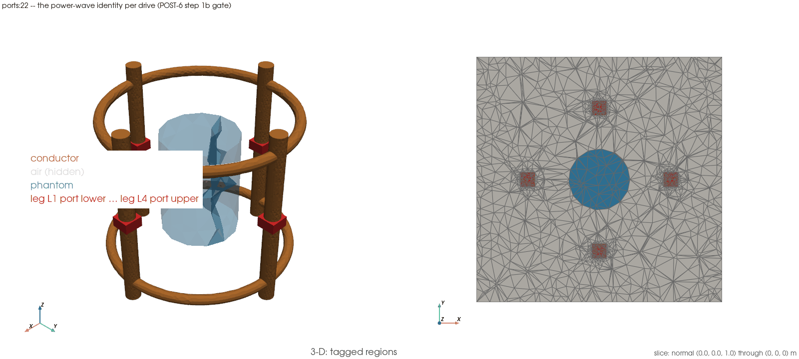

# `ports:22` — the power-wave identity per drive

Script: `examples/ports/22_power_wave_identity_per_drive.py` (`EX-150`)
Gate: `tests/validation/test_port_drive_superposition.py` (`POST-6` step 1b)

## 1. What this demonstrates

`ports:13` prints a **drive-level** ratio (volume loss over accepted power) that
reads ≈ 0.88 and says why in prose. This example shows the identity that *does*
close: what "the S-parameters conserve power" means on a field-derived 4×4.
For each single drive `k` of the 4-leg birdcage (`PORT-9` fixture, 10 MHz,
degree 1, 116 085 cells):

- `P_acc,k = ½|a_k|²(1 − Σ_i|S_ik|²)` — the power the **S-column** says was
  accepted (the package's `accepted_power_w`, and the closed form written out);
- `P_net,k = supplied_k − Σ_i sheets_ik` — the **terminal accounting**:
  `supplied_k = ½Re(V_src I_k*)` less `½|I_i|²Re Z_p` on all four sheets.

**Why (1b-i) is an identity, not a discretisation test.** At `z0 = Re Z_p` both
sides are built from the *same* stored terminal readings, so they are one
quantity algebraically; a 1e-6 band can only catch the assembly disagreeing
with its own definition.

**Why P_vol differs.** `P_vol,k = ½∫σ|E_k|²` is the field-side loss integral; it
carries the discretisation, so it does not close to the identity's level. It is
printed, not gated. Note the measured gap here is ≈ 13 %
(`|P_acc − P_vol|/P_acc`), larger than the ≈ 1 % scale of
`POWER_BALANCE_BAND` that the single-drive *residual* (which includes the sheet
terms) sits at; the brief's "≈ 1 %" expectation did not hold for this print, and
nothing is asserted on it.

**Why `ports:13`'s ratio sits near 0.88.** Known-issues, `POST-6` step 1. That
question is not re-opened here.

### The S-diagonal control

Deleting `S_kk` from column `k` removes the port's own reflection from the
accepted power, so `P_acc,k` grows by exactly `½|a_k|²|S_kk|²`, a miss of
`|S_kk|²/(1 − Σ_i|S_ik|²)` against `P_net,k` — the **ceiling**, computed from S
alone. The control is evaluated independently (written out, not differenced).

### Everything is imported

`STEP1B_POWER_WAVE_RTOL`, `STEP1B_CONTROL_MIN_MISS`, `build_four_port_sweep`,
`_power_shares`, `POWER_BALANCE_BAND`, `run_n_port_sparameter_sweep`,
`superpose_drives` — all by name; no `test_*` name or fixture, no gate or `src/`
edit. The sweep runs with `keep_fields=True`, as `ports:13` does.

## Setup figure



The `GEO-18` gapped, sheeted four-leg birdcage with the phantom loaded (copper
and saline translucent, `air` hidden, each gap split into lower/upper
lumped-sheet halves), sliced at `z = 0`, the port-gap mid-plane — the same
picture as `ports:13`. Rendered once with `FEM_EM_SETUP_FIGURES=1`
(`20261024T171129Z_EX-150.log`); PNG 418 KiB.

## 2. How to run it

```
./run_examples.sh -e ports:22 -n 2 -t 600
```

Needs the complex DolfinX build (the runner sources it for the `ports:` group).
Tier: heavy window, complex build, `-n 2`; measured **51 s** harness
(48.3 s script, field-keeping sweep 8.4 s) in `20261024T171129Z_EX-150.log`,
Status 0.

## 3. How to analyze it, step by step

**Step 1 — cells.** `116085`, equal to the gate's record.

**Step 2 — the identity.** Per drive, `P_acc` and `P_net` agree to round-off
(rel dev 1.683e-15 / 8.412e-16 / 0.000e+00 / 8.409e-16 for P1–P4, against the
gate's 8.414e-16 / 8.412e-16 / 1.679e-15 / 8.409e-16; band 1e-6). The record
digits are printed beside the readings and not asserted for equality; at
round-off the last digit is not reproducible.

**Step 3 — the control.** Miss 7.659732e-01 / 7.656687e-01 / 7.634896e-01 /
7.652279e-01, each equal to its ceiling and to the gate's record, ≈ 763–766×
the `1e-3` floor. The ceiling is the fixture's own number, so no larger factor
is claimed.

**Step 4 — the cross-check.** Single-drive power residuals 9.795751e-03 /
9.796209e-03 / 9.794985e-03 / 9.795283e-03, inside `POWER_BALANCE_BAND`
(1e-2), equal to the `EX-49` records.

**Step 5 — printed only.** `|a_k|` = 7.071068e-02, `Σ_i|S_ik|²` ≈ 0.7934–0.7938,
`|S_kk|` ≈ 0.3972–0.3974, `P_vol,k` ≈ 4.48–4.49e-04 W against `P_acc,k` ≈
5.15–5.16e-04 W.

**Step 6 — open it in ParaView.** `File → Open →`
`examples/ports/paraview_output/ports_22_power_wave_identity_per_drive_combined.xdmf`.
Colour by `E_sq_P1` … `E_sq_P4` (`|E_k|²`, DG0, one distinctly named array per
drive); threshold `CellTags` on the phantom tag (`3`) to see the load. The
facet grid carries the four sheet tags 211–214.

**Step 7 — what a deviation means.** Every band is the gate's, so a miss here
is an example/test divergence: (K) first; if (K) holds and (1b-i) misses, a
known-issues entry naming both logs and a stop. A ceiling-equality miss means
the control is not the perturbation it claims. No band moves.

## What it does not show

No absolute S accuracy, no resonance or tuning claim, no AED comparison, no
64 / 128 MHz. `POST-6` step 1b-ii's regression pin is neither computed nor
asserted. The drive-level accounting question is not re-opened.

## Related

- Superposition twin: `examples/ports/13_birdcage_asymmetric_drive.md` (`EX-49`).
- Gate: `tests/validation/test_port_drive_superposition.py`.
- Package entry point: `src/fem_em_solver/ports/superposition.py`.
