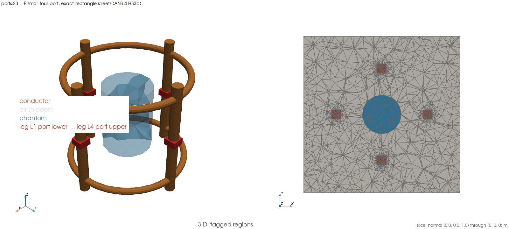

# `ports:23` — the lumped-sheet power identity per sheet, and the excess against the sheet width

Script: `examples/ports/23_lumped_sheet_excess_vs_width.py` (`EX-152`)
Gate: `tests/validation/test_ans4_h33_sheet_width_excess.py` (`ANS-4` H33a)

## 1. What this demonstrates

On the F-small exact-rectangle four-port (σ = 800 S/m wire, 64 MHz, degree 1,
P1 driven alone, κ off) every lumped sheet dissipates power in the **field**
that its **terminal** does not account for. Per sheet `s`:

- `P_sheet,field` — the sheet's field dissipation, the facet integral of the
  solved `E`;
- `½ Re(1/Z_p)|V_s|²` — the dissipation the lumped terminal says the sheet
  has, with the gap voltage `V_s = V_src − I_s Z_p` from the package's own
  terminal current;
- **`X_s` = the first minus the second** — the sheet excess.

`CS_s` is the same excess built a second way, from the sheet's facet integrals
alone (area `A`, `∫E·ĥ`, `∫|n̂×E|²`, `∫|E·ĥ|²`) through the variance split
`CS_s = ½ Re(Y_s)(L_s − |J_s|²/A_s)`. **Why `CS_s / X_s = 1` is a real test:**
`X_s` uses the terminal current and the volume-dissipation machinery, `CS_s`
uses only facet integrals of the field, so agreement at ≈ 1e-10 compares two
independent code paths — it is not an algebraic tautology.

The example re-computes H33a's gates at two of its three widths,
`f = 0.25` (w₀/2) and `f = 0.5` (w₀, the record width), and prints the excess:

| gate | what it asserts | band (imported) |
|---|---|---|
| (Wd) | meshed sheet area = `f · port_dx · LEG_GAP_LENGTH` | `STRIP_BAND` |
| (CS) | `|CS_s/X_s − 1|` on all four sheets | `DISCRETE_IDENTITY_RTOL` |
| (c-V) | a planted ×1.01 on `V` moves CS/X off 1 | ≥ `BLIND_FACTOR` × `DISCRETE_IDENTITY_RTOL` |
| (P_w) | `P_src = P_vol + ΣP_sheet,field` | `DISCRETE_IDENTITY_RTOL` |
| (c-blind) | the conductor-blind sum misses | ≥ `BLIND_FACTOR` × `DISCRETE_IDENTITY_RTOL` |
| (P_acc-1) | line cut `½Re(V₁Ī₁)` = wave form `|V_src|²/(8 z₀)(1 − |S₁₁|²)` | `DISCRETE_IDENTITY_RTOL` |
| (R0) | at `f = 0.5` the rung's S equals `ANS4_EXACT_STRIP_S_P1_RECORDS["64"]` (`-n 2` only) | `LEG_D0_REPRODUCTION_BAND` |

**What the excess is, and is not.** The excess is a **record** — the
lumped-sheet finding of known-issues (2026-10-11), owned by `ANS-4` chain H.
This example shows that it is real (two independent paths agree on it to
≈ 1e-10) and how it moves with the sheet width; it does not explain it.

**Not shown:** degree 2 (`ANS-4` H33b, cited, not run); the w₀/4 width; Palace's
excess (H34); any cause of the excess; any band on the excess.

### Everything is imported

`_width_case`, `excess_w`, `gap_voltage`, `p_acc_wave`, `width_exponent`,
`PORT_IDS`, `DRIVEN`, `PLANTED_V_FACTOR`, `RECORD_FRACTION` from the gate module
as `h33`; the bands from the modules `h33` takes them from. No `test_*` name, no
gate or `src/` edit. The only solve the example adds is the record-width P1
re-solve for the picture (`_solve_driven`, the same call `_width_case` makes).

## Setup figure



The gapped, sheeted four-leg birdcage with the phantom loaded (copper and saline
translucent, `air` hidden, each gap split into lower/upper lumped-sheet halves),
sliced at `z = 0`, the port-gap mid-plane, on the record-width (`f = 0.5`) rung.
Rendered once with `FEM_EM_SETUP_FIGURES=1`
(`20261025T200450Z_EX-152.log`); PNG 411 KiB.

## 2. How to run it

```
./run_examples.sh -e ports:23 -n 2 -t 600
```

Needs the complex DolfinX build (the runner sources it for the `ports:` group).
Tier: heavy window, complex build, `-n 2`; measured **98 s** harness (95.9 s
script; 41.9 s for the `f = 0.5` rung and diagnostic) in
`20261025T200450Z_EX-152.log`, Status 0.

## 3. How to analyze it, step by step

**Step 1 — cells.** `f = 0.5`: 117 206 cells (the gate's 116 085 record is the
older mesh image; ratio 1.0097, printed by the fixture).

**Step 2 — (Wd).** Largest sheet-area relative error 8.882e-16 (`f = 0.25`) and
1.554e-15 (`f = 0.5`), band 1e-9: the sheet is the exact CAD rectangle.

**Step 3 — (CS) and (c-V).** `|CS/X − 1|` ≤ 5.5e-11 at `f = 0.25` and ≤ 1.04e-10
at `f = 0.5` over P1–P4 (band 1e-6). The planted ×1.01 on `V` moves it to
1.0006–1.0027, about 1e5 × the 1e-5 floor.

**Step 4 — (P_w), (c-blind), (P_acc-1).** `P_w` 3.306e-16 / 6.495e-15 and
`P_acc-1` 0 / 1.331e-15 (`f = 0.25` / `0.5`; band 1e-6). The conductor-blind sum
misses by 8.664e-02 / 8.587e-02, so the identity does depend on the conductor
term.

**Step 5 — (R0).** At `f = 0.5`, `‖S − S_rec‖/‖S_rec‖` = 9.557e-11 (band 1e-9),
equal to the H33a record at the printed digits.

**Step 6 — printed only: the excess.** `X_s / P_acc`, P1–P4, summed:

| f | P1 | P2 | P3 | P4 | Σ | H33a Σ |
|---|---|---|---|---|---|---|
| 0.25 | 7.250600e-05 | 8.411915e-06 | 4.107957e-06 | 1.455148e-05 | 9.957736e-05 | 9.957736e-05 |
| 0.5 | 3.093558e-05 | 3.570717e-06 | 3.056820e-06 | 3.790608e-06 | 4.135372e-05 | 4.135372e-05 |

The excess falls as the sheet widens; the driven sheet carries most of it.
The **two-point** width exponent of `ΣX_s/P_acc` is −1.2678, a slope between two
widths only (H33a's three-point LSQ is −1.6848; H33b's degree-2 figure is
≈ −2.09, cited, not run here). `σ_max(S)` 0.999751 / 0.999760. Record digits
are printed beside readings; nothing here asserts digit equality.

**Step 7 — open it in ParaView.** `File → Open →`
`examples/ports/paraview_output/ports_23_lumped_sheet_excess_vs_width_combined.xdmf`
(`|E|` of the `f = 0.5` P1 drive as DG0 `E_mag_P1`; the facet grid carries the
four sheet tags 211–214). The per-sheet table is
`examples/ports/paraview_output/ports_23_lumped_sheet_excess_vs_width_table.csv`.
Both are gitignored artifacts on disk.

**Step 8 — what a deviation means.** Every band is the gate's. A red here while
H33a's `20261025T095010Z_ANS-4-H33a-W1.log` was green is an image or path
divergence: a known-issues entry naming both logs, and a stop. No band moves.

## Related

- `ports:3` — `examples/ports/03_lumped_sheet_port_widths.md` (sheet-width sweep on
  the two-torus, a cross-route deviation).
- `ports:22` — `examples/ports/22_power_wave_identity_per_drive.md` (per-drive
  accepted power).
- `ans:8` — `examples/ansys_benchmarks/ans8_f_human_quadrature_mode_content_64MHz/`
  (where `sheet_variance_split` first appeared).
- Gate: `tests/validation/test_ans4_h33_sheet_width_excess.py`.
