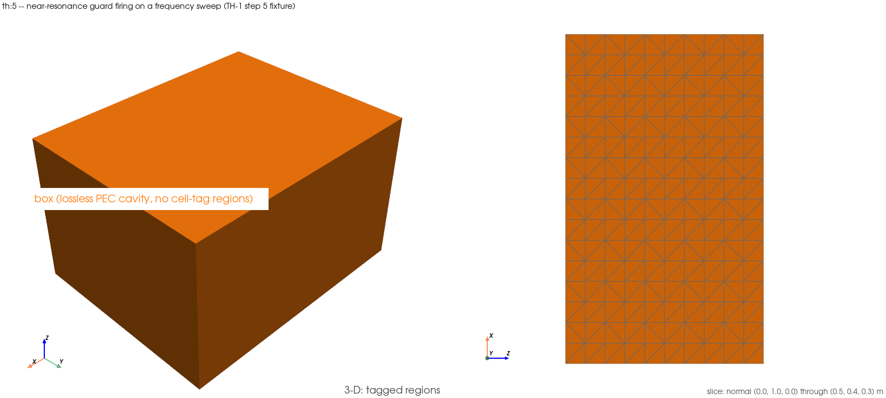

# `-e th:5` — the near-resonance guard firing on a frequency sweep

Guide for `examples/time_harmonic/05_resonance_guard_sweep.py`. Written to be
followed without the source open.

## 1. What this demonstrates

**The first example in this repository whose subject is a failure mode of the
solver rather than a field.** Every other example shows a solve that worked.
This one shows the solve that silently does not.

PROJECT_PLAN §7 names the trap: with PEC boundaries and a low-loss interior the
curl-curl operator is *exactly singular* at the truncation box's cavity
eigenfrequencies (the ones `th:2` computes), and MUMPS returns a clean exit code
on a near-singular system — the same shape as `MAG-10`'s "converged, residual
0.0, 920% error". An MRI birdcage is deliberately operated near resonance, so
Phase 6 will live inside this trap.

`core/resonance.py` is the detector. Stored electric energy
`W(f) = (ε₀/4)∫εᵣ|E|²` is smooth away from a mode and behaves like a simple pole
`W ∼ |f − f₀|⁻²` near one, so the logarithmic sensitivity
`S = |d ln W / d ln f| ≈ 2f/|f − f₀|` is `O(1)` in a quiet band and diverges on
approach. It needs no eigen-solve and no geometry — only two solves a sweep is
already doing.

The sweep windows, the mesh, the material and the drive are *imported* from the
module that closed `TH-1` step 5 (`tests/validation/test_resonance_guard.py`),
never restated. The §7 `EX-8` plan is explicit about why: the first attempt at
that gate failed on a badly-placed window (separation 2.814×), so the windows
are the gate's or they are wrong.

On record at `-n 2` (`20260810T033313Z_EX-8-gate.log`, 26 s, 2026-08-09 22:30
slot; every printed quantity reproducing `20260731T021521Z_TH-1-step5b.log`
digit for digit):

| Quantity | Value | Bound |
| --- | --- | --- |
| Approach max `|dlnW/dlnf|` | **137.554** | > 50 (fires) |
| Implied detuning at approach | **1.454%** | ≈1.5% on record |
| Quiet-band max slope | **21.951** | < 50 (stays silent) |
| Separation between the two | **6.267×** | — |
| Energy amplification, 4% → 1% detuning | **16.505×** | pole law `(0.04/0.01)²` = 16.0× |
| Amplification error | **3.156%** | 10% |
| Approach sweep energies | 5.8742e-07 / 2.3992e-06 / 9.6953e-06 | — |
| Quiet sweep energies | 1.4700e-07 / 9.4344e-08 / 6.6048e-08 | — |
| Energy re-assembled from the exported Functions | **0.00e+00** relative | bitwise |
| Peak `|E|`, near-resonant, native N1curl field at the mesh vertices (`20261025T183230Z_POST-4.log`) | **5.8778e+03** V/m | — |
| Peak `|E|`, quiet, native | **5.9984e+02** V/m | factor **9.80** |
| P1 export (picture), record: near-resonant / quiet | 6.0350e+03 / 6.1719e+02 V/m | factor 9.78 |
| Six solves | 21.4 s | 23.3 s total |

The gate is `TH-1` step 5 (✅ 2026-07-31). Every bound above is that gate's own;
none was loosened and none was invented. This example closes nothing
physics-side; Phase-2 §5.4 diagnostics backfill.

## 2. How to run it

```
./run_examples.sh -e th:5 -n 2 -t 180
```

**Complex build required** — the `th:` group sources it automatically. Tier:
**standard**; 26 s harness-wall on record, 21.4 s of it the **six** solves (three
approach points, three quiet points). This is the most expensive of the five
`th:` examples for exactly that reason: the negative control is solved here, not
cited, and it costs half the run.

## Setup figure



`examples/time_harmonic/figures/time_harmonic_05_resonance_guard_setup.png`.
This is a plain box domain with **no cell-tag regions** — the fixture is the
same shape of medium `th:2`'s cavity uses (a single lossless, source-free
1.0 × 0.8 × 0.6 m box bounded by `n × E = 0`), but meshed finer (8, 7, 5) and
solved at N1curl degree 2, so there is nothing to colour by region (and no
field either: the helper draws the mesh, not a solved array) and none is
invented here. The figure is rendered on `dmesh.create_box`'s own mesh right
after the sweep's six solves complete, the same mesh every approach and quiet
point in the table above is solved on. The 3-D panel shows the single
untagged volume (one colour, since there is only one region); the slice panel
cuts normal to y through the box centre (0.5, 0.4, 0.3), i.e. the x–z plane —
the same orientation `th:2` uses on its coarser mesh, with the (8, 7, 5)
mesh's finer edges visible.

## 3. How to analyze it, step by step

**Step 1 — read the sweep table before either verdict.** Six rows, three per
arm, each with its frequency, stored energy, and slope. The approach energies

```
  5.8742e-07  →  2.3992e-06  →  9.6953e-06
```

rise by more than an order of magnitude across the arm; the quiet ones

```
  1.4700e-07  →  9.4344e-08  →  6.6048e-08
```

drift gently downward. That contrast is the whole phenomenon, and it is visible
before any threshold is applied.

**Step 2 — the guard fires on the approach arm.**

```
  approach: max |dlnW/dlnf| = 137.554  (threshold 50)  implied detuning 1.454%
```

137.554 against a threshold of 50 is not a marginal trip. The **implied
detuning** is the more useful output of the two: the guard converts its own
slope back into a distance from the pole, `≈ 2f/S`, and says the nearest sweep
point sits about 1.45% away from a cavity mode. That is an actionable number —
it tells you where the mode is without an eigen-solve.

**Step 3 — the negative control is in-fixture and solved here, not cited.** A
guard that always triggers is exactly as useless as one that never does. The
quiet arm — the midpoint between the two lowest modes, as far from both poles as
the band allows — is solved in this same run and must stay **silent**:

```
  quiet: max |dlnW/dlnf| = 21.951  (threshold 50, untriggered)
  separation: 6.267x
```

The 6.267× separation between the two maximum slopes is the discrimination this
example claims. Note the quiet arm is not *far* below the threshold — 21.951
against 50 — which is honest: the quiet band of a resonant box is not a quiet
place, and the guard's margin is a factor of ≈2, not a factor of 100.

**Step 4 — the amplification against the pole law, which is what makes this a
calibrated detector rather than a tripwire.**

```
  amplification 16.505x  (pole law (0.04/0.01)^2 = 16.0x)  3.156%, ceiling 10%
```

Going from 4% detuning to 1% detuning is a factor of 4 in distance and therefore
16 in energy under `W ∼ |f − f₀|⁻²`. The measured 16.505× is **3.156%** off
that. This is the assertion that distinguishes "the numbers grew" from "the
numbers grew the way a simple pole makes them grow" — a tripwire only needs the
first, a detector you can trust near a birdcage resonance needs the second.

**Step 5 — the exported fields are the scored fields.** The two `.xdmf` arrays
are the phasors solved at the nearest approach point and at the quiet midpoint,
and the stored energy **re-assembled from the Function objects handed to the
writer** reproduces their sweep-table entries to **0.00e+00** relative —
bitwise, since they are the same objects. That is what catches an off-by-one in
the sweep index or a stale field being written, which on a picture of this kind
would be undetectable.

**Step 6 — open it in ParaView, and use the same colour scale for both.**
`File → Open → examples/time_harmonic/paraview_output/time_harmonic_05_resonance_guard_combined.xdmf`.

1. Colour by `E_magnitude_near`, then by `E_magnitude_quiet`, **with the range
   locked**. The near-resonant field saturates the scale; the quiet one is
   nearly black. That factor **9.80** (native field: 5.8778e+03 vs 5.9984e+02 V/m) is the pole
   made visible, on the same mesh with the same drive. The colours come from the
   CG1 export, whose peaks are 6.0350e+03 vs 6.1719e+02 V/m (factor 9.78): the
   export's own record, not the field's. An earlier version of this page quoted
   the export's peaks as 6.0531e+03 / 6.1951e+02 (factor 9.77); the current
   image's export reads as above (`POST-4` R2, 2026-10-25).
2. Now look at each field's *shape* on its own auto-scaled range. **Both are
   clean, smooth, entirely plausible fields.** Nothing about the near-resonant
   solve's exit code, residual, or field shape says anything is wrong — only its
   magnitude does. This is the point of the whole example: the failure mode is
   invisible to every check except the one this guard performs.
3. **Glyph** on the near-resonant field: it has picked up the spatial pattern of
   the nearby cavity mode, which is why its energy diverges. Compare it with the
   `th:2` fundamental if you want to see the same shape solved deliberately.

**Step 7 — what a deviation means.** Approach slope below 50 → either the mesh
or the box changed and the mode moved out of the swept window; check the implied
detuning before concluding the guard is broken. Quiet slope **above** 50 → the
window is badly placed, which is exactly the `TH-1` step-5 first-attempt failure
(separation 2.814×), and the fixture's windows must not be re-tuned to make it
pass. Amplification outside 10% while the slopes hold → the energy functional or
the detuning arithmetic, not the solver. Separation falling toward 1 → the guard
has lost its discrimination and should be treated as non-functional, not as
marginal. Any of these is a regression finding against `TH-1` step 5: report and
stop.

## Related

- The gate this example runs: `tests/validation/test_resonance_guard.py`
  (`TH-1` step 5), and PROJECT_PLAN.md §7 for its record.
- The eigenfrequencies whose poles this guard is detecting, solved directly:
  `examples/time_harmonic/02_pec_cavity_resonances.py` (`th:2`).
- The end-to-end coil + phantom demo that Phase 6 will operate near resonance:
  `examples/mri/01_coil_phantom_fields.py` (`mri:1`, ungated).
