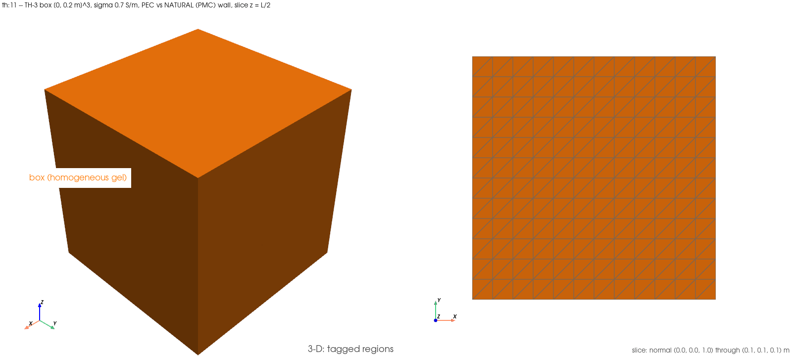

# `th:11` — PEC wall against PMC wall: each boundary option, its own field

Script: `examples/time_harmonic/11_pec_pmc_boundary_modes.py` (`EX-64`)
Gate: `tests/solver/test_boundary_condition_selection.py` (`TH-3`)

## 1. What this demonstrates

The boundary model. Every example that names a boundary passes
`"pec_zero_tangential_a"`; `th:8` and `mri:1` sit on the `NATURAL` default,
unnamed and unanchored. This example solves the `TH-3` box (0.2 m cube,
127.74 MHz, σ = 0.7 S/m, ε_r = 78, degree 1) once under each option, against a
manufactured field that suits it. Under PEC, E meets every face normally
(`n × E = 0`). Under `NATURAL` (a perfect magnetic wall), E meets it
tangentially (`n × curl E = 0`, E itself free).

Everything is imported from the gate module: `TH3_SIZES` (12, 24),
`_solve_mms`, `_th3_field_ufl`, `_th3_exterior_edges`, and the bands, now
named `TH3_REL_L2_BAND` (0.10) and `TH3_RATE_FLOOR` (0.9). Nothing is restated.
The gate's `_solve_mms` gains one additive keyword, `return_fields=False`,
so the example can export the field it asserts, and the two literals became
named constants with unchanged values. The gate module was re-run green in the
same slot (`EX-64-th3-regate`).

Asserted, per mode:

- owned constrained dofs are exactly `18 n²` under PEC (2592 at 12³, 10368 at
  24³) and exactly 0 under `NATURAL`;
- relative L2 at 24³ is below `TH3_REL_L2_BAND`, below the 12³ value, and the
  rate is above `TH3_RATE_FLOOR`.

**Negative control (asserted):** E_nat's source under PEC and E_pec's source
under `NATURAL`, at 12³, each miss by more than `TH3_REL_L2_BAND`. The gate
read 0.891 and 0.626.

Printed beside the gate record (`docs/testing/logs/20260930T022051Z_TH-3-W1.log:280–297`),
a difference reported and not asserted: 1.165799e-01 → 5.852485e-02 (0.9942)
for PEC, 7.527560e-02 → 3.774071e-02 (0.9961) for `NATURAL`. Also printed,
never gated: the wall-trace fraction `∮|n×E_h|² dS / ∮|E_h|² dS`, which is 0
under PEC and ≈ 1 under `NATURAL`.

Scope: homogeneous-data PEC and `NATURAL` on a box, degree 1. Not per-face PMC,
non-zero Dirichlet data, `pec_facet_tags`, or symmetry planes (`TH-16`).

## 2. How to run it

```
./run_examples.sh -e th:11 -n 2 -t 300
```

Needs the complex DolfinX build, which the runner sources for the `th:` group.
Tier: **standard**; the whole run takes ≈ 34 s at `-n 2`. Verification runs go
through the logging harness with the runner's emitted command
(`./scripts/run_examples.sh -e th:11 --dry-run`). Add
`-e FEM_EM_SETUP_FIGURES=1` after `exec -T` to re-render the setup figure.

## Setup figure



`examples/time_harmonic/figures/time_harmonic_11_pec_pmc_boundary_modes_setup.png`.
The figure is rendered on the first mesh the gate's solve builds (12³ tetrahedra).
It shows one untagged homogeneous region, sliced at z = L/2. The two boundary
options share this mesh and differ only in the wall condition.

## 3. How to analyze it, step by step

**Step 1 — the mode lines.** Each `[pec]` and `[natural]` size line prints
in the gate's own format, so it compares with the gate record digit for digit.
The `ASSERTED ==` figure beside `owned constrained dofs` is the exact count.
A miss beyond print rounding is an example/test divergence, never a re-record.

**Step 2 — the rate lines.** The rate 12³ → 24³ is 0.9942 (PEC) and 0.9961
(`NATURAL`), against a floor of 0.9. This is first-order convergence of the
degree-1 N1curl space, under both walls.

**Step 3 — the wall-trace fraction.** PEC reads at round-off (≈ 6e-32),
because the constrained edges pin `n × E_h` to zero. `NATURAL` reads 0.9972:
the field arrives at the wall tangentially, and the small shortfall from 1 is
the discretisation. Neither number is gated.

**Step 4 — the control.** The wrong source under the wrong wall misses by
0.891 (E_nat under PEC) and 0.626 (E_pec under `NATURAL`), against a match of
a few percent. The two boundary options are therefore not interchangeable, and
the gate's bands can tell them apart.

**Step 5 — ParaView.** Open
`examples/time_harmonic/paraview_output/time_harmonic_11_pec_pmc_boundary_modes_pec_combined.xdmf`
and
`examples/time_harmonic/paraview_output/time_harmonic_11_pec_pmc_boundary_modes_natural_combined.xdmf`
and colour by `E_real` or `E_error_magnitude`. Both are CG1 interpolants of
the degree-1 N1curl solution, written at 24³; they are for looking at, and
nothing is asserted on them. Under PEC, `E_real` vanishes tangentially on the
faces. Under `NATURAL` it does not.

## Related

- The PEC box and its real spectrum: `examples/time_harmonic/02_pec_cavity_resonances.md`.
- The Leontovich (third-kind) wall on the same box: `examples/time_harmonic/10_lossy_wall_cavity_q.md`.
- The gate module: `tests/solver/test_boundary_condition_selection.py`.
