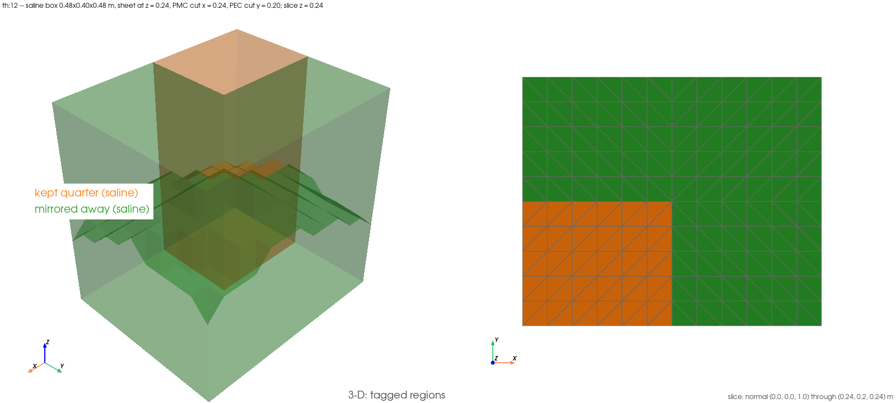

# `th:12` — quarter the box: a PMC plane and a PEC plane, the port rescaled

Script: `examples/time_harmonic/12_symmetry_plane_quarter_box.py` (`EX-66`)
Gate: `tests/validation/test_th16_symmetry_plane_driven.py` (`TH-16` step 2)

## 1. What this demonstrates

The boundary model on a driven port. No other example cuts a model on a
symmetry plane. This one solves one saline box (0.48 × 0.40 × 0.48 m,
64 MHz, degree 1) with one interior lumped sheet (ĥ = ŷ, 50 Ω, 1 V at
z = 0.24) four ways, on mirror-exact meshes: full, PMC half, PEC half and
quarter. It shows the rule (Jin §8.7.5):

- A cut plane **containing** ĥ (x = 0.24) is a PMC plane. It is the driven
  path's natural condition, so the cut is left unpinned. The half-sheet sees
  Z doubled and I halved, and `full_impedance(Z_h, "pmc")` restores Z_f.
- A cut plane **normal** to ĥ (y = 0.20) is a PEC plane, so it is pinned.
  Z and V halve, and `full_impedance(Z_h, "pec")` restores Z_f.
- The quarter (both cuts, `halve_sheet_spec` applied twice) returns Z_f
  directly, on a quarter of the cells.

Everything is imported from the gate module: the quarter mesh and its numpy
mirrors (`build_cases`, `_distribute`, `_tag`), the solve (`_solve`), the
64 interior points and mirror maps (`POINTS`, `_mx`, `_my`, `S_X`, `S_Y`),
the counts (`EXPECTED`, `EXPECTED_PMC_CUT_FACETS`), the band
`LEG_D0_REPRODUCTION_BAND` (1e-9) and the control floor `NC1_FLOOR` (10 %).
Nothing is restated. The gate gained two additive changes: `_solve(...,
return_fields=False)`, which adds `"fields"` when set, and a module-level
`build_cases()`, which holds the fixture's case table moved verbatim. The
gate was re-run green in the same slot (`EX-66-th16-regate`, 22 passed).

Asserted:

- the vertex, cell and owned sheet-facet counts `== EXPECTED`, and the
  natural cut-facet counts `== EXPECTED_PMC_CUT_FACETS`;
- (1) the full field at `POINTS` and at their three mirror images satisfies
  E(mirror p) = S·E(p);
- (2) PMC half: Z through `full_impedance(·, "pmc")`, V, I/2, P/2 and E at
  `POINTS`;
- (3) PEC half: Z through `full_impedance(·, "pec")`, V/2, I and P/2;
- (4) quarter: Z and P/4.

Each identity must hold to within `LEG_D0_REPRODUCTION_BAND`. On a
mirror-exact mesh the half and quarter models are the full discrete problem
restricted to its even or odd subspace, so they agree to solver round-off,
not to a discretisation error.

**Negative control (asserted):** the PMC half with its cut *pinned* (the
wrong condition, `ALL_FACES`). |Z/(2Z_f) − 1| must exceed `NC1_FLOOR`; the
gate read 5.786521e-01.

Printed beside the gate record (`docs/testing/logs/20260929T111548Z_TH-16-step2-W2.log:96–132`),
a difference reported and not asserted:
Z_f = 1.082882778204e+01 + 3.482120962988e+00j Ω, P_f = 1.458517771552e-03 W,
mirror residual 1.038e-14, identities ≤ 1.3e-15 (E 6.4e-15).

Scope: one box, one interior sheet, 64 MHz, degree 1, mirror-exact meshes.
It does not cover a mesh cutter, the birdcage (`TH-16` step 3), multi-port S,
a sheet lying in a cut plane, a separately meshed full box, memory figures or
the eigen path.

## 2. How to run it

```
./run_examples.sh -e th:12 -n 2 -t 180
```

Needs the complex DolfinX build, which the runner sources for the `th:` group.
Tier: **standard**. The whole run takes ≈ 6 s at `-n 2`. Verification runs go
through the logging harness with the runner's emitted command
(`./scripts/run_examples.sh -e th:12 --dry-run`). Add
`-e FEM_EM_SETUP_FIGURES=1` after `exec -T` to re-render the setup figure.

## Setup figure



`examples/time_harmonic/figures/time_harmonic_12_symmetry_plane_quarter_box_setup.png`.
The figure shows the full mirror-exact box (8 640 tetrahedra). The cell tags
are figure-only: 1 is the kept quarter (x < 0.24, y < 0.20) and 2 is what the
two cuts mirror away; both regions are one saline material. The slice is at
z = 0.24, the sheet's plane. The quarter's corner meets the sheet's centre, so
each model keeps its share of the sheet: a half, a half or a quarter.

## 3. How to analyze it, step by step

**Step 1 — the structure lines.** Each model prints its vertex, cell and owned
sheet-facet counts beside the asserted tuple. The PMC half and the quarter
also print their 240 / 120 natural facets on x = 0.24. Those facets are left
unpinned: a PMC plane is simply not constrained on the driven path.

**Step 2 — the port lines.** Read V, I and Z across the four models. The PMC
half keeps V and halves I, the PEC half halves V and keeps I, and the quarter
halves both. So the quarter's Z equals Z_f while its P is P_f/4.
`examples/time_harmonic/paraview_output/time_harmonic_12_symmetry_plane_quarter_box_port_table.csv` lists each model's raw Z beside the full-model Z restored
by `full_impedance`.

**Step 3 — the identity lines (1)–(4).** Every relative error is at
round-off (≈ 1e-15), eight orders under the 1e-9 band. The full field's
mirror residual confirms the symmetry the cuts rely on: E_x is odd across
x = 0.24 (PMC, tangential E even), and E_y is even across y = 0.20 (PEC,
tangential E odd).

**Step 4 — the control.** Pinning the PMC cut, which is the natural mistake
of treating every cut as a wall, moves Z by ≈ 58 %. The cut condition is
not a detail.

**Step 5 — ParaView.** Open
`examples/time_harmonic/paraview_output/time_harmonic_12_symmetry_plane_quarter_box_full_combined.xdmf`
beside
`examples/time_harmonic/paraview_output/time_harmonic_12_symmetry_plane_quarter_box_quarter_combined.xdmf`
(also
`examples/time_harmonic/paraview_output/time_harmonic_12_symmetry_plane_quarter_box_pmc_half_combined.xdmf`
and
`examples/time_harmonic/paraview_output/time_harmonic_12_symmetry_plane_quarter_box_pec_half_combined.xdmf`),
and colour by `E_real` or `E_imag`. The facet-tag block marks the faces
(1–6) and the sheet (10). The quarter's field is the full field's corner.
These are CG1 interpolants of the degree-1 N1curl solution; they are for
looking at, and nothing is asserted on them.

## Related

- One condition on every wall of a source-free box: `examples/time_harmonic/11_pec_pmc_boundary_modes.md`.
- The gate module: `tests/validation/test_th16_symmetry_plane_driven.py`.
- The quarter birdcage (`TH-16` step 3c): `tests/validation/test_th16_quarter_birdcage.py`.
