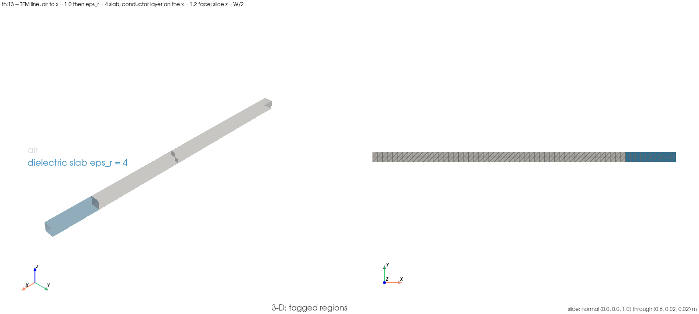

# `th:13` — a foil thinner than its skin depth: Γ of a slab-backed conductor layer on a driven TEM line

Script: `examples/time_harmonic/13_layered_foil_reflection.py` (`EX-70`)
Gate: `tests/validation/test_th18_layered_reflection.py` (`TH-18` step 2)

## 1. What this demonstrates

A line driven from one end, with the reflected wave read back. No other example
does this: `th:1` pins the exact field on every face, and every other Γ in the
repository is a lumped-port S. It is also the first example that consumes
`core/layered_impedance.py` (`th:10` and `ports:18` use the bulk (1 + j)R_s).

The line is a box 1.2 × 0.04 × 0.04 m, E along z, at 127.74 MHz, degree 2. Air
runs to x = 1.0 and a dielectric slab (εᵣ = 4) from there to x = 1.2. The x = 0
face is pinned to the drive, the z faces are PEC, the y faces are natural. The
x = 1.2 face carries a **conductor layer** of conductivity σ = 10 S/m as Jin
§5.8.3's third-kind surface term, with Z_s from `layered_surface_impedance`.
Γ is the 41-point least-squares fit of E_z on x ∈ [0.15, 0.85], referenced at
x = 1.0. The skin depth is δ = 14.081751 mm, so 5δ = 70.4 mm and δ/2 = 7.04 mm.

Five terminations:

| case | termination | role |
|---|---|---|
| `leo` | bulk Leontovich, Z_s = (1 + j)R_s | the surface term most examples use |
| `t5` | foil 5δ thick | reflects as the bulk surface |
| `thin` | foil δ/2 thick | leaks; Γ moves by ≈ 0.09 |
| `pec` | perfect conductor | the limit |
| `copper` | 35 µm of 5.8e7 S/m | printed only, never gated |

Everything gated is imported, never restated: `fem_gamma`, `closed_form_gamma`,
`_fixture`, `_delta`, `B_MAG`, `B_ARG`, `PREMISE_CAP`, `NEGATIVE_CONTROL_HAND`,
`LENGTH`, `WIDTH`, `AIR_TAG`, `SLAB_TAG`, plus `_leo_zs`, `_foil_zs`,
`COPPER_T`, `COPPER_SIGMA` for the Z_s column of the table. One additive
lift in the gate module, disclosed: `fem_gamma(case, return_fields=False)`
returns `(Γ, fields)` when the flag is set, skipping the cache read; the default
path is byte-identical and the gate was re-run green in the same slot
(`EX-70-th18-regate`: 21 passed).

Asserted, as the gate writes it:

- (1) `leo`: d|Γ| and d∠Γ ≤ `PREMISE_CAP` (1e-3);
- (2)–(4) `t5`, `thin`, `pec`: d|Γ| ≤ `B_MAG` (3e-6), d∠Γ ≤ `B_ARG` (5e-5 rad).

**Negative control (asserted):** the bulk Leontovich Γ against the thin-foil
closed form. |Γ_leo,FEM − Γ_thin,cf| must exceed 10·max(B) (5e-4) and sit
within max(B) of `NEGATIVE_CONTROL_HAND` (0.093). The gate read 0.092963; the
ceiling is ≈ 186× the floor.

Printed beside the record (`docs/testing/logs/20260930T021508Z_TH-18-step2-W2.log:99–124`),
a difference reported and not asserted: d|Γ| / d∠Γ of 7.185e-07 / 1.354e-05
(`leo`), 7.184e-07 / 1.354e-05 (`t5`), 1.176e-06 / 1.417e-05 (`thin`),
3.331e-16 / 1.423e-05 (`pec`), and the copper |Γ_cu − Γ_pec| of 5.242e-05.

Scope: normal incidence, 127.74 MHz, σ = 10 S/m, one foil, degree 2. It is not
a copper gate (copper is printed), oblique incidence, `th:10`'s cavity Q or a
birdcage.

## 2. How to run it

```
./run_examples.sh -e th:13 -n 2 -t 180
```

Needs the complex DolfinX build, which the runner sources for the `th:` group.
Tier: **standard**. The whole run takes ≈ 9 s at `-n 2` (five solves of ≈ 1 s
each after a ≈ 1 s first compile). Verification runs go through the logging
harness with the runner's emitted command
(`./scripts/run_examples.sh -e th:13 -n 2 -t 180 --dry-run`). Add
`-e FEM_EM_SETUP_FIGURES=1` after `exec -T` to re-render the setup figure.

## Setup figure



`examples/time_harmonic/figures/time_harmonic_13_layered_foil_reflection_setup.png`.
The figure shows the gate's mesh (1 440 tetrahedra, 240 in the slab): air for
x ≤ 1.0 and the εᵣ = 4 dielectric slab for x ≥ 1.0, sliced at z = W/2. The
conductor layer has no cells: it is a surface term on the x = `LENGTH` = 1.2 m
face, the right-hand end of the box.

## 3. How to analyze it, step by step

**Step 1 — the Γ table.** Read the five `[case]` lines: FEM and closed-form |Γ|
and ∠Γ and their differences. `leo` and `t5` agree to ≈ 1e-6 in |Γ| with
|Γ| ≈ 0.910: at 5δ the foil is a bulk surface. `thin` reads |Γ| = 0.838 with
∠Γ = 1.637 rad: the foil leaks, the wave sees the slab backed by a thin sheet,
and Γ moves.

**Step 2 — the assertions (1)–(4).** The FEM and the transmission-line cascade
agree to the band the gate froze, the same number at 4 digits as the record.
`pec` is unit modulus to round-off (3.3e-16) with a phase error of 1.4e-5 rad,
which is the discretisation floor shared by every case.

**Step 3 — the control.** Replacing the foil by the bulk Leontovich term and
comparing with the thin-foil closed form misses by 0.092963, ≈ 186× the
5e-4 floor. That miss is the physics the bulk term cannot represent.

**Step 4 — the printed-only line.** 35 µm of copper is a PEC at this
frequency to 5.2e-5 in Γ. It is a reading, not a gate.

**Step 5 — ParaView.** Open
`examples/time_harmonic/paraview_output/time_harmonic_13_layered_foil_reflection_combined.xdmf`
and colour by `E_real_<case>` or `E_imag_<case>`; the facet tags
(drive 11, termination 12, z faces 13) are a separate block in the same file.
The Γ table is `examples/time_harmonic/paraview_output/time_harmonic_13_layered_foil_reflection_gamma_table.csv`.
The E arrays are CG1 interpolants of the degree-2 N1curl solution; they are for
looking at, Γ is never re-fitted from them, and nothing is asserted on them.

## Related

- The gate module: `tests/validation/test_th18_layered_reflection.py`.
- The layered surface impedance: `src/fem_em_solver/core/layered_impedance.py`.
- The bulk Leontovich cavity: `examples/time_harmonic/10_lossy_wall_cavity_q.md`.
