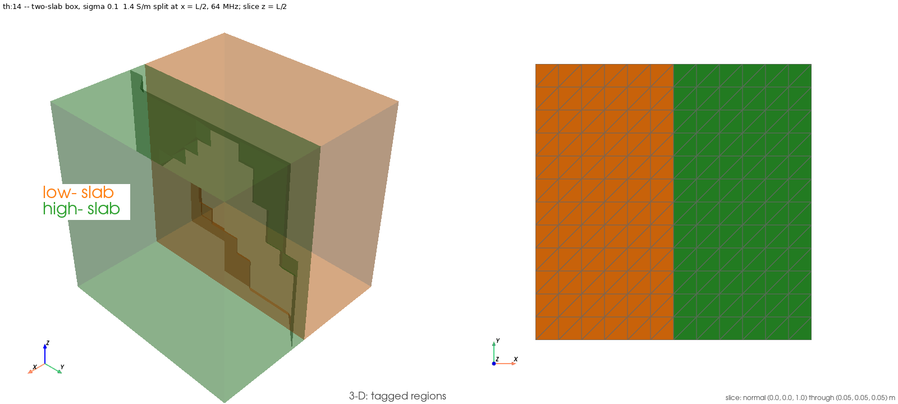

# `th:14` — does the total current close? ∇·J_tot at CG2 against its vacuous CG1 twin

Script: `examples/time_harmonic/14_current_divergence_two_slab.py` (`EX-71`)
Gate: `tests/validation/test_current_divergence.py` (`POST-3` step 3)

## 1. What this demonstrates

Charge conservation, as an output quantity. Outside an impressed source the
total current is divergence free,

    ∇·J_tot = 0,    J_tot = (σ(x) + jωε₀εᵣ(x)) E,

and `post/current_divergence.py` scores it as a dual norm over the
degree-p Lagrange space that vanishes on the wall, normalised by ‖J_tot‖.
`th:8` (`EX-26`) shows the Poynting balance on homogeneous fixtures only; no
other example imports this module or builds the two-slab box.

The fixture is `POST-3`'s box: σ = 0.1 | 1.4 S/m split at x = L/2, 64 MHz,
degree-1 N1curl, driven by the σ_low plane wave on the wall (not the exact
two-material solution, and it need not be: the identity has no free
parameters). Two meshes, n = 8 (3 072 cells) and n = 12 (10 368 cells).

The same field reads two ways. Against a CG1 test space the residual is
round-off, because ∇(CG1) lies inside the N1curl₁ test space the solve already
enforced (Galerkin orthogonality). Against CG2 it is not enforced, so the
number is a property of the discrete solution: 9.3e-2 at n = 8 and 6.4e-2 at
n = 12, first order in h.

Everything is imported, never restated: `_solve_piecewise`, `_residual`,
`COARSE_N`, `FINE_N` and the four bounds `CG2_RATE_FLOOR`,
`CG2_COARSE_CEILING`, `CG1_VACUITY_CEILING`, `CG2_CG1_SEPARATION_FLOOR` from
the gate module; `_two_material_mesh` (figure only), `_report`, `OMEGA`, `MU_R`
from `tests/validation/test_poynting_balance.py`. The gate's four literal
bounds were lifted to those module constants for this example (values and
messages unchanged); the gate was re-run green in the same slot
(`EX-71-post3-regate`).

Asserted:

- (1) the CG2 residual falls under refinement, fine < coarse;
- (2) its rate in h exceeds `CG2_RATE_FLOOR` (0.7);
- (3) the coarse residual is below `CG2_COARSE_CEILING` (0.15).

**Negative control (asserted):** the vacuity pair on the n = 8 field. The CG1
residual is below `CG1_VACUITY_CEILING` (1e-10) and CG2/CG1 exceeds
`CG2_CG1_SEPARATION_FLOOR` (1e6). The gate read 6.852517e-15 and a separation
of 1.36e13 (round-off, never a record).

Printed beside the gate record (`docs/testing/logs/20260930T200032Z_POST-3-closing-W1.log:119–124`),
a difference reported and not asserted: CG2 9.316430e-02 (n = 8) and
6.358255e-02 (n = 12). Printed only: the Poynting balance on the n = 12 field
with the true σ(x) (record 11.8537 %), and the CG2 residual with
`include_sigma=False`, which the gate measured as a non-control (≈ 1.07×).

Scope: one box, two slabs, 64 MHz, degree 1. It does not cover the μᵣ leg, the
32³ balance, the phasor semantics of `POST-3` step 4, or a coil.

## 2. How to run it

```
./run_examples.sh -e th:14 -n 2 -t 180
```

Needs the complex DolfinX build, which the runner sources for the `th:` group.
Tier: **standard**. The whole run takes ≈ 6 s at `-n 2`. Verification runs go
through the logging harness with the runner's emitted command
(`./scripts/run_examples.sh -e th:14 --dry-run`). Add
`-e FEM_EM_SETUP_FIGURES=1` after `exec -T` to re-render the setup figure.

## Setup figure



`examples/time_harmonic/figures/time_harmonic_14_current_divergence_two_slab_setup.png`.
The figure shows the n = 12 box (10 368 tetrahedra) built by the gate's
`_two_material_mesh`; this is a separate mesh object from the one the solve
uses, so it is for looking at only. The low-σ slab (σ = 0.1 S/m) is
x ≤ L/2 and the high-σ slab (σ = 1.4 S/m) is x ≥ L/2, with L = 0.1 m. The
slice is z = L/2; the interface lands on a mesh plane, so σ is exactly the
geometry. (The renderer's font drops the Greek letter in the legend.)

## 3. How to analyze it, step by step

**Step 1 — the CG2 lines.** Read the two `[POST-3 step 3]` lines for CG2:
the relative residual, the dual norm, ‖J‖ and the Krylov iterations, at n = 8
and n = 12. The first-order fall is the point: the residual is an emergent
discretisation error, and it goes away with h.

**Step 2 — the assertions (1)–(3).** The rate is ≈ 0.94 in h against a floor
of 0.7, and the coarse residual sits well under its 0.15 ceiling.

**Step 3 — the control.** The same n = 8 field against CG1 reads ≈ 7e-15,
and the CG2/CG1 separation is ≈ 1.4e13. If the separation ever collapsed to
O(1), the CG2 number would be reporting an identity the solve already
imposes.

**Step 4 — the printed-only lines.** The Poynting balance on the same
n = 12 field is 11.8537 %, a different identity on the same field.
`include_sigma=False` moves the CG2 residual by ≈ 1.07×: dropping σ from
J_tot is not a control, because at 64 MHz conduction and displacement
currents are comparable and the O(h) interpolation error dominates the σ
jump.

**Step 5 — ParaView.** Open
`examples/time_harmonic/paraview_output/time_harmonic_14_current_divergence_two_slab_n12_combined.xdmf`
and colour by `E_real` or `E_imag`; `sigma` is the DG0 conductivity read from
the solve's own mesh. The E arrays are CG1 interpolants of the degree-1
N1curl solution; they are for looking at, and nothing is asserted on them.

## Related

- The Poynting balance on homogeneous fixtures: `examples/time_harmonic/08_poynting_power_balance.md`.
- The gate module: `tests/validation/test_current_divergence.py`.
- The Poynting-balance gate whose fixture this imports: `tests/validation/test_poynting_balance.py`.
