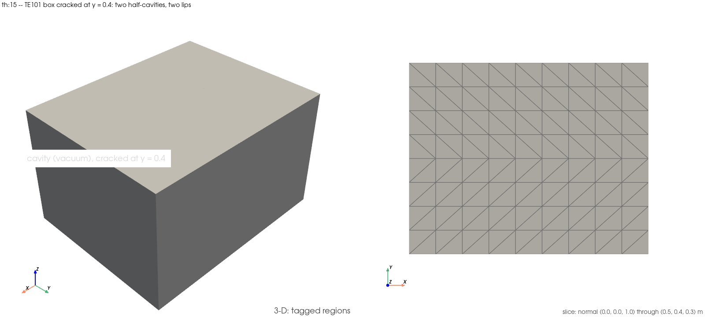

# `th:15` — the cracked TE₁₀₁ box: two Leontovich lips against Pozar

Script: `examples/time_harmonic/15_cracked_box_two_sided_lips.py` (`EX-82`)
Gate: `tests/validation/test_geo33_two_sided_leontovich.py` (`GEO-33` step 0b)

## 1. What this demonstrates

`th:10` (`EX-60`) is the uncracked lossy box. Here the y = 0.4 plane of the same
1.0 × 0.8 × 0.6 m box is a **crack**: two separate half-cavities, each lip an
exterior facet with its own outward normal. `TH-14`'s `ds` Leontovich term
therefore acts on both lips, and the wall loss rises by the lip area. Pozar's
closed form for the half box (1.0, 0.4, 0.6) gives the Q the pair must reach.

Beside it sits the same plane as a **single-valued** sheet (the merged mesh with
`sheet=(septum, SEPTUM_TAG)`). TE₁₀₁ has E_t = 0 on y = 0.4 because E points
along y, so that sheet cannot see the mode. This is the negative control.

Everything is imported from the gate module, never restated: `EDGES`,
`HALF_EDGES`, `SIGMA_GATE`, `DEGREE`, `RATIO_LITERAL`, `K0_SQ`, `SEPTUM_TAG`,
`Q_TOLERANCE`, `FREQUENCY_TOLERANCE_PCT`, `_area`, `_check_mode`, plus
`pozar_te10l_q_conductor` and `cracked_box_mesh`. Two structural `is` checks are
printed (`g33.Q_TOLERANCE is test_cavity_leontovich_q.Q_TOLERANCE`, and the same
for the frequency band). The solver is the gate's own
`solve_impedance_mesh_mode`, with one additive keyword, `return_vectors=False`,
and the defaulted last field `MeshImpedanceModes.mode_functions`. With the flag
off the call is byte-identical, and the gate modules were re-run green in the same
slot (`20261002T202032Z_EX-82-geo33-regate.log`, 18 passed; Q = 8.017679e+02).

Asserted at the imported bands:

- **(Q0)** merged walls only, Q₀ vs Pozar of the full box: 8.017516e+02 vs
  8.016849e+02, 0.0083 %.
- **(Qs)** cracked, both pair members vs Pozar of the half box: 6.192100e+02,
  0.0611 %.
- **(R)** Q_sep/Q₀ vs `RATIO_LITERAL`: 0.772322, 0.0528 %.
- **(F)** and **(D)** on every solve, through the gate's `_check_mode`.
- **Exported-mode identity:** the Rayleigh quotient
  `(∫|∇×E|² + γ∫_ds|n×E|² [+ γΣ±∫_dS|n±×E±|² for the control]) / ∫|E|²` returns
  λ to ≤ 1e-6 relative for the Q₀ mode, both pair members and the control
  (measured ≤ 3.3e-14).
- **Negative control:** Q_sheet/Q₀ = 1.00000000 (|Δ| 6.58e-12) within
  `Q_TOLERANCE` of 1; its miss from `RATIO_LITERAL` is 29.548 %, above the band
  (5.91×) and at the ceiling 1/`RATIO_LITERAL` − 1, which a sheet that only
  adds loss cannot exceed.

Printed, no band: the lip areas beside 0.6; 1/Q_sep − 1/Q₀ = 3.676919e-04; the
**lip share** s_h = ∫_lips|n×E|² / ∫_∂|n×E|² of each pair member, 0.228129
(predicted 0.2274, range [0.2265, 0.2290]; inside), beside 1 − R(measured) =
0.227678 and 1 − `RATIO_LITERAL` = 0.228086; the septum E_t fraction of the
control mode, 1.5e-22 (predicted ≤ 1e-8); the lower-half energy fraction of
each pair member (0 and 1 in this run — the pair is an arbitrary basis of an
exact degeneracy, so the fraction is never used as a label).

Scope: the lip term on two separate half-cavities, degree 2, σ = 1e4. Not
claimed: a partial crack, strip sheets, a birdcage, copper, or `GEO-33` step 1.

## 2. How to run it

```
./run_examples.sh -e th:15 -n 2 -t 180
```

Needs the complex DolfinX build, which the runner sources for the `th:` group.
Tier: **standard**; the run takes ≈ 15 s. Verification runs go through the
logging harness with the runner's emitted command
(`./scripts/run_examples.sh -e th:15 --dry-run`). Add
`-e FEM_EM_SETUP_FIGURES=1` after `exec -T` to re-render the setup figure.

## Setup figure



`examples/time_harmonic/figures/time_harmonic_15_cracked_box_two_sided_lips_setup.png`.
Rendered on the cracked mesh right after it is built, with the slice normal to
z. It shows one region, the vacuum cavity, with the duplicated plane at y = 0.4
visible as the two lips.

## 3. How to analyze it, step by step

**Step 1 — structural checks and lip areas.** Both `is` checks print `True`, and
the two lip areas print 0.599999999999999 beside 0.6.

**Step 2 — the anchors.** `[Q0]`, `[Qs]` and `[R]` print beside the gate's own
records (`20261002T095638Z_GEO-33-step0b-W2.log`). The `[GEO-33 0b]` lines are the
gate's `_check_mode` format, so they compare line for line. A miss beyond print
rounding is an example/test divergence, never a re-record.

**Step 3 — the control.** `[control]` reads 1.00000000: a single-valued sheet at
y = 0.4 adds nothing, because the mode has no tangential E there. The cracked
pair, with a lip on each side, reads 0.7723.

**Step 4 — `[mode]`.** The Rayleigh quotient ties each exported eigenfunction to
its asserted λ, including the control's septum term.

**Step 5 — the lip share.** The lips carry ≈ 22.8 % of the wall |n×E|², matching
1 − Q_sep/Q₀. This is the energy-loss reading of the Pozar ratio. It is
basis-independent because the two halves are disjoint mirrors.

**Step 6 — ParaView.** Open
`examples/time_harmonic/paraview_output/time_harmonic_15_cracked_box_two_sided_lips_combined.xdmf`.
Colour by `E_magnitude_pair_a` and `_b` (each normalised by its own maximum;
never label a member by half). Threshold the facet block on the lip tags 11 and 12
to see the two lips. Colour by `curlE_magnitude_pair_a` (∝ |H|, unit peak) to
show H_t ≠ 0 at y = 0.4: the lips carry wall current, while E_y is normal to the
plane, which is why the single-valued sheet reads 1.000. `half_index` is 0 below
y = 0.4 and 1 above.

## Related

- The uncracked lossy box: `examples/time_harmonic/10_lossy_wall_cavity_q.md`.
- The PEC box: `examples/time_harmonic/02_pec_cavity_resonances.md`.
- The symmetry-plane quarter box: `examples/time_harmonic/12_symmetry_plane_quarter_box.md`.
- The PEC/PMC boundary modes: `examples/time_harmonic/11_pec_pmc_boundary_modes.md`.
- The gate module: `tests/validation/test_geo33_two_sided_leontovich.py`.
