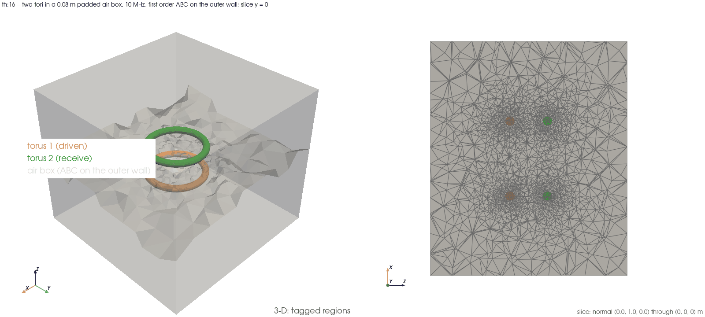

# `th:16` — the absorbing boundary on a small box: at 10 MHz it is a magnetic wall

Script: `examples/time_harmonic/16_abc_two_torus.py` (`EX-103`)
Gates: `tests/validation/test_th5_abc_two_torus.py` (`TH-5` step 2a),
`tests/validation/test_th5_mixed_wall_two_torus.py` (`TH-5` step 2b)

## 1. What this demonstrates

For the user who reaches for HFSS's *Radiation* boundary on a coil-sized box.
The script solves `PORT-1`'s two tori (tag 1 driven, 10 MHz, degree 1) in an
air box whose outer wall (facet tag 1) is PEC, natural, or the first-order ABC
(Jin 3e §9.2 (9.44), s = 1, `fem_em_solver.core.boundary_terms.first_order_abc_term`,
through `TimeHarmonicSolver.solve(extra_bilinear_terms=…)`). It shows three
things.

- **The ABC is in the matrix and it absorbs.** Re Z₁₁^ABC > 0 at every
  padding, and Re Z₁₁·I₁² equals ∮|n × E|²/η₀ over the wall (3.553290e-03 W
  on both sides at 0.08 m, residual 1.363e-11). The PEC wall carries no
  tangential E (∮ 5.299704e-37 W, round-off) and no Re Z. The natural wall
  carries a large tangential E (0.2581840 W) and still has Re Z₁₁ = 0:
  tangential E on the wall is not absorption. Read the three as
  *absorbing, pinned, reflecting*.
- **At k₀·half-width ≈ 0.02–0.04 the ABC is a reflector.** It acts as the
  natural (magnetic) wall: its box term B^ABC = d^ABC − D∞^PEC is positive
  where PEC's is negative, +4.7133 / +2.3965 / +1.1256 pp at W = 0.08 / 0.10 /
  0.12 m. Its deficit differs from the natural wall's by 0.224456 pp at
  0.08 m. Padding still matters under an ABC on this box.
- **The ⅓ PEC + ⅔ natural post-solve mix cancels the box term**: B^mix =
  −0.2520 pp against |B^PEC|/5 = 1.9468 pp, and swapped weights miss by
  2.5647×. It is a combination of two solves, not a boundary condition.

r(W) = |B^ABC|/|B^PEC| = 0.4846 / 0.3567 / 0.2266 is printed as a record
beside the sphere model's 0.5. It is never asserted: (R) was retired by the
2026-10-07 weekly.

**Imports, never restated.** The solver call (`_solve_z_column`), the
paddings, the weights `W_PEC` / `W_NAT`, `MIX_BAR_DIVISOR`, the bands
(`P0_BAND_PP`, `IDENTITY_TOLERANCE`) and the fit helpers come from the two
`TH-5` gate modules. The 2a gate gained one additive keyword,
`_solve_z_column(..., return_fields=False)`; when True it adds `omega_m12`,
the field Function `e`, the mesh and the two tag objects to the returned dict.
The default path is unchanged: the gate was re-run green in the same slot
(`EX-103-th5-regate-W1`, 7 passed at `-n 2`, every `[TH-5 2a …]` digit equal
to the step 2c window; `EX-103-th5-regate-W3`, 2 passed, 9 skipped).
**2b's own module was not re-run.** Its (M) / (c2) clauses are evaluated here
from this run's PEC and natural 0.08 m solves, after the script asserts both
meshes have the 119 533 cells that 2b's window recorded.

Asserted: (P0) |d^PEC(0.08) − `P0_RUNG_PP`| ≤ `P0_BAND_PP`; (E) Re Z₁₁^ABC > 0
at each padding and PEC |Re Z₂₁|/|Z₂₁| ≤ `IDENTITY_TOLERANCE`; (S) B^PEC < 0 <
B^ABC at all three paddings; (c1) |d^NAT − d^PEC| > `P0_BAND_PP` (the wall
really changed); (M) |B^mix| ≤ |B^PEC|/`MIX_BAR_DIVISOR`; (c2) swapped
weights |B^swap| > the same bar.

**Negative controls.** (c1) A broken run that leaves the Dirichlet set on
returns d^PEC, so B^ABC < 0 and (S) is red; the separation |B^ABC − B^PEC| is
14.4391 pp against a rung precision of ≈ 5e-5 pp. A conjugated γ would make
the wall a source and Re Z₁₁ < 0, which (E) catches. (c2) swapped weights
miss the bar by a factor 2.5647.

Printed, not asserted: the headline table, the power per wall, (c3), the ABC
free-exponent fit (it fails on this three-point ladder, as in the gate), and
the original "≥ 5×" bar (False at every padding, the banked negative).

Scope: `PORT-1`'s two-torus box, d = 0.04 m, 10 MHz, degree 1, at paddings
0.08 / 0.10 / 0.12 m, under the PEC, natural and first-order ABC walls
(natural at 0.08 m only), at `-n 2`. **Not claimed:** an open boundary at
k₀R < π; the band k₀R ∈ (0.04, π) that holds the 64 / 128 MHz birdcage box;
any birdcage, SAR or *Radiation*-parity figure; a user-settable mixed wall;
a second-order ABC or PML; natural rungs at 0.10 / 0.12 m; why r(W) falls;
anything `TH-5` does not claim.

## 2. How to run it

```
./scripts/run_examples.sh -e th:16 -n 2 -t 480
```

Needs the complex DolfinX build, which the runner sources for the `th:` group.
Tier: **heavy**. The whole run takes ≈ 240 s at `-n 2` (five mesh + solve
pairs, ≈ 220 s of it). Verification runs go through the logging harness with
the runner's emitted command
(`./scripts/run_examples.sh -e th:16 -n 2 -t 480 --dry-run`). Add
`-e FEM_EM_SETUP_FIGURES=1` after `exec -T` to re-render the setup figure.

**The recipe for your own box:**
`TimeHarmonicProblem(..., boundary_condition="natural")` plus
`solver.solve(..., extra_bilinear_terms=[first_order_abc_term(msh, facet_tags, tag, omega)])`.
Under `"pec_zero_tangential_a"` the Dirichlet rows silently overwrite the
term.

## Setup figure



`examples/time_harmonic/figures/time_harmonic_16_abc_two_torus_setup.png`.
The mesh is the ABC 0.08 m run (119 533 tetrahedra). Tag 1 is the driven
torus, tag 2 the receiving torus, tag 3 the air box (translucent; the ABC acts
on its outer wall). The slice is y = 0, which cuts both tori.

## 3. How to analyze it, step by step

**Step 1 — the gate lines.** The five `[TH-5 2a]` lines are the gate's own
print: wall, padding, cells, complex Z₁₁ and Z₂₁, the deficit, and the
boundary integral. They equal the step 2c window to every printed digit
except mesh / solve seconds and the PEC boundary integral (≈ 5e-37 W,
round-off on a structural zero).

**Step 2 — (P0), (E).** The PEC 0.08 m deficit is −8.0404 pp, 0.0080 pp from
the rung (band 0.05). Re Z₁₁^ABC reads +3.784205e-03 / +2.620085e-03 /
+1.923719e-03 Ω: the term entered the matrix. *Re Z₁₁ > 0 is the proof that
the term entered; tangential E on the wall is not.*

**Step 3 — the padding table (S).**

| W (m) | cells | d^ABC (pp) | B^ABC (pp) | B^PEC (pp) | r(W), record |
|---|---|---|---|---|---|
| 0.08 | 119 533 | +6.4067 | +4.7133 | −9.7258 | 0.4846 |
| 0.10 | 135 685 | +4.0899 | +2.3965 | −6.7190 | 0.3567 |
| 0.12 | 153 952 | +2.8190 | +1.1256 | −4.9667 | 0.2266 |

At k₀R ≪ 1 the ABC flips the box term's sign rather than removing it, so
padding still matters. The ABC is an open boundary only at k₀R ≳ π (`TH-5`
step 1b, |Γ_sph(π)| 0.0506, cited from that entry). The honest line is
"valid for k₀R ≳ π; a reflector for small boxes".

**Step 4 — the power per wall.** Absorbing (ABC, 3.553290e-03 W both sides),
pinned (PEC, ≈ 5e-37 W) and reflecting (natural, 2.581840e-01 W with
Re Z₁₁ = 0).

**Step 5 — the mix (M), (c2).** B^PEC (solve-referenced) −9.7338 pp, B^NAT
+4.4889 pp, r_NAT 0.4612; B^mix −0.2520 pp against the bar 1.9468 pp. Swapped
weights: B^swap −4.9929 pp (2.5647× the bar). Equal weights: B^half −2.6225 pp;
zeroing weight w_PEC* = 0.3156. (S) uses the fit-referenced B^PEC (−9.7258 pp)
and (M) the solve-referenced one (−9.7338 pp); the two are never swapped.

**Step 6 — repeat at the same width.** A second unflagged `-n 2` run
(`EX-103-control-n2`) reproduces every integer (cells 119 533 / 135 685 /
153 952), every deficit and every sign; all asserts hold. It is a
same-width repeat, not a width comparison.

**Step 7 — ParaView.** Open
`examples/time_harmonic/paraview_output/time_harmonic_16_abc_two_torus_pec_combined.xdmf`,
`examples/time_harmonic/paraview_output/time_harmonic_16_abc_two_torus_abc_combined.xdmf`
and
`examples/time_harmonic/paraview_output/time_harmonic_16_abc_two_torus_natural_combined.xdmf`
side by side. Extract Block → the facet block, Threshold tag 1, colour by
|E_imag| on one shared range. Under PEC only the normal component survives on
the wall; the natural and ABC walls are predicted to look nearly alike (their
deficits differ by 0.224 pp). Slice y = 0 to see the field between the tori.
These are CG1 interpolants of the degree-1 N1curl solution: a picture, not a
reading; nothing is asserted on them.

## Related

- The same fixture with a PEC box: `examples/ports/01_two_torus_port_pair.md`.
- Another surface term through the same hook: `examples/ports/18_birdcage_copper_leontovich.md`.
- The gate modules: `tests/validation/test_th5_abc_two_torus.py`,
  `tests/validation/test_th5_mixed_wall_two_torus.py`,
  `tests/validation/test_port_reaction_impedance.py`.
- The term itself: `src/fem_em_solver/core/boundary_terms.py`.
