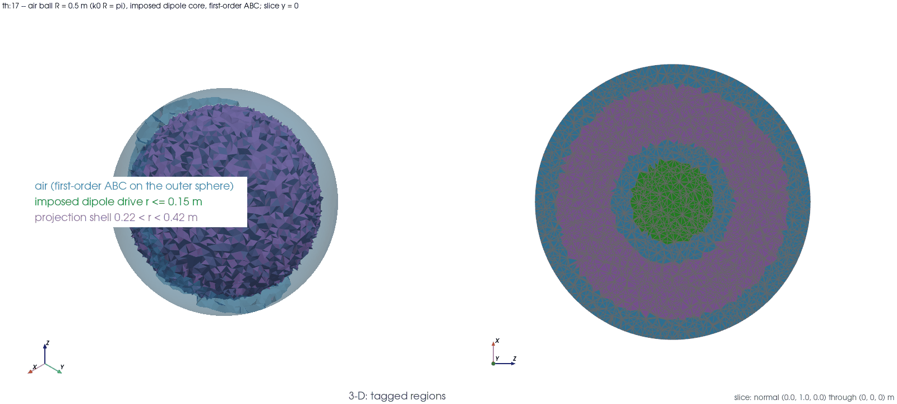

# `th:17` — where the absorbing boundary works: a dipole in a sphere at k₀R = π

Script: `examples/time_harmonic/17_abc_dipole_sphere.py` (`EX-142`)
Gate: `tests/validation/test_th5_dipole_sphere.py` (`TH-5` step 1b)

## 1. What this demonstrates

For the user who asks whether the first-order absorbing boundary condition
(ABC, Jin 3e §9.2 (9.44), s = 1, `first_order_abc_term`) is an open boundary.
`th:16` shows it failing on a small box (k₀·half-width 0.02–0.04: a magnetic
wall). This example shows it **working**, and says how much it still reflects.

A Hertzian dipole's outgoing field E_out is imposed (Dirichlet) in the inner
ball r ≤ 0.15 m of an air ball of radius R = 0.5 m at wavelength 1 m, so
k₀R = π. The outer sphere (facet tag 1, faceted) is terminated by the exact
wave impedance, by the first-order ABC, and by PEC. The reflection
coefficient Γ is read by a volume least-squares projection of E onto
{E_out, conj(E_out)} over 0.22 < r < 0.42 m, and set against the closed form
Γ_sph(x) = −e^{−2jx}/(2x² − 1 + 2jx).

- **The premise holds.** With the exact impedance on the wall, |Γ_E| =
  1.7695e-03: the solve and the projection together read "no reflection" to
  well inside the band.
- **The ABC reflects what the closed form says.** |Γ_sph(π)| = 0.0505957066
  (= 1/√(1 + 4π⁴)); the ABC solve reads Γ_A = −4.673816e-02 + 1.472716e-02j,
  and |Γ_A − Γ_sph(π)| = 1.8336e-03. The ABC is not transparent at k₀R = π:
  it reflects ≈ 5 % in amplitude, and the solve reproduces that figure.
- **PEC is not that.** At λ₀/20, Γ_PEC = 0.782555 − 0.623784j and
  |Γ_PEC − Γ_sph(π)| = 1.0484, ≈ 175 × the band.

**Imports, never restated.** `K0`, `R_BALL`, `R_DRIVE`, `PROJ_R`, `BAND`,
`BAND_CEILING`, `_gamma_sphere`, `_e_out_np`, `_ball`, `_solve_ball` and
`_DipoleProjection` come by name from
`tests/validation/test_th5_dipole_sphere.py`. No gate module or `src/` edit.

Asserted, exactly as the gate's own four asserts: (B) `BAND` ≤ `BAND_CEILING`
(6e-3 ≤ 1.6865e-02); (E) |Γ_E| ≤ `BAND` at λ₀/40; (A) |Γ_A − Γ_sph(π)| ≤
`BAND` at λ₀/40; (c-PEC) |Γ_PEC − Γ_sph(π)| > `BAND` at λ₀/20 (the negative
control: the PEC wall reached the solve and misses by a factor of ≈ 175).

Printed, never gated: cell counts, every Γ beside its gate record, |Γ_PEC| /
|Γ_ABC| on **mixed rungs** (20.42 here; the gate's same-rung record is 21.61),
and the size curve below.

**What it does not show.** No birdcage, no box, no PML (`TH-5` step 3 is a
record), no second-order ABC, no oblique incidence, no convergence rate (the
gate module's λ₀/20 → λ₀/40 pair is printed there, not gated), no k₀R = 2π
gate (printed only in the module), degree 1 only, no AED comparison. Nothing
here is an open-boundary statement about a birdcage box.

## 2. How to run it

```
./run_examples.sh -e th:17 -n 2 -t 600
```

Needs the complex DolfinX build, which the runner sources for the `th:` group.
Tier: **heavy**. The run takes ≈ 75 s inside Python (76 s through the
harness) at `-n 2`: mesh 4.9 s, exact solve 33.1 s, ABC solve 33.8 s, PEC rung
2.5 s. Add `-e FEM_EM_SETUP_FIGURES=1` after `exec` to re-render the setup
figure.

## Setup figure



`examples/time_harmonic/figures/time_harmonic_17_abc_dipole_sphere_setup.png`.
The mesh is the λ₀/40 ball (151 498 tetrahedra). Tag 1 is the air (translucent;
the ABC acts on its outer sphere), tag 2 the imposed-drive ball r ≤ 0.15 m,
tag 3 the projection shell 0.22 < r < 0.42 m. The slice is y = 0.

## 3. How to analyze it, step by step

The numbers below are from
`docs/testing/logs/20261023T170527Z_EX-142.log`; each equals the gate record
(`20260930T185052Z_TH-5-step1b-W2.log`) to every printed digit.

**Step 1 — the closed form.** |Γ_sph(π)| = 0.0505957066 against 1/√(1 + 4π⁴) =
0.0505957066.

**Step 2 — the λ₀/40 rung.** 151 498 cells. Γ_E = 1.278291e-03 − 1.223502e-03j
(|Γ_E| = 1.7695e-03); Γ_A = −4.673816e-02 + 1.472716e-02j, and
|Γ_A − Γ_sph(π)| = 1.8336e-03, both under `BAND` = 6e-3.

**Step 3 — the PEC control at λ₀/20.** 19 553 cells. Γ_PEC = 7.825549e-01 −
6.237844e-01j; the miss is 1.0484 against `BAND`. Mixed-rung ratio
|Γ_PEC|/|Γ_A| = 20.42, printed only.

**Step 4 — the size curve** (closed form, numpy, printed only).

| x = k₀R | \|Γ_sph(x)\| | 1/(2x²) |
|---|---|---|
| 0.04 | 0.999995 | (not a regime) |
| 0.5 | 0.894427 | (not a regime) |
| 1 | 0.447214 | 0.5 |
| π | 0.050596 | 0.050661 |
| 2π | 0.012664 | 0.012665 |
| 3π | 0.005629 | 0.005629 |

The ABC reflects ≈ 1/(2x²) for x ≫ 1 and everything as x → 0. That small-x end
is `th:16`'s small box (k₀·half-width 0.02–0.04), where the ABC acts as a
magnetic wall; see `examples/time_harmonic/16_abc_two_torus.md`.

**Step 5 — ParaView.** Open
`examples/time_harmonic/paraview_output/time_harmonic_17_abc_dipole_sphere_abc_combined.xdmf`.
Clip through the z-axis, colour `E_real` by magnitude, and compare with
`E_out_real`: the two look nearly alike, since the ABC transmits ≈ 95 % in
amplitude at k₀R = π. The facet tags are in the same file. These are CG1
interpolants of the degree-1 N1curl solution: a picture, not a reading;
nothing is asserted on them.

## Related

- The failing case, a small box: `examples/time_harmonic/16_abc_two_torus.md`.
- The gate module: `tests/validation/test_th5_dipole_sphere.py`.
- The term itself: `src/fem_em_solver/core/boundary_terms.py`.
