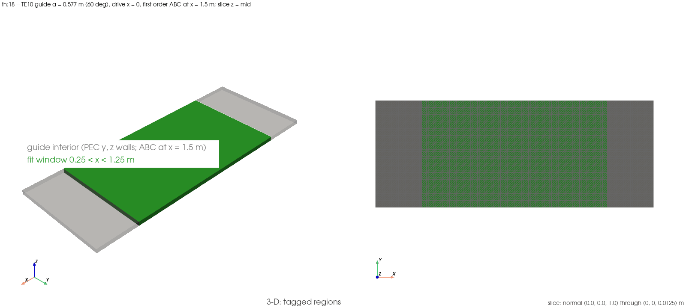

# `th:18` — the first-order ABC at oblique incidence: a TE10 guide at 60°

Script: `examples/time_harmonic/18_abc_oblique_incidence.py` (`EX-143`)
Gate: `tests/validation/test_th5_abc_reflection.py` (`TH-5` step 1a, the (O) leg)

## 1. What this demonstrates

For the user who asks how well the first-order absorbing boundary condition
(ABC, Jin 3e §9.2 (9.44), s = 1, `first_order_abc_term`) works when the wave
does not arrive head-on. `th:16` shows it failing on a small box and `th:17`
shows it working on a sphere, where the wave leaves along the normal. This
example shows its one built-in error, the angle dependence.

A rectangular PEC guide of width a = λ₀/(2 sin 60°) = 0.57735 m is driven in
TE10 at λ₀ = 1 m. The mode is a plane-wave pair at 60° to the axis, with
β = k₀ cos 60° = π rad/m. The far end is terminated by Jin's angle-matched
condition γ = jk₀ cosθ, by the plain first-order ABC, and by PEC. Γ is read by
the gate's 41-point fit and set against Jin's (9.48),
R(θ) = (cosθ − 1)/(cosθ + 1), which is −1/3 at 60°.

- **The premise holds.** With the angle-matched condition, |Γ_exact| =
  1.161362e-04.
- **The ABC reflects what the closed form says.** Γ_ABC = −3.332454e-01 +
  2.468819e-04j, and |Γ_ABC − R| = 2.620831e-04. A third of the amplitude comes
  back, and the solve reproduces that.
- **PEC is not that.** Γ_PEC = −0.999999 + 0.000659j, |Γ_PEC − R| = 0.6667,
  ≈ 222 × the band.

**Imports, never restated.** `K0`, `LAMBDA0`, `THETA_O`, `A_O`, `L_O`,
`BETA_O`, `FIT_O`, `O_BAND` and `_te10` come by name from
`tests/validation/test_th5_abc_reflection.py`, and
`abc_first_order_reflection_te` from `src/fem_em_solver/core/boundary_terms.py`.
Two disclosed lifts in the gate module, no `src/` edit: `O_BAND = 3e-3` was
hoisted by value from the two inline literals of `test_te10_sixty_degrees`, and
`_te10` gained an additive `return_fields=False` keyword that appends the field,
mesh and facet tags. The module was re-run green at `-n 2`
(`docs/testing/logs/20261024T003104Z_EX-143-regate.log`, 8 passed in 34 s).

Asserted: (O1) |Γ_exact| ≤ `O_BAND`; (O2) |Γ_ABC − R| ≤ `O_BAND`; (R)
|R − (−1/3)| ≤ 1e-15; (c-PEC) |Γ_PEC − R| > `O_BAND`, the negative control:
the PEC wall reached the solve and misses by a factor of ≈ 222.

Printed, never gated: mesh and cell count, every Γ beside its gate record, the
ABC / PEC factor and the R(θ) table below.

**What it does not show.** No curved boundary (`th:17`), no small-box failure
(`th:16`), no second-order ABC, no PML (`TH-5` step 3 is a record), no TEM-line
h² rate (the (N) leg is not imported; its bands are inline), degree 1 at λ₀/80
only, no birdcage box, no AED comparison. Nothing here is an open-boundary
statement about a birdcage box.

## 2. How to run it

```
./run_examples.sh -e th:18 -n 2 -t 600
```

Needs the complex DolfinX build, which the runner sources for the `th:` group.
Tier: **heavy**. The run takes ≈ 15 s inside Python (17 s through the harness)
at `-n 2`: exact solve 4.0 s, ABC solve 3.7 s, PEC solve 4.2 s. Add
`-e FEM_EM_SETUP_FIGURES=1` after `exec` to re-render the setup figure.

## Setup figure



`examples/time_harmonic/figures/time_harmonic_18_abc_oblique_incidence_setup.png`.
The mesh is the λ₀/80 guide (66 240 tetrahedra, 120 × 46 × 2 cells). Tag 1 is
the guide interior (translucent; PEC on y and z, the drive at x = 0, the ABC at
x = 1.5 m), tag 2 the fit window 0.25 < x < 1.25 m. The slice is z = mid.

## 3. How to analyze it, step by step

The numbers below are from `docs/testing/logs/20261024T003217Z_EX-143.log`; each
equals the gate record (`20260930T094044Z_TH-5-step1a2-W1.log`) at the printed
digits, except Γ_PEC, whose gate record is printed to six decimals.

**Step 1 — the closed form.** R(60°) = −0.33333333333333326, within 5.6e-17 of
−1/3.

**Step 2 — the mesh.** 66 240 cells, (120, 46, 2), a = 0.57735 m,
β = 3.141593.

**Step 3 — the angle-matched end.** Γ_exact = 9.895163e-05 + 6.079623e-05j.

**Step 4 — the first-order ABC.** Γ_ABC = −3.332454e-01 + 2.468819e-04j; the
miss from R is 2.620831e-04, both under `O_BAND` = 3e-3.

**Step 5 — the PEC control.** Γ_PEC = −9.999998e-01 + 6.590161e-04j; the miss
is 0.6667, and |Γ_PEC − R|/|Γ_ABC − R| = 2543.7.

**Step 6 — the R(θ) curve** (closed form, numpy, printed only).

| θ | R(θ) |
|---|---|
| 0° | +0.000000 |
| 30° | −0.071797 |
| 45° | −0.171573 |
| 60° | −0.333333 |
| 75° | −0.588791 |
| 85° | −0.839663 |

The first-order ABC is exact only at normal incidence; its reflection grows with
angle and tends to −1 at grazing. That is why `th:17`'s sphere, where the wave
leaves along the normal everywhere, reads ≈ 0.05, while a box corner would not.

**Step 7 — ParaView.** Open
`examples/time_harmonic/paraview_output/time_harmonic_18_abc_oblique_incidence_abc_combined.xdmf`.
Slice at z = mid and colour the z-component of `E_real`. The standing-wave
ripple along x is the −1/3 reflection, and it is absent on a matched load. The
facet tags are in the same file. These are CG1 interpolants of the degree-1
N1curl solution: a picture, not a reading; nothing is asserted on them.

## Related

- The failing case, a small box: `examples/time_harmonic/16_abc_two_torus.md`.
- The working case, a sphere: `examples/time_harmonic/17_abc_dipole_sphere.md`.
- The gate module: `tests/validation/test_th5_abc_reflection.py`.
- The term itself: `src/fem_em_solver/core/boundary_terms.py`.
