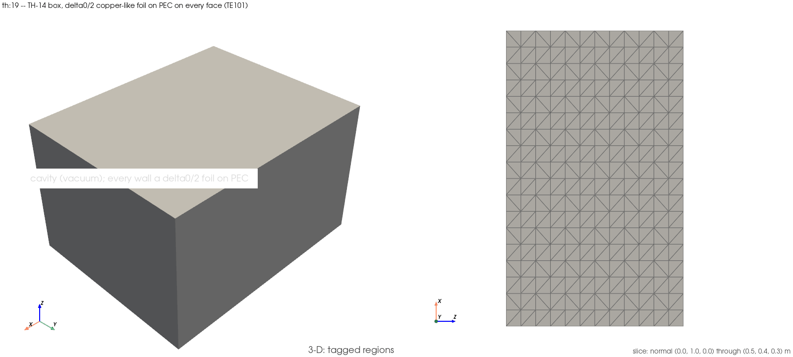

# `th:19` — a foil thinner than its skin depth on a cavity wall

Script: `examples/time_harmonic/19_layered_wall_cavity_q.py` (`EX-144`)
Gate: `tests/validation/test_th18_layered_impedance_cavity.py` (`TH-18` step 1)

## 1. What this demonstrates

For the user who asks what a thin conducting layer does to a resonator. The
`TH-14` box (1.0 × 0.8 × 0.6 m, TE₁₀₁, degree 2, σ = 1e4 S/m) has the
Leontovich wall `(1 + j)R_s` replaced, through
`solve_impedance_wall_cavity_mode(surface_impedance_fn=)`, by the layered input
impedance of `src/fem_em_solver/core/layered_impedance.py` (Jin 3e §3.4.2
(3.87)–(3.89)): one conductor foil of fixed thickness on a PEC backing.

The wall impedance Z_s = R + jX has two parts, and the cavity reads them
separately. **Q reads R** (Q = Q_c·R_s/R). **The frequency shift reads X**
(Δf/f = −(X/R_s)/(2Q_c)). A foil at δ₀/2 on PEC has R/R_s = 0.1602 and
X/R_s = 0.9680. R drops to a sixth while X barely moves, so Q rises 6.24× and
the resonance sits almost where bulk metal puts it.

- **Five skin depths is bulk metal** (`t5`): Q_t5/Q_leo = 0.9998744405.
- **A foil at δ₀/2 on PEC is less lossy than bulk metal** (`thin`): the PEC
  backing reflects what the foil lets through. Q_thin = 5.005122e+03 against
  Q_leo = 8.017679e+02.
- **The same foil on free space is more lossy** (`air`): R/R_s = 2.0076,
  Q_air = 3.992288e+02. Printed only.
- **Bulk Leontovich misses the thin layer** (c-bulk): 1 − Q_leo/Q_thin_predicted
  = 0.8398, against a ceiling of 1.

**Imports, never restated.** `EDGES`, `FINE`, `DEGREE`, `SIGMA`, `Q_LEO_RECORD`,
`PREMISE_TOLERANCE`, `T5_RATIO`, `T5_TOLERANCE`, `THIN_RATIO`,
`THIN_RATIO_TOLERANCE`, `Q_THIN_PREDICTED`, `SHIFT_RATIO`, `SHIFT_TOLERANCE`,
`NEGATIVE_CONTROL_FLOOR` and `_omega0` come by name from
`tests/validation/test_th18_layered_impedance_cavity.py`; `Q_TOLERANCE` from
`tests/validation/test_cavity_leontovich_q.py`. No gate module and no `src/`
edit.

Asserted, as the gate asserts them: (P) Q_leo against its record; (i)
|Q_t5/Q_leo − `T5_RATIO`| ≤ `T5_TOLERANCE`; (ii) the thin Q ratio within
`THIN_RATIO_TOLERANCE` and Q_thin within `Q_TOLERANCE` of `Q_THIN_PREDICTED`;
(iii) the thin frequency-shift ratio within `SHIFT_TOLERANCE`, on Re ω; (c-bulk)
the negative control above.

**What it does not show.** No copper birdcage (`ANS-6` and `TH-14` are
elsewhere), no multi-layer stack beyond one foil, no oblique incidence, no
reflection from a line (`examples/time_harmonic/13_layered_foil_reflection.md`
shows the same foil as a reflection coefficient), no mesh-convergence
statement, no AED comparison. `examples/time_harmonic/10_lossy_wall_cavity_q.md`
shows the Leontovich cavity Q against σ.

## 2. How to run it

```
./run_examples.sh -e th:19 -n 2 -t 300
```

Needs the complex DolfinX build, which the runner sources for the `th:` group.
Tier: **standard**. The run takes 8.4 s inside Python (10 s through the harness)
at `-n 2`; each of the five solves takes ≈ 1.4 s. Add
`-e FEM_EM_SETUP_FIGURES=1` after `exec` to re-render the setup figure.

## Setup figure



`examples/time_harmonic/figures/time_harmonic_19_layered_wall_cavity_q_setup.png`.
The mesh is the (9, 7, 6) box, 2 268 tetrahedra, 15 998 degree-2 dofs. Every
face carries the δ₀/2 foil on PEC. The slice is y = mid, where TE₁₀₁'s E points
along y.

## 3. How to analyze it, step by step

The numbers below are from `docs/testing/logs/20261024T003645Z_EX-144.log`; each
equals the gate record (`20260929T200249Z_TH-18-step1-W1.log.gz`) at the printed
digits, except the PEC Q (below).

**Step 1 — the foil.** ω₀ = 1.830580279e+09 rad/s, δ₀ = 2.948598743e-04 m,
δ₀/2 = 1.474299372e-04 m, R_s = 3.391441e-01 Ω.

**Step 2 — the mesh.** 2 268 cells and 15 998 dofs, as recorded.

**Step 3 — the five solves.**

| wall | f (MHz) | Q | R/R_s | X/R_s |
|---|---|---|---|---|
| PEC | 291.353194 | 2.084014e+18 | — | — |
| bulk (Leontovich) | 291.171399 | 8.017679e+02 | 1 | 1 |
| 5δ₀ on PEC | 291.171394 | 8.016672e+02 | 1.0001255901 | 1.0000267885 |
| δ₀/2 on PEC | 291.177318 | 5.005122e+03 | 0.1601866860 | 0.9679795966 |
| δ₀/2 on η₀ | 291.292164 | 3.992288e+02 | 2.0075500622 | 0.3334009587 |

The PEC Q is round-off in an eigenvalue that should be real. It is a number
without a meaning, not a reading, and the gate records a different one; nothing
is asserted on it.

**Step 4 — the gates.**

- (P) Q_leo = 8.0176788e+02, rel 1.998e-08 against the record.
- (i) Q_t5/Q_leo = 0.9998744405, |diff| 1.446e-08.
- (ii) Q_thin/Q_leo = 6.2426070, miss −0.0017 %; Q_thin = 5.005122e+03 against
  5004.69, miss +0.0086 %; Pozar's Q_c = 8.016849e+02.
- (iii) (f_thin − f_pec)/(f_leo − f_pec) = 0.9674439, miss −0.0554 %.
- (c-bulk) 1 − Q_leo/`Q_THIN_PREDICTED` = 0.8398 > `NEGATIVE_CONTROL_FLOOR`.

**Step 5 — the reading.** Q rose 6.24× and the shift is 96.7 % of the
Leontovich one: Q sees R, the shift sees X. The foil on free space (`air`) has
Q_thin/Q_air = 12.537, so the PEC backing is what makes a thin foil good.

**Step 6 — ParaView.** Open
`examples/time_harmonic/paraview_output/time_harmonic_19_layered_wall_cavity_q_combined.xdmf`.
Slice at y = mid and colour `E_real` along y: the TE₁₀₁ half-sine in x and z.
These are CG1 interpolants of the degree-2 N1curl mode: a qualitative picture,
not a reading; nothing is asserted on them.

## Related

- The Leontovich cavity: `examples/time_harmonic/10_lossy_wall_cavity_q.md`.
- The foil as a line reflection: `examples/time_harmonic/13_layered_foil_reflection.md`.
- The gate module: `tests/validation/test_th18_layered_impedance_cavity.py`.
- The layered impedance: `src/fem_em_solver/core/layered_impedance.py`.
