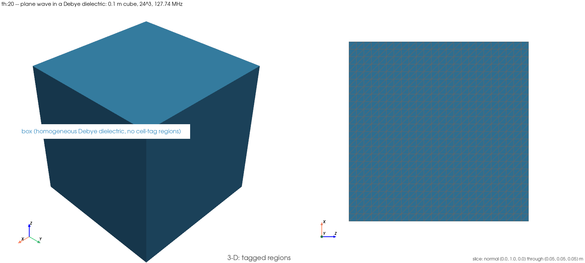

# `th:20` — a plane wave in a dispersive (Debye) dielectric

Script: `examples/time_harmonic/20_debye_plane_wave.py` (`EX-145`)
Gate: `tests/validation/test_mat3_debye_plane_wave.py` (`MAT-3` step 1)

## 1. What this demonstrates

For the user who asks what a frequency-dependent permittivity does to a wave.
`examples/time_harmonic/01_lossy_plane_wave.md` (`th:1`) solves the `TH-6` plane
wave with constant ε and σ. Here the same 0.1 m box is filled with a
single-pole Debye dielectric with ionic conductivity,

ε̂(f) = ε∞ + Δε / (1 + j2πfτ) − jσ / (2πfε₀),

with ε∞ = 50, Δε = 30, τ = 1/(2π·100 MHz), σ = 0.5 S/m. `ColeColeMaterial`
evaluates ε̂(f) in numpy and `as_homogeneous(f)` freezes it at the solve
frequency into the solver's ε′ and σ_eff. The decay α and phase β the solve
produces must equal k₀√ε̂(f) at each Larmor frequency, 63.87 and 127.74 MHz.

- **Both ε′ and σ_eff move between the two frequencies** (ε′ 71.31 → 61.40,
  σ_eff 0.548 → 0.603 S/m), so α is 9.4035 and 12.4703 Np/m, a ratio of 1.3261.
- **A model fitted at one Larmor frequency and reused at the other** (control a)
  mis-states the decay at 127.74 MHz by ≈ 12 %.
- **A static ε** (control b, ε = εs = 80, no dispersion) misses it by ≈ 22 %.

**Imports, never restated.** `F_HIGH`, `F_LOW`, `BAND`, `EPS_INF`, `DELTA_EPS`,
`TAU`, `SIGMA_IONIC`, `DEBYE`, `_truth` and `_solve` come by name from
`tests/validation/test_mat3_debye_plane_wave.py`; `_solve_plane_wave` from
`tests/validation/test_lossy_plane_wave.py`; `ColeColeMaterial` from
`fem_em_solver.materials`. No gate module and no `src/` edit.

Asserted, as the gate asserts them: (i) 127.74 MHz at 24³, rel L2, α and β
each < `BAND`; (ii) 63.87 MHz at 24³, α and β each < `BAND`; (c-a) the wrong
frequency's ε̂ misses α by more than `BAND`; (c-b) dropped dispersion misses α
by more than `BAND`. The L2 rate is printed beside its record and not asserted.

**What it does not show.** No Cole–Cole α ≠ 0 solve (the numpy identities are in
the gate's unit tests), no tissue table (`MAT-3` step 2 is the operator's), no
gel fit, no coil, no SAR, no AED comparison.

## 2. How to run it

```
./run_examples.sh -e th:20 -n 2 -t 600
```

Needs the complex DolfinX build, which the runner sources for the `th:` group.
Tier: **heavy** ceiling, but the run takes 31.0 s inside Python (33 s through
the harness) at `-n 2`; each 24³ solve (82 944 cells) takes ≈ 12 s. Add
`-e FEM_EM_SETUP_FIGURES=1` after `exec` to re-render the setup figure.

## Setup figure



`examples/time_harmonic/figures/time_harmonic_20_debye_plane_wave_setup.png`.
The mesh is the 24³ box, 82 944 tetrahedra, one homogeneous medium filling it,
sliced at y = mid, which shows the propagation axis x and the polarisation
axis z.

## 3. How to analyze it, step by step

The numbers below are from `docs/testing/logs/20261024T004035Z_EX-145.log`; each
equals the gate record (`20260929T183252Z_MAT-3-step1.log.gz`) at the printed
digits.

**Step 1 — the closed form.**

| f (MHz) | ε′ | ε″ | σ_eff (S/m) | α (Np/m) | β (rad/m) |
|---|---|---|---|---|---|
| 127.74 | 61.3993 | 84.9196 | 0.60348 | 12.4703 | 24.4047 |
| 63.87 | 71.3078 | 154.3256 | 0.54836 | 9.4035 | 14.7038 |

α ratio 128/64 = 1.3261.

**Step 2 — the solves.**

| solve | cells | rel L2 | α | β |
|---|---|---|---|---|
| 12³ @ 127.74 | 10 368 | 6.59165e-02 | 12.46183 | 24.42076 |
| 24³ @ 127.74 | 82 944 | 3.29632e-02 | 12.47353 | 24.41826 |
| 24³ @ 63.87 | 82 944 | 2.09928e-02 | 9.40746 | 14.71079 |

L2 rate 0.9998 (printed, not asserted). Measured α ratio 128/64 = 1.3259.

**Step 3 — the gates.**

- (i) 127.74 MHz: α off by 0.0262 %, β by 0.0554 %, against `BAND` = 5 %.
- (ii) 63.87 MHz: α off by 0.0419 %, β by 0.0475 %.
- (c-a) ε̂(63.87 MHz) solved at 127.74 MHz, 16³: α miss 11.9990 % (2.4× the
  band); β miss 2.8665 %, printed only.
- (c-b) dispersion dropped, 16³: α miss 21.9949 % (4.4× the band); β miss
  5.7816 %, printed only.

**Step 4 — the reading.** The solver's own decay and phase follow k₀√ε̂(f) to
well under a tenth of a percent at both frequencies, and the two controls miss
by 2.4× and 4.4× the band: the dispersive material reached the solve.

**Step 5 — ParaView.** Open
`examples/time_harmonic/paraview_output/time_harmonic_20_debye_plane_wave_combined.xdmf`
(the 24³ solve at 127.74 MHz). Colour by `E_magnitude`; Plot Over Line along x
shows the exponential decay, `E_real` / `E_imag` the phase winding. These are
CG1 interpolants of an N1curl field: a qualitative picture, not a reading;
nothing is asserted on them.

## Related

- The constant-ε plane wave: `examples/time_harmonic/01_lossy_plane_wave.md`.
- The gate module: `tests/validation/test_mat3_debye_plane_wave.py`.
- The base fixture: `tests/validation/test_lossy_plane_wave.py`.
