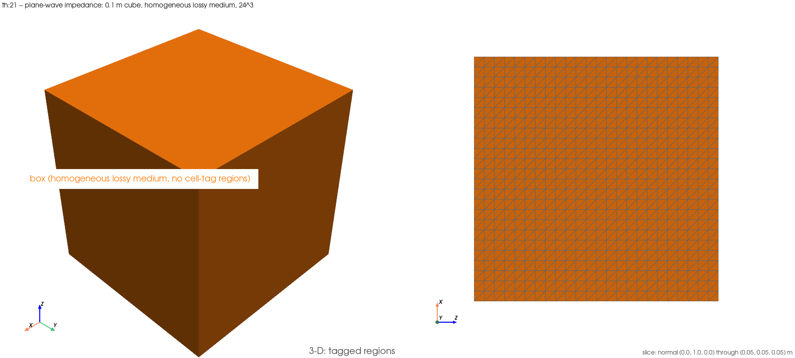

# `th:21` — the wave impedance of a lossy plane wave, from Faraday's law

Guide for `examples/time_harmonic/21_plane_wave_impedance.py`. Written to be
followed without the source open.

## 1. What this demonstrates

`th:1` (`examples/time_harmonic/01_lossy_plane_wave.py`) solves this same 24³
lossy plane wave and shows only the decay and phase constants of E. This example
looks at the *other* field. For `E = ẑ exp(−j k x)`, Faraday's law gives
`B = ∇×E/(−jω)`, with `∇×E = j k exp(−j k x) ŷ`, so `|E|/|B| = ω/|k|` at every
point. B is obtained from the **solved** E by `magnetic_flux_density_from_e`
(a DG0 phasor), not from the closed form.

The point is that, in a conductor, `|k|` is set by the complex permittivity.
`ω/|k|` is therefore **not** the lossless phase speed `c/√εᵣ`: in this saline
(σ = 0.7 S/m, εᵣ = 78, 127.74 MHz) `ω/|k|` = 2.674540e+07 m/s against
`c/√78` = 3.394481e+07 m/s. In a conductor E/B is set by `|k|`, not by the
lossless phase speed, so a σ-blind reading of a B map from an E solve (or the
reverse) is off by ≈ 21 % in this saline.

The gate is `POST-2` (✅ 2026-09-30), `tests/validation/test_field_consistency_metrics.py`.
`POST2_BAND` and the 24³ / 12³ readings come from it by import; the closed forms
come from `tests/validation/test_lossy_plane_wave.py`. This example closes
nothing.

Readings of this run, from `docs/testing/logs/20261024T093646Z_EX-146.log`
(`-n 2`, complex, Status 0, 31 s harness-wall, 29.2 s in Python), each beside
the `POST-2` record it reproduces (`20260930T094718Z_POST-2-balance-W1.log.gz`):

| Quantity | Reading (24³) | `POST-2` record | Gate |
| --- | --- | --- | --- |
| (R) mean ratio miss vs ω/\|k\| | +0.0164 % | +0.0164 % | < `POST2_BAND` (5 %) |
| (S_E) E span miss vs 1 − e^{−αΔx_c} | +0.5378 % | +0.5378 % | < `POST2_BAND` |
| (S_B) B span miss | +0.0002 % | +0.0002 % | < `POST2_BAND` |
| (Bal) balance at v = ω/\|k\| | 1.638957e-04 | — | < `POST2_BAND` |
| (c-σ) mean ratio vs c/√εᵣ | −21.1963 % | −21.1963 % | \|miss\| > `POST2_BAND` (≈ 4.2×) |

Printed only, never gated: the max-ratio miss +0.7185 % (a pointwise max); the
12³ rung (10 368 cells) mean +0.0649 %, spans +1.1437 % / +0.0007 %, control
−21.1580 %; fitted α = 13.06930, β = 27.03135 at 24³ beside the closed forms
13.067043 / 27.015150; samples E/B 82 944 each; the balance at c/√εᵣ
2.119626e-01; and the gate's 1e-9 identity on the balance, which reads
+7.128e-14 here and is printed, not asserted.

## 2. How to run it

```
./run_examples.sh -e th:21 -n 2 -t 600
```

Needs the complex DolfinX build, which the runner sources for the `th:` group.
Tier: **heavy** ceiling, but the run takes 29.2 s inside Python at `-n 2`: two
gate solves (24³ in 11.4 s, 12³ in 1.0 s) and one 24³ re-solve for the picture
(11.7 s). Add `-e FEM_EM_SETUP_FIGURES=1` after `exec` to re-render the setup
figure.

## Setup figure



`examples/time_harmonic/figures/time_harmonic_21_plane_wave_impedance_setup.png`.
The mesh is the 24³ box, 82 944 tetrahedra, one homogeneous lossy medium filling
it and no cell-tag regions, sliced at y = mid, which shows the propagation axis
x and the polarisation axis z.

## 3. How to analyze it, step by step

**Step 1 — the ratio of the means.** The mean |E| is 5.580502e-01 V/m and the
mean |B| is 2.086186e-08 T; their ratio 2.674978e+07 m/s sits +0.0164 % from
ω/|k|. That is (R).

**Step 2 — the spans.** Both magnitudes fall as `e^{−αx}`, so each span ratio
is `1 − e^{−αΔx_c}` with Δx_c = 0.097917 m the centroid x-extent. E misses by
+0.5378 % (the Dirichlet faces pin it) and B by +0.0002 %. These are (S_E) and
(S_B).

**Step 3 — the balance.** `compute_field_consistency_diagnostics` with
`reference_speed_m_per_s = ω/|k|` returns a dimensionless balance of
1.638957e-04, equal to `|r − v|/max(r, v)`. This is (Bal).

**Step 4 — the negative control.** Against the σ-blind `c/√εᵣ` the same ratio
misses by −21.1963 %, ≈ 4.2× `POST2_BAND`, asserted. If σ never reached the
solve this would sit inside the band.

**Step 5 — open it in ParaView.**
`File → Open → examples/time_harmonic/paraview_output/time_harmonic_21_plane_wave_impedance_combined.xdmf`,
colour by `E_magnitude` and `B_magnitude`: both fade by the same `e^{−αx}`, and
their pointwise ratio is the constant ω/|k|. The P1 export of an N1curl (E) or
DG0 (B, L² projected) field is a qualitative picture; the numbers above are
read from the solved fields, not from the exported arrays.

## What it does not show

No energy or power quantity, no birdcage B₁, no degree-2 claim, and no claim
that the diagnostic detects a wrong solve (`POST-2`'s own "not claimed").

## Related

- The same box, E only, decay and phase: `examples/time_harmonic/01_lossy_plane_wave.py` (`th:1`).
- The gate this example runs: `tests/validation/test_field_consistency_metrics.py`
  (`POST-2`) and `tests/validation/test_lossy_plane_wave.py` (`TH-6`).
