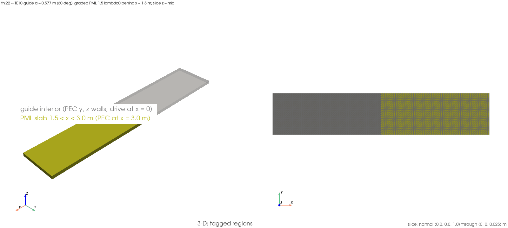

# `th:22` — a graded, PEC-backed PML at 60° incidence, against the first-order ABC

Script: `examples/time_harmonic/22_pml_oblique_incidence.py` (`EX-153`)
Gate: `tests/validation/test_th5_pml_oblique.py` (`TH-5` step 3b)

## 1. What this demonstrates

For the user who asks what a perfectly matched layer (PML) buys over the
first-order ABC when the wave arrives at an angle. `th:18` shows the ABC on a
TE10 guide at 60°: it sends back −1/3 of the amplitude. This example puts a
graded PML slab behind the same guide and reads the reflection with the same
projection.

The guide is `th:18`'s: a = λ₀/(2 sin 60°) = 0.57735 m, PEC y and z walls, TE10
drive at x = 0, physical length 1.5 m, λ₀ = 1 m. The mode is a plane-wave pair
at 60° to the axis (β = k₀ cos 60° = π rad/m). Behind x = 1.5 m sits a PML slab
1.5 λ₀ thick (Jin 3e §9.6.2 (9.152)–(9.154), FE form (9.157), polynomial
profile (9.165) with m = 2 and s_max = 2.198807), with PEC at its far end.

A metal-backed PML reflects |R| = exp(−2 k₀ s″ L cos θ) (Jin 3e §9.6.1 (9.133));
integrated over the graded profile that is |Γ_c(θ)| = R(0)^cos θ, a derivation
from (9.133) and (9.165) rather than a numbered equation. With R(0) = 1e-6 and
cos 60° = 1/2, Γ_c = +1e-3. The ABC at the same angle reflects −1/3, so the
PML is expected to be ≈ 333× quieter.

- **The closed form holds.** Γ_c = 1.000000e-03, and
  | |Γ_c| / |Γ_c(0)|^cos θ − 1 | = 1.110e-15.
- **The PML reads Γ_c.** Degree 2, λ₀/40 (33 120 cells):
  |Γ − Γ_c| = 1.1031e-07, against `PML_REFLECTION_BAR` = 1e-4.
- **The ABC reads −1/3.** Γ_ABC = −3.333334e-01 + 6.232205e-07j, and
  |Γ_ABC| / |Γ_PML| = 333.3, against `CABC_RATIO_BAR` = 100 (ceiling
  (1/3)/1e-3 = 333).
- **The negative control.** With s_max = 0 the same slab is vacuum behind a PEC
  wall: |Γ| = 1.000000 against `NC0_BAR` = 0.9, so the absorption is the PML's
  and not the slab's geometry.

**Why k_fit and not k₀ cos θ.** The projection reads Γ by fitting the standing
wave over x in FIT_O. The discrete guide's propagation constant is not exactly
k₀ cos θ, so the read scans β by ±5e-3 relative about k₀ cos θ and takes the
interior minimum (here k_fit − β = −2.5009e-06 rad/m, interior). The k₀ cos θ
read is printed beside it: |Γ − Γ_c| = 2.8512e-07 rather than 1.1031e-07. Both
are far under the bar; the gate asserts the k_fit read.

**Imports, never restated.** `COS_O`, `N_GATE`, `CABC_RATIO_BAR`, `NC0_BAR`,
`_drive` and `_guide` come from `tests/validation/test_th5_pml_oblique.py` as
`t3b`; `PML_D`, `PML_M`, `PML_REFLECTION_BAR`, `R_ABSORB`, `S_ABSORB`,
`_solve_terms` from `test_th5_pml_reflection.py`; `A_O`, `L_O`, `LAMBDA0`,
`OMEGA`, `K0`, `BETA_O`, `FIT_O`, `TAG_Y`, `TAG_Z`, `_box`, `_Projection`,
`_solve` from `test_th5_abc_reflection.py`; `IDENTITY_TOLERANCE` from
`test_port_reaction_impedance.py`; `pml_slab_term` and
`pml_reflection_pec_backed` from `src/fem_em_solver/core/boundary_terms.py`. The
PML and ABC runs write `t3b._guide`'s branches out to keep the field for the
picture; the s_max = 0 run calls `t3b._guide` directly. No gate-module or `src/`
edit.

**What it does not show.** One angle (60°), one thickness (1.5 λ₀), one profile
(m = 2); no angle sweep; no degree 1 (the gate prints it, the example does not
run it); no PML on a 3D scatterer or on the birdcage box; no claim on `TH-5`
step 2's bar. Nothing here is an open-boundary statement about a birdcage box.

## 2. How to run it

```
./run_examples.sh -e th:22 -n 2 -t 420
```

Needs the complex DolfinX build, which the runner sources for the `th:` group.
Tier: **heavy**. The run takes ≈ 111 s inside Python (113 s through the harness)
at `-n 2`: PML solve 60.5 s, ABC solve 16.3 s, s_max = 0 solve 31.9 s. Add
`-e FEM_EM_SETUP_FIGURES=1` after `exec` to re-render the setup figure.

## Setup figure



`examples/time_harmonic/figures/time_harmonic_22_pml_oblique_incidence_setup.png`.
The mesh is the λ₀/40 PML-extended guide (33 120 tetrahedra). Tag 1 is the
physical guide (translucent; PEC on y and z, the drive at x = 0), tag 2 the PML
slab 1.5 < x < 3.0 m (PEC at x = 3.0 m). The slice is z = mid.

## 3. How to analyze it, step by step

The numbers below are from `docs/testing/logs/20261025T202452Z_EX-153.log`; each
equals the gate record (`20261025T111709Z_TH-5-step3b-W1.log`) at the printed
digits.

**Step 1 — the closed form.** Γ_c(60°) = 1.000000e-03; the angular identity
reads 1.110e-15 against `IDENTITY_TOLERANCE` = 1e-9.

**Step 2 — the PML run.** 33 120 cells, 60.5 s. k_fit read
Γ = 9.999865e-04 + 1.094752e-07j; |Γ − Γ_c| = 1.1031e-07.

**Step 3 — the ABC run** (the physical guide only, 16 560 cells, 16.3 s):
Γ_ABC = −3.333334e-01 + 6.232205e-07j, beside `th:18`'s −0.33325 (that is its
degree-1 λ₀/80 read) and Jin's closed form −1/3.

**Step 4 — the ratio.** |Γ_ABC| / |Γ_PML| = 333.3, matching the gate record.

**Step 5 — the control.** s_max = 0: |Γ| = 1.000000 (k₀ cos θ read also
1.000000), 31.9 s.

**Step 6 — ParaView.** Open
`examples/time_harmonic/paraview_output/time_harmonic_22_pml_oblique_incidence_pml_combined.xdmf`
(Re/Im E on the PML run, PML slab as cell tag 2, facet tags in the file) and
`examples/time_harmonic/paraview_output/time_harmonic_22_pml_oblique_incidence_abc_combined.xdmf`
(the ABC run). Slice at z = mid and colour the z-component of `E_real`: the ABC
run shows the −1/3 standing-wave ripple; the PML run is a clean travelling wave
that dies inside the slab. These are CG1 interpolants of the degree-2 N1curl
solution: a picture, not a reading; nothing is asserted on them.

## Related

- The ABC at the same angle: `examples/time_harmonic/18_abc_oblique_incidence.md`.
- The ABC on a sphere: `examples/time_harmonic/17_abc_dipole_sphere.md`.
- The gate module: `tests/validation/test_th5_pml_oblique.py`.
- The terms: `src/fem_em_solver/core/boundary_terms.py`.
