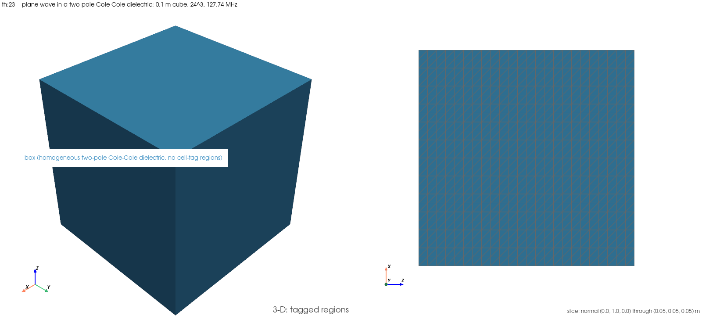

# `th:23` — a plane wave in a broadened two-pole (Cole–Cole) dielectric

Script: `examples/time_harmonic/23_cole_cole_plane_wave.py` (`EX-157`)
Gate: `tests/validation/test_mat3_cole_cole_plane_wave.py` (`MAT-3` step 1b)

## 1. What this demonstrates

For the user who asks what a *broadened*, multi-pole permittivity does to a
wave. `examples/time_harmonic/20_debye_plane_wave.md` (`th:20`) fills the
`TH-6` box with a single Debye pole. Real tissue is not that: Gabriel's fits
use several poles, each with a depression exponent α > 0. Here the same 0.1 m
box is filled with

ε̂(f) = ε∞ + Σₙ Δεₙ / (1 + (j2πfτₙ)^(1−αₙ)) − jσ / (2πfε₀),

ε∞ = 4, σ = 0.2 S/m, and two poles: (Δε, f_c, α) = (50, 100 MHz, 0.30) and
(4000, 1 MHz, 0.35). The decay α and phase β the solve produces must equal
k₀√ε̂(f) at 63.87 and 127.74 MHz.

- **What α > 0 does to a pole.** A Debye pole traces a semicircle in the
  (ε′, ε″) plane; `(jωτ)^(1−α)` is evaluated on the principal branch, with
  argument π(1−α)/2, and flattens that semicircle into a depressed arc: the
  loss peak is lower and spread over more decades. The evaluator is compared
  with an independent standard-library `cmath` sum, which agrees to 1.7e-16.
- **Why two poles.** The γ-like pole near 100 MHz sits right at the Larmor
  frequencies; the large β-like pole near 1 MHz is two decades below them but
  its broadened tail still adds a large ε′ and ε″ at 64 and 128 MHz. Neither
  pole alone gives the permittivity below.

| f (MHz) | ε̂ Cole–Cole | ε̂ Debye-reduced twin (every αₙ = 0) |
|---|---|---|
| 127.74 | 118.420 − 182.618j | 23.244 − 83.724j |
| 63.87 | 181.505 − 283.983j | 40.493 − 141.581j |

- **Control a′ (Debye-reduced).** The same poles with every αₙ set to 0
  solved at 127.74 MHz misses the Cole–Cole decay α by 20.05 %. It proves the
  depression exponent reaches the solve.
- **Control b′ (wrong frequency).** ε̂ frozen at 63.87 MHz and solved at
  127.74 MHz misses α by 30.11 %. It proves the frequency at which the medium
  is frozen reaches the solve.

**Imports, never restated.** `BAND`, `F_HIGH`, `F_LOW`, `EPS_INF`, `POLES`,
`SIGMA_IONIC`, `COLE_COLE`, `DEBYE_REDUCED`, `_eps_cmath`, `_truth`,
`_wrong_f_truth` and `_solve` come by name from
`tests/validation/test_mat3_cole_cole_plane_wave.py`; `_solve_plane_wave` from
`tests/validation/test_lossy_plane_wave.py`. The evaluator bound 1e-12 has no
module name; the example cites the gate's literal at
`test_mat3_cole_cole_plane_wave.py:109`. No gate module and no `src/` edit.

Asserted, as the gate asserts them: (Ev) evaluator against `cmath`; (i)
127.74 MHz, rel L2 falling from 12³ to 24³, rate > 0.9, rel L2, α and β each
< `BAND`; (ii) 63.87 MHz at 24³, α and β each < `BAND`; (a′) and (b′) each miss
α by more than `BAND`.

**What it does not show.** Any tissue's published σ / ε_r (`MAT-3` step 2 is the
operator's table), broadband or time-domain solves, temperature dependence, a
coil, SAR, or any external comparison.

## 2. How to run it

```
./run_examples.sh -e th:23 -n 2 -t 420
```

Needs the complex DolfinX build, which the runner sources for the `th:` group.
Tier: **standard**; the run takes 31.8 s inside Python (35 s through the
harness) at `-n 2`; each 24³ solve (82 944 cells) takes ≈ 12 s. Add
`-e FEM_EM_SETUP_FIGURES=1` after `exec` to re-render the setup figure.

## Setup figure



`examples/time_harmonic/figures/time_harmonic_23_cole_cole_plane_wave_setup.png`.
The mesh is the 24³ box, 82 944 tetrahedra, one homogeneous medium filling it,
sliced at y = mid, which shows the propagation axis x and the polarisation
axis z.

## 3. How to analyze it, step by step

The numbers below are from `docs/testing/logs/20261026T110247Z_EX-157.log`; they
equal the gate record (`20261026T094151Z_MAT-3-step1b-W1b.log`) at the digits
the plan records for it.

**Step 1 — the closed form.**

| f (MHz) | α (Np/m) | β (rad/m) | \|ev − cmath\|/\|cmath\| |
|---|---|---|---|
| 127.74 | 18.8581 | 34.7047 | 1.306e-16 |
| 63.87 | 11.8044 | 21.5541 | 1.687e-16 |

Closed-form control ceilings at 127.74 MHz: Debye-reduced α miss 19.9130 %,
wrong-frequency α miss 29.7715 %.

**Step 2 — the solves.**

| solve | cells | rel L2 | α | β |
|---|---|---|---|---|
| 12³ @ 127.74 | 10 368 | 9.49618e-02 | 18.85220 | 34.78200 |
| 24³ @ 127.74 | 82 944 | 4.75018e-02 | 18.86589 | 34.73752 |
| 24³ @ 63.87 | 82 944 | 2.95578e-02 | 11.80833 | 21.56536 |

L2 rate 0.9994.

**Step 3 — the gates.**

- (i) 127.74 MHz: α off by 0.0415 %, β by 0.0947 %, against `BAND` = 5 %.
- (ii) 63.87 MHz: α off by 0.0334 %, β by 0.0520 %.
- (a′) Debye-reduced, 16³: α miss 20.0464 % (4.0× the band); β miss 42.8355 %,
  printed only.
- (b′) wrong frequency, 16³: α miss 30.1096 % (6.0× the band); β miss
  10.6734 %, printed only.

**Step 4 — the reading.** The solver's decay and phase follow k₀√ε̂(f) to under
a tenth of a percent at both frequencies for a broadened two-pole medium, and
the two controls miss by 4.0× and 6.0× the band: the depression exponents and
the freezing frequency both reached the solve.

**Step 5 — ParaView.** Open
`examples/time_harmonic/paraview_output/time_harmonic_23_cole_cole_plane_wave_combined.xdmf`
(the 24³ solve at 127.74 MHz). Colour by `E_magnitude`; Plot Over Line along x
shows the exponential decay, `E_real` / `E_imag` the phase winding. These are
CG1 interpolants of an N1curl field: a qualitative picture, not a reading;
nothing is asserted on them.

## Related

- The constant-ε plane wave: `examples/time_harmonic/01_lossy_plane_wave.md`.
- The single-pole Debye plane wave: `examples/time_harmonic/20_debye_plane_wave.md`.
- The gate module: `tests/validation/test_mat3_cole_cole_plane_wave.py`.
- The base fixture: `tests/validation/test_lossy_plane_wave.py`.
